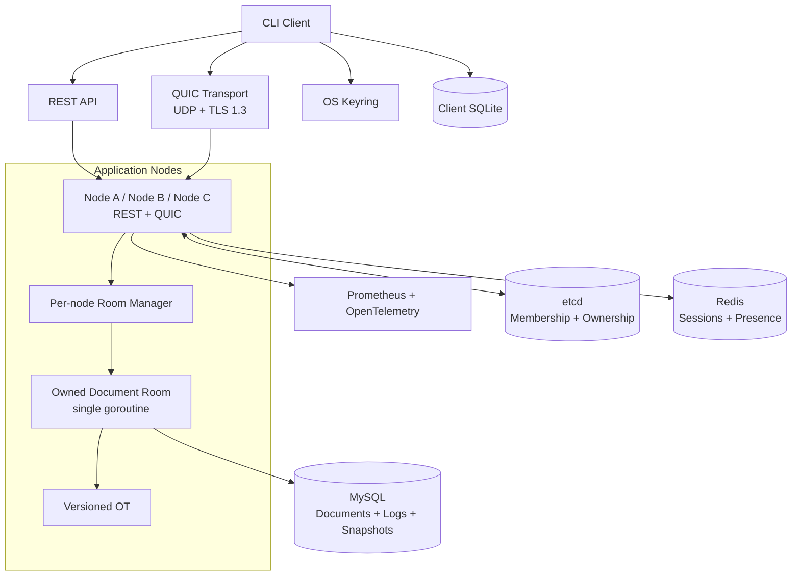

# Realtime Collaborative Code Editor

基于 Go、QUIC 和多节点 Ownership 的实时协作编辑后端。
A real-time collaborative editing backend built with Go, QUIC, and multi-node ownership.

## 1. 项目介绍 / Project Overview

### 中文

本项目实现了一个面向代码与纯文本场景的实时协作编辑后端，并提供可恢复的 CLI 客户端。客户端通过 REST 完成注册、登录、文档和权限管理，通过 QUIC 可靠有序 Stream 发送实时编辑消息。服务端使用 Operational Transformation（OT）处理并发 Insert/Delete，以单文档单 Room goroutine 串行维护内存状态，并在 MySQL 事务中持久化文档、权限、Operation Log、Snapshot 和 Fencing Token。

选择 QUIC 是为了在 UDP 之上获得 TLS 1.3、可靠有序 Stream、连接级超时与后续扩展空间，同时让实时传输与 REST 控制面保持独立。多节点架构用于避免单节点成为长期可用性瓶颈：etcd 负责 Membership 和 Lease-backed Ownership，Rendezvous Hashing 只选择优先候选节点，MySQL Fencing Token 最终阻止旧 Owner 继续写入。

主要技术包括 Go、QUIC、MySQL、Redis、etcd、SQLite、JWT、mTLS、Prometheus 和 OpenTelemetry。当前后端、CLI 恢复链路、多节点接管和真实依赖集成测试已经完成；Docker 与 Google Cloud Terraform 配置已经准备，但尚未执行云端部署，也没有图形化前端。

### English

This project implements a real-time collaborative editing backend for code and plain text, together with a recoverable CLI client. Clients use REST for registration, authentication, document management, and permissions, while real-time edits travel over reliable ordered QUIC streams. The server resolves concurrent Insert/Delete operations with Operational Transformation (OT), keeps each document's in-memory state inside one Room goroutine, and persists documents, permissions, operation logs, snapshots, and fencing tokens through MySQL transactions.

QUIC provides TLS 1.3, reliable ordered streams, connection-level timeouts, and room for transport evolution over UDP, while keeping the real-time data plane separate from the REST control plane. The multi-node design removes the long-term availability dependency on a single process: etcd manages membership and lease-backed ownership, Rendezvous Hashing selects only the preferred candidate, and MySQL fencing tokens ultimately prevent stale owners from writing.

The main stack is Go, QUIC, MySQL, Redis, etcd, SQLite, JWT, mTLS, Prometheus, and OpenTelemetry. The backend, CLI recovery path, multi-node failover, and real-dependency integration tests are implemented. Docker and Google Cloud Terraform assets are prepared, but no cloud deployment has been performed and no graphical frontend is included.

## 2. 核心功能 / Key Features

| 功能 | Feature | 技术实现 / Implementation |
| --- | --- | --- |
| 实时通信 | Real-time Communication | QUIC reliable bidirectional stream、TLS 1.3、ALPN、length-prefixed JSON |
| 协作编辑 | Collaborative Editing | Versioned Operational Transformation，支持 Insert/Delete |
| 节点发现 | Node Discovery | etcd Membership、Lease、Watch |
| 节点选择 | Node Selection | Rendezvous Hashing，仅选择优先候选节点 / preferred candidate only |
| 所有权管理 | Ownership | etcd Lease + Transaction + ACTIVE/RECOVERING state |
| 写入保护 | Write Protection | MySQL Fencing Token，在事务内校验 NodeID 与 Token |
| 数据持久化 | Persistence | MySQL Document、Permission、Operation Log、Snapshot |
| Session 与在线状态 | Session & Presence | Redis Session、Operation Lease、Presence TTL、Pub/Sub reconciliation |
| 本地恢复 | Local Recovery | SQLite document state、Pending Edit、refresh-attempt transaction |
| 身份认证 | Authentication | JWT Access Token + Refresh Token Rotation + encrypted replay |
| 内部通信 | Internal Communication | mTLS、证书 NodeID/Incarnation 绑定、Membership revalidation |
| 权限模型 | Authorization | `owner / write / read`，动态变更立即生效 |
| 慢客户端保护 | Slow-client Protection | 有界发送队列、非阻塞广播、自动移除慢连接 |
| 可观测性 | Observability | Prometheus metrics、OpenTelemetry tracing、structured redacted logs |
| 优雅关闭 | Graceful Shutdown | Context、SIGINT/SIGTERM、Room/QUIC/HTTP dependency-ordered shutdown |

## 3. 系统架构 / System Architecture



### 中文

REST API 是认证、文档与权限管理的控制面；QUIC Transport 是实时编辑数据面。QUIC 客户端可以连接任意节点，节点根据 etcd 中的 Owner 信息处理请求或返回经过认证的 Owner Redirect。Owner-sensitive Permission 写入到达非 Owner 节点时，会通过内部 mTLS 转发到 Owner 节点重新鉴权并执行。每个应用节点拥有独立的 Room Manager，用于创建、恢复和回收本节点持有 Ownership 的文档 Room；Room 只依赖 Transport 与 Storage 接口，不直接依赖 QUIC 或 SQL。MySQL 是文档和最终写入校验的权威来源，etcd 是节点与在线 Ownership 的权威来源，Redis 只管理 Session、Operation Lease、Presence 和跨节点撤销通知。客户端将文档版本与 Pending Edit 保存在 SQLite，将 Refresh Token 保存在 OS Keyring。

### English

The REST API is the control plane for authentication, documents, and permissions; QUIC is the real-time editing data plane. A QUIC client may connect to any node, which either serves the document or returns an authenticated owner redirect based on etcd ownership. When an owner-sensitive permission write reaches a non-owner node, the node forwards it over internal mTLS so the owner can reauthenticate and execute it. Each application node has its own Room Manager, which creates, recovers, and retires Rooms owned by that node. A Room depends only on transport and storage interfaces, not directly on QUIC or SQL. MySQL is authoritative for documents and final write validation, etcd is authoritative for live nodes and ownership, and Redis is limited to sessions, operation leases, presence, and cross-node revocation. The client stores document versions and pending edits in SQLite, while refresh tokens remain in the OS keyring.

## 4. 核心设计 / Core Design

### 4.1 多节点路由 / Multi-node Routing

**中文：** 目的：允许 QUIC 客户端从任意节点进入，并让 Permission 写入到达文档 Owner。技术：etcd Membership、OwnerResolver、Permission mTLS forwarding 和 QUIC `owner_redirect`。流程：入口节点解析 Owner；本节点为 Owner 时进入 Room，否则 Permission 写入通过 mTLS 转发，QUIC 客户端验证 Redirect 后重连。原因：路由信息与写入权必须分离。保证：Endpoint 只能来自可信 Membership，非法地址、Redirect loop 和不可达 Owner 都会 fail closed，不回退到本地写入。

**English:** Purpose: allow QUIC clients to enter through any node and route permission writes to the document owner. Technology: etcd membership, `OwnerResolver`, mTLS permission forwarding, and QUIC `owner_redirect`. Flow: the entry node resolves the owner; a local owner enters the Room path, otherwise permission writes are forwarded over mTLS and the QUIC client validates the redirect before reconnecting. Rationale: routing information must remain separate from write authority. Guarantees: endpoints come only from trusted membership; invalid targets, redirect loops, and unavailable owners fail closed without local-write fallback.

### 4.2 一致性节点选择 / Rendezvous Hashing

**中文：** 目的：为无 Owner 文档选择稳定的优先节点。技术：对 Doc ID 与 READY Node Identity 进行 Rendezvous Hashing 排序。流程：节点集合变化时重新计算候选顺序，但健康 Room 不主动迁移。原因：减少节点加入或退出造成的映射变化。保证：Hash 排名不授予写入权，最终 Ownership 仍必须经过 etcd Transaction。

**English:** Purpose: select a stable preferred node for a document without an owner. Technology: Rendezvous Hashing over the document ID and READY node identities. Flow: membership changes update candidate ranking, but healthy Rooms are not migrated proactively. Rationale: minimize remapping when nodes join or leave. Guarantees: hash ranking never grants write authority; ownership still requires an etcd transaction.

### 4.3 文档所有权管理 / Room Ownership

**中文：** 目的：任一时刻只允许一个权威 Room。技术：etcd Lease、Transaction、Watch，以及 `RECOVERING → ACTIVE` 状态。流程：候选节点原子获取 Ownership，激活更高 Fencing Token，从 Snapshot + Operation Log 恢复并校验文档后才标记 ACTIVE。原因：etcd 适合管理短期在线所有权，MySQL 适合保存长期状态。保证：Lease 丢失触发 Self-Fencing；恢复失败的节点不会对外提供 Active Room。

**English:** Purpose: keep exactly one authoritative Room at a time. Technology: etcd leases, transactions, watches, and `RECOVERING → ACTIVE` ownership states. Flow: a candidate atomically acquires ownership, activates a higher fencing token, restores and validates the document from snapshot plus operation log, and only then becomes ACTIVE. Rationale: etcd manages ephemeral live ownership while MySQL preserves durable state. Guarantees: lease loss triggers self-fencing, and failed recovery never exposes an active Room.

### 4.4 写入隔离机制 / Fencing Token

**中文：** 目的：阻止网络分区中的旧 Owner 继续写入。技术：单调递增的 `WriteAuthority{NodeID, FencingToken}` 和 MySQL 行锁事务。流程：新 Owner 先在 MySQL 激活更高 Token；Edit、Permission、Snapshot 与恢复基线写入都在同一事务中校验 NodeID 和 Token。原因：etcd 与 MySQL 无法原子提交，最终写入校验必须放在持久化事务内部。保证：新 Token 激活后，旧 Token 的所有写入都返回 Fenced/Service Unavailable，不能产生广播或内存分叉。

**English:** Purpose: prevent a stale owner in a network partition from continuing to write. Technology: monotonic `WriteAuthority{NodeID, FencingToken}` values and row-locked MySQL transactions. Flow: a new owner activates a higher token in MySQL; edits, permissions, snapshots, and recovery baselines validate node ID and token in the same transaction as the write. Rationale: etcd and MySQL cannot commit atomically, so final authorization belongs inside the durable transaction. Guarantees: after a higher token is activated, every stale-token write is rejected before broadcast or in-memory mutation.

### 4.5 协作编辑 / Collaborative Editing

**中文：** 目的：在并发编辑下保持所有客户端内容与版本一致。技术：单 Room goroutine、Versioned OT 和持久化 Operation Log。流程：Room 串行处理权限、Version、OT Transform、`CommitEdit`、内存更新和广播；数据库提交发生在广播之前。原因：单写入者模型让并发顺序明确，又不把传输层逻辑混入 OT。保证：支持 Insert/Insert、Insert/Delete、Delete/Insert、Delete/Delete；Version 连续、`request_id` 幂等，失败事务不会改变 Room 状态。

**English:** Purpose: keep content and versions consistent under concurrent edits. Technology: one Room goroutine, versioned OT, and a durable operation log. Flow: the Room serializes permission checks, version handling, OT transformation, `CommitEdit`, in-memory mutation, and broadcast; the database commits before any broadcast. Rationale: a single-writer model makes ordering explicit without coupling OT to the transport. Guarantees: Insert/Insert, Insert/Delete, Delete/Insert, and Delete/Delete are supported; versions remain contiguous, `request_id` is idempotent, and failed transactions do not mutate Room state.

### 4.6 快照与日志重放 / Snapshot + Replay

**中文：** 目的：在 Room 重建时恢复状态并限制内存 History。技术：MySQL Snapshot、保存 OT 后实际 Operation 的追加日志和版本连续性校验。流程：加载最新 Snapshot，按 Version 重放后续 Operation，并与 documents 行的 Content/Version 比对；成功 Snapshot 才推进 History Floor。原因：Snapshot 缩短恢复路径，Operation Log 保留可验证的增量历史。保证：版本缺口或内容不一致会拒绝启动 Room；Snapshot 失败不会错误裁剪 History。

**English:** Purpose: recover Room state while bounding in-memory history. Technology: MySQL snapshots, append-only logs of transformed operations, and version-continuity validation. Flow: load the latest snapshot, replay later operations in version order, and compare the result with the document row; the history floor advances only after a successful snapshot. Rationale: snapshots shorten recovery while operation logs retain verifiable incremental history. Guarantees: version gaps or content mismatches prevent Room activation, and snapshot failure never trims required history.

### 4.7 跨节点会话撤销 / Session Revocation

**中文：** 目的：Logout 或用户禁用后立即阻止旧 Session 继续操作。技术：Redis Session、Operation Lease、Pub/Sub、周期性 reconciliation 和 Connection Registry。流程：业务操作先获取 Lease；Logout 等待已开始的操作结束，撤销 Session 并发布事件，各节点关闭对应 QUIC Connection。原因：Pub/Sub 可能丢消息，因此不能作为唯一正确性机制。保证：每次认证使用都会重新验证 Session，周期性对账覆盖丢失通知，Redis 异常时 fail closed。

**English:** Purpose: stop an old session after logout or user disablement. Technology: Redis sessions, operation leases, Pub/Sub, periodic reconciliation, and a connection registry. Flow: operations acquire a lease; logout waits for already-started work, revokes the session, publishes an event, and each node closes matching QUIC connections. Rationale: Pub/Sub may lose messages and cannot be the sole correctness mechanism. Guarantees: authenticated use revalidates the session, reconciliation covers missed notifications, and Redis failures fail closed.

### 4.8 客户端故障恢复 / Client Recovery

**中文：** 目的：在断网、进程崩溃或 Owner 切换后恢复编辑且不重复提交。技术：连接状态机、指数退避、JWT Refresh、`RESUME/SYNC/RESYNC_REQUIRED`、SQLite Pending 和 OS Keyring。流程：Edit 先以原始 `request_id` 提交到 SQLite，再发送；重连后完成认证与版本同步，然后按顺序重试 Pending。原因：本地持久化必须先于网络发送，Refresh Token 不应落入普通文件。保证：同一时刻只有一个 Reconnect Loop；ACK 与 Pending 删除原子提交，Token Rotation 使用稳定请求 ID 和加密 Replay Record。

**English:** Purpose: recover from network loss, process crashes, or owner changes without duplicate edits. Technology: a connection state machine, exponential backoff, JWT refresh, `RESUME/SYNC/RESYNC_REQUIRED`, SQLite pending state, and the OS keyring. Flow: an edit is committed to SQLite with its original `request_id` before transmission; after reconnecting, the client authenticates, synchronizes versions, and retries pending edits in order. Rationale: local durability must precede network send, and refresh tokens should not be stored in ordinary files. Guarantees: only one reconnect loop runs at a time; acknowledgement and pending deletion commit atomically, while token rotation uses a stable request ID and encrypted replay record.

## 5. 技术栈 / Technology Stack

版本均来自当前仓库配置。 / Versions below are read from the current repository configuration.

| 类别 / Category | 技术 / Technology | 当前版本或约束 / Version or Constraint |
| --- | --- | --- |
| 语言 / Language | Go | language `1.26.0`, toolchain `1.26.10` |
| HTTP | Go `net/http` | standard library |
| 实时传输 / Realtime Transport | `quic-go` | `v0.49.1`, TLS 1.3 |
| 数据库 / Database | MySQL | local `8.4.13`; Cloud SQL target `MYSQL_8_4` |
| Session / Presence | Redis | local `7.4.5`; Memorystore target `REDIS_7_2` |
| 集群协调 / Coordination | etcd | `3.5.17` |
| 客户端存储 / Client Storage | `modernc.org/sqlite` | `v1.34.5` |
| JWT | `golang-jwt/jwt/v5` | `v5.2.2` |
| Metrics | Prometheus Go Client | `v1.20.5` |
| Tracing | OpenTelemetry | core/sdk/exporter `v1.45.0`, HTTP instrumentation `v0.61.0` |
| Infrastructure as Code | Terraform | `>= 1.8.0, < 2.0.0`; audited with `1.17.1` |
| Terraform Providers | Google / Random | `8.10.0` / `3.9.0` |
| Container Images | MySQL / Redis / etcd | `8.4.13` / `7.4.5-alpine` / `3.5.17` |

## 6. 项目结构 / Project Structure

```text
cmd/                    # 可执行程序 / executables
  server/               # REST、QUIC 与生命周期组合根 / service composition root
  quic-client/          # 可恢复 CLI 客户端 / recoverable CLI client
  migrate/              # MySQL Migration runner
  admin/                # 管理工具 / administrative utility
  loadtest/             # REST + QUIC 压测工具 / load generator
  healthcheck/          # 容器健康检查 / container health probe
internal/
  api/                  # REST、认证中间件、跨节点 mTLS forwarding
  authentication/       # JWT、Redis Session、Rotation、Presence、Revocation
  client/               # 重连、Redirect、Resume、Pending recovery
  cluster/              # Membership、Rendezvous、Ownership interfaces
    etcd/                # etcd Registry、Lease、Ownership、Failover
    rpc/                 # 内部 mTLS RPC / internal mTLS RPC
  collab/               # 文档 Operation 与 OT
  config/               # 环境配置与安全校验 / configuration validation
  migration/            # 有序、可恢复 Migration runner
  observability/        # Logs、metrics、tracing、health
  protocol/             # REST/QUIC 消息与错误码 / messages and error codes
  room/                 # 单 goroutine 文档状态机 / document state machine
  storage/              # Storage contracts、Memory、Replay
    mysql/               # MySQL transaction and fencing implementation
  transport/            # Transport interface
    quic/                # QUIC framing、client、server、connection lifecycle
migrations/             # MySQL schema migrations
deploy/gcp/              # Google Cloud Terraform 与启动模板 / Terraform and startup templates
docs/                    # 架构、运维、测试和部署报告 / architecture and operations docs
```

### 中文

`internal/room` 不引用 QUIC 实现，`internal/storage` 不引用 etcd，集群协调、持久化和传输分别通过接口连接。`cmd/server` 是唯一负责创建依赖并按顺序关闭资源的组合根。

### English

`internal/room` does not import the QUIC implementation, and `internal/storage` does not depend on etcd. Cluster coordination, persistence, and transport meet through explicit interfaces. `cmd/server` is the composition root that creates dependencies and shuts them down in order.

## 7. 快速开始 / Getting Started

### 环境要求 / Prerequisites

中文：需要 Go 1.26.10+、Docker、Docker Compose 和 OpenSSL。运行客户端还需要系统凭据服务（macOS Keychain、Windows Credential Manager 或 Linux Secret Service）。
English: Go 1.26.10+, Docker, Docker Compose, and OpenSSL are required. The client also needs the platform credential service: macOS Keychain, Windows Credential Manager, or Linux Secret Service.

### 环境配置 / Environment Configuration

复制示例配置并替换所有密码与密钥占位符。生产 Secret、`.env` 和证书私钥不得提交。
Copy the example configuration and replace every password and key placeholder. Never commit production secrets, `.env`, or certificate private keys.

```bash
cp .env.example .env
```

为本地 QUIC 服务创建只用于开发的 CA 和 localhost 证书。
Create a development-only CA and localhost certificate for the local QUIC server.

```bash
mkdir -p certs
openssl req -x509 -newkey rsa:2048 -nodes -days 365 \
  -keyout certs/ca.key -out certs/ca.crt -subj '/CN=Collab Local CA'
openssl req -newkey rsa:2048 -nodes \
  -keyout certs/server.key -out certs/server.csr -subj '/CN=localhost'
printf 'subjectAltName=DNS:localhost,IP:127.0.0.1\nextendedKeyUsage=serverAuth\n' > certs/server.ext
openssl x509 -req -days 365 -in certs/server.csr \
  -CA certs/ca.crt -CAkey certs/ca.key -CAcreateserial \
  -out certs/server.crt -extfile certs/server.ext
```

### 启动基础设施与初始化数据库 / Infrastructure and Database Initialization

Compose 启动 MySQL 8.4.13 与 Redis 7.4.5；Migration 命令创建并校验 Schema。
Compose starts MySQL 8.4.13 and Redis 7.4.5; the migration command creates and validates the schema.

```bash
docker compose up -d --wait
set -a
source .env
set +a
go run ./cmd/migrate
```

### 启动服务端 / Server Startup

单节点开发模式仍使用完整 MySQL、Redis、JWT 和 QUIC 路径。REST 默认监听 TCP `:8080`，QUIC 默认监听 UDP `:8443`，管理端点默认只监听 `127.0.0.1:9090`。
Single-node development mode still exercises MySQL, Redis, JWT, and QUIC. REST listens on TCP `:8080`, QUIC on UDP `:8443`, and management endpoints on `127.0.0.1:9090` by default.

```bash
go run ./cmd/server
```

### 创建用户并启动客户端 / Register and Start a Client

先通过 REST 注册并登录，从响应中取得 Access Token 和 Refresh Token；不要把真实 Token 写入仓库或 shell 脚本。
Register and log in through REST, then obtain the access and refresh tokens from the response. Do not store real tokens in the repository or a shell script.

```bash
curl -X POST http://localhost:8080/api/auth/register \
  -H 'Content-Type: application/json' \
  -d '{"username":"user-a","password":"StrongPassword123!"}'

curl -X POST http://localhost:8080/api/auth/login \
  -H 'Content-Type: application/json' \
  -d '{"username":"user-a","password":"StrongPassword123!"}'
```

首次运行可通过环境变量导入 Token；Refresh Token 成功导入后由 OS Keyring 管理。CLI 不接受 Token 命令行参数，以避免进入 shell history 或进程列表。
Tokens may be imported through environment variables on first use; after import, the refresh token is managed by the OS keyring. The CLI deliberately has no token flags so credentials do not enter shell history or process listings.

```bash
export COLLAB_ACCESS_TOKEN='<access-token>'
export COLLAB_REFRESH_TOKEN='<refresh-token>'
export COLLAB_CA_FILE='certs/ca.crt'
go run ./cmd/quic-client -addr localhost:8443 -api http://localhost:8080 -profile user-a
```

客户端启动后可使用以下命令。 / Available interactive commands:

```text
join DOC_ID
edit insert POSITION TEXT
edit delete POSITION LENGTH
status
pending
reconnect
disconnect
exit
```

### 测试命令 / Test Commands

以下命令用于基础质量检查；真实集成测试还需要下一节列出的环境变量。
These commands run the base quality gates; real integration tests also require the environment variables described below.

```bash
gofmt -l .
go test -count=1 ./...
go test -count=1 -race ./...
go vet ./...
go build ./...
```

## 8. 测试 / Testing

### 中文

- 单元测试覆盖 OT、Room 顺序、权限、协议、Framing、客户端状态机、配置和错误映射。
- 集成测试使用真实 MySQL、Redis、etcd、TLS/mTLS、QUIC 和 SQLite，覆盖事务回滚、Fencing、Ownership 接管、跨节点 Logout、Snapshot + Replay、断线恢复和进程崩溃恢复。
- Race Detector 在 package 并行执行条件下验证 Room、QUIC、Client、Session 与 Ownership 并发路径。
- 未设置集成测试变量时，相关测试会明确 Skip；这种结果不能视为真实集成测试通过。变量包括 `MYSQL_TEST_DSN`、`REDIS_TEST_ADDR`、`REDIS_TEST_PASSWORD`、`ETCD_TEST_ENDPOINTS`、etcd TLS 文件，以及 `CLUSTER_TEST_*` 内部 mTLS 证书。
- 完整隔离环境和无 Skip 的验收结果记录在 [Final Quality Gate](docs/operations/final-quality-gate.md) 与 [Phase 9.1 Audit](docs/operations/phase-9.1-pre-commit-audit.md)。

### English

- Unit tests cover OT, Room ordering, permissions, protocol handling, framing, the client state machine, configuration, and error mapping.
- Integration tests use real MySQL, Redis, etcd, TLS/mTLS, QUIC, and SQLite to verify rollback, fencing, ownership takeover, cross-node logout, snapshot plus replay, reconnect, and process-crash recovery.
- The Race Detector exercises concurrent Room, QUIC, Client, Session, and Ownership paths with package-level parallelism enabled.
- Integration tests explicitly skip when their environment variables are absent; a skipped result is not treated as real-infrastructure validation. Required values include `MYSQL_TEST_DSN`, `REDIS_TEST_ADDR`, `REDIS_TEST_PASSWORD`, `ETCD_TEST_ENDPOINTS`, etcd TLS files, and the `CLUSTER_TEST_*` internal mTLS certificates.
- The isolated, no-skip validation procedure and results are documented in [Final Quality Gate](docs/operations/final-quality-gate.md) and [Phase 9.1 Audit](docs/operations/phase-9.1-pre-commit-audit.md).

### 受控多节点测试数据 / Controlled Multi-node Results

以下结果来自 Apple M4 开发机上的小规模突发测试，不是生产容量、SLA 或长期稳定性声明。
These results come from a small controlled burst test on an Apple M4 development machine. They are not production capacity, SLA, or soak-test claims.

| 节点 / Nodes | 客户端 / Clients | 文档 / Documents | Applied Edits | Errors | RPS | P95 |
| ---: | ---: | ---: | ---: | ---: | ---: | ---: |
| 1 | 4 | 2 | 40 | 0 | 241.3 | 24.6 ms |
| 3 | 9 | 6 | 135 | 0 | 491.5 | 29.9 ms |
| 5 | 15 | 10 | 300 | 0 | 660.0 | 29.8 ms |

详细条件、故障注入矩阵和限制见 [Phase 8.9 Load Test](docs/performance/phase-8.9-load-test.md)。
See [Phase 8.9 Load Test](docs/performance/phase-8.9-load-test.md) for conditions, fault injection, and limitations.

## 9. 部署 / Deployment

### 中文

仓库包含多阶段 Dockerfile、非 Root 运行用户、Health Check、Compose 本地依赖，以及 Google Cloud Terraform。目标云架构使用三台 Compute Engine 应用节点、三节点 etcd、私网 Cloud SQL MySQL HA、Memorystore Redis、Secret Manager、Cloud NAT、内部 mTLS 和 Monitoring。Terraform 已完成 `fmt`、`validate` 和离线 `plan`，计划结果为 75 add / 0 change / 0 destroy。

**基础设施已经准备，尚未执行部署。** 没有运行 `terraform apply`，没有创建 Google Cloud 收费资源。正式部署前仍需准备真实证书与 Secret、远程 State Bucket、预算、镜像扫描和回滚窗口。

### English

The repository includes a multi-stage Dockerfile, a non-root runtime user, health checks, Compose-based local dependencies, and Google Cloud Terraform. The target cloud architecture uses three Compute Engine application nodes, a three-member etcd cluster, private Cloud SQL MySQL HA, Memorystore Redis, Secret Manager, Cloud NAT, internal mTLS, and Monitoring. Terraform has passed `fmt`, `validate`, and an offline `plan` with 75 additions, 0 changes, and 0 deletions.

**Infrastructure prepared, deployment not performed.** `terraform apply` has not been run and no paid Google Cloud resource has been created. Production deployment still requires real certificates and secrets, a protected remote state bucket, budget approval, image scanning, and a rollback window.

```bash
docker build -t collab-editor:local .

terraform -chdir=deploy/gcp fmt -recursive -check
terraform -chdir=deploy/gcp init
terraform -chdir=deploy/gcp validate
terraform -chdir=deploy/gcp plan -refresh=false
```

不要在未审核 Plan、预算和回滚方案时执行 Apply。
Do not apply without an approved plan, budget, and rollback procedure.

## 10. 技术文档 / Documentation

| 文档 / Document | 中文说明 | English Description |
| --- | --- | --- |
| [Final Code Review](docs/architecture/final-code-review.md) | Phase 1–9.0 架构边界、调用链和审查结论 | Architecture boundaries, call paths, and review findings |
| [System Review](docs/architecture/phase-8.7-system-review.md) | 客户端恢复、多节点和持久化系统审查 | Client recovery, multi-node, and persistence review |
| [Readability Refactoring](docs/architecture/readability-refactoring-report.md) | Clean Code 重构范围与兼容性说明 | Readability refactoring scope and compatibility notes |
| [Final Quality Gate](docs/operations/final-quality-gate.md) | 真实依赖测试与最终质量 Gate | Real-dependency tests and final quality gates |
| [Pre-Commit Audit](docs/operations/phase-9.1-pre-commit-audit.md) | Secret、依赖、许可证、Docker、Terraform 审计 | Secret, dependency, license, Docker, and Terraform audit |
| [Production Readiness](docs/operations/phase-8.10-production-readiness.md) | 容器、安全、备份与恢复运行手册 | Container, security, backup, and recovery runbook |
| [Observability](docs/operations/phase-8.8-observability.md) | Metrics、tracing、health 与日志约定 | Metrics, tracing, health, and logging conventions |
| [Load Test](docs/performance/phase-8.9-load-test.md) | 多节点受控压测与故障注入结果 | Controlled multi-node load and failure results |
| [Google Cloud Deployment](docs/deployment/phase-9.0-google-cloud-deployment.md) | GCP 架构、成本、部署和回滚设计 | GCP architecture, cost, deployment, and rollback design |

## 11. 当前限制 / Current Limitations

### 中文

- 暂无图形化前端；当前客户端以 CLI、协议验证和恢复测试为主。
- 一个 QUIC Connection 当前只承载一个文档和一个 bidirectional Stream；未启用 Datagram 或多文档 Stream multiplexing。
- OT 是线性文本 OT-lite，不是完整 CRDT，也未实现图形化编辑器所需的 Optimistic UI、光标同步和本地多操作 Rebase。
- MySQL Operation Log 仍为追加写入，尚未实现长期归档策略。
- 第一版多节点部署采用稳定节点身份，不包含自动扩缩容、自动证书签发或健康 Room 主动迁移。
- Google Cloud 尚未部署；Terraform 验证不能替代真实配额、IAM、证书、DNS 和网络验证。
- Phase 8.9 是短时小规模测试，不代表生产峰值容量、跨区域延迟或长期内存稳定性。
- 当前环境因 Docker Hub Token Endpoint 网络超时尚未完成最终镜像构建与镜像 CVE 扫描。
- 仓库尚未选择公开分发许可证。

### English

- There is no graphical frontend; the current client focuses on CLI operation, protocol validation, and recovery testing.
- One QUIC connection currently carries one document over one bidirectional stream; datagrams and multi-document stream multiplexing are not enabled.
- OT is a linear-text OT-lite implementation, not a full CRDT. Optimistic UI, cursor synchronization, and editor-side multi-operation rebase are not implemented.
- The MySQL operation log is append-only and does not yet have a long-term archival policy.
- The initial multi-node deployment assumes stable node identities; it does not automate scaling, certificate issuance, or proactive migration of healthy Rooms.
- Google Cloud has not been deployed. Terraform validation cannot replace real quota, IAM, certificate, DNS, and network verification.
- Phase 8.9 was a short, small-scale test and does not establish production peak capacity, cross-region latency, or long-term memory stability.
- The final container image build and image CVE scan remain unverified because the current environment cannot reach the Docker Hub token endpoint reliably.
- The repository does not yet declare a public-distribution license.
