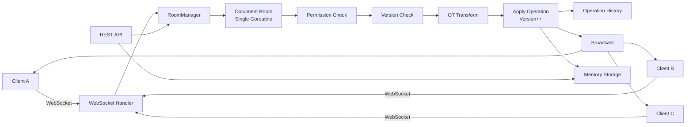
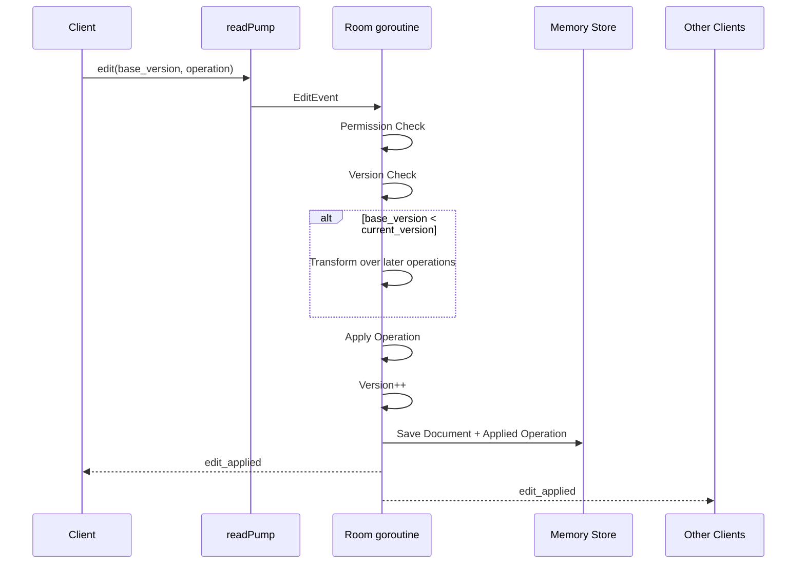
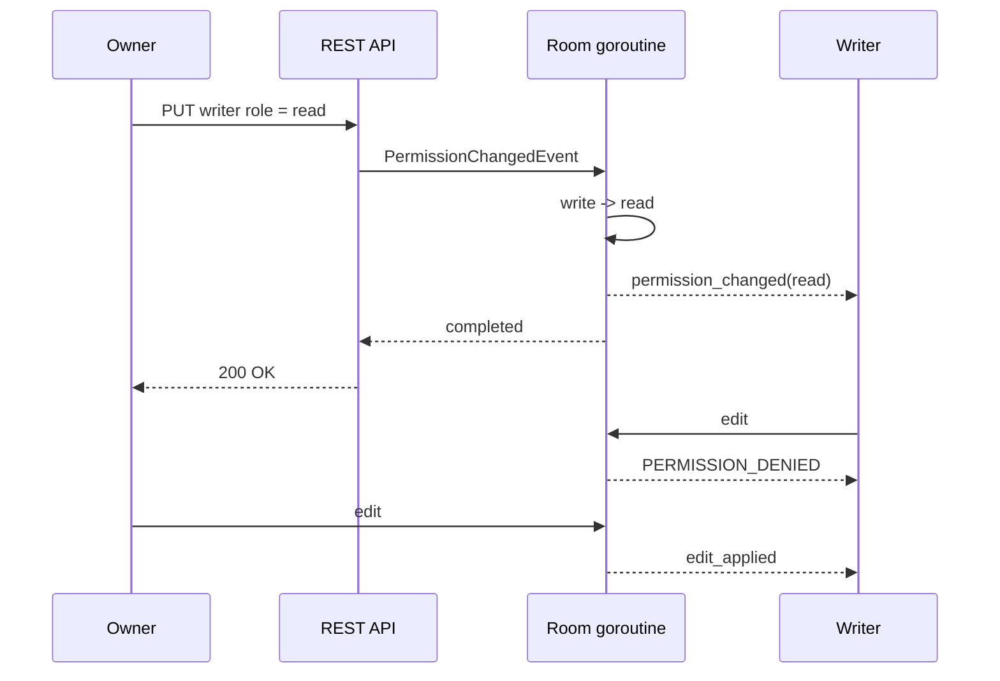

# Realtime Collaborative Code Editor — Go Backend

这是一个使用 **Go + WebSocket** 实现的实时多人代码协作编辑后端原型。系统聚焦协同编辑的核心问题：低延迟同步、并发冲突处理、动态权限控制，以及 Go 并发模型的实际落地。

项目采用单节点、内存存储，以便把核心同步协议和权限语义保持得足够清晰、可测试、可演示。

## 功能概览

| 能力 | 实现方式 |
|---|---|
| 多人实时同步 | WebSocket 长连接 + Room 内存状态 |
| 同一文档并发编辑 | 文档 Version + 简化 OT（Operational Transformation） |
| Go 并发模型 | 每个 Room 一个 goroutine，事件通过 channel 串行处理 |
| 权限控制 | `owner / write / read`，所有编辑均在服务端校验 |
| 动态权限变化 | 在线用户可从 `write` 降级为 `read`，无需重连即可立即生效 |
| 数据模型 | Document / Operation / Permission |
| 存储 | 并发安全的内存存储 |
| API 演示 | REST 管理文档与权限，WebSocket 完成协同编辑 |
| 测试 | OT、版本、权限、Unicode、REST + WebSocket 集成测试、Race Detector |

---

## 架构设计



### 核心设计：一个文档对应一个 Room

`RoomManager` 维护：

```text
docID -> Room
```

每个活跃文档由一个 Room 管理。Room 内保存：

- 当前文档内容
- 当前 Version
- 已接受的 Operation History
- 在线 Client
- 当前权限状态

**Room goroutine 是这些协作状态的唯一写入者。**

所有状态变化都进入同一个事件队列：

```text
Client goroutine
      │
      ▼
  Room.events
      │
      ▼
Room goroutine
      │
      ├─ Join
      ├─ Edit
      ├─ Leave
      └─ Permission Change
```

这种设计避免了多个 goroutine 同时修改 `content / version / history / permissions`，同时让 Edit 与 Permission Change 具有确定的处理顺序。

`RoomManager` 只使用 `sync.RWMutex` 保护共享的 Room 注册表；文档本身不依赖一个“大锁”完成同步。

---

## WebSocket 并发模型

每个 WebSocket 连接使用两个独立执行路径：

```text
Client
  │
  ▼
readPump
  │
  ▼
Room.events
  │
  ▼
Room goroutine
  │
  ▼
client.send
  │
  ▼
writePump
  │
  ▼
Client
```

- `readPump`：读取客户端消息并提交 Room Event。
- `writePump`：从 `client.send` channel 读取服务端消息并写回 WebSocket。
- Room 不直接操作 WebSocket connection。

这样可以把**网络 I/O**与**协作状态修改**分离，并保证同一个连接只有一个写路径。

---

## 一次编辑的处理流程



实时编辑的主路径全部在内存中完成，不需要在每次按键时访问外部数据库。

---

## 并发冲突处理：Version + OT-lite

每个文档维护单调递增的 `version`。

客户端编辑时必须携带：

```json
{
  "base_version": 10
}
```

服务端根据版本处理：

```text
base_version == current_version
→ 直接校验并应用

base_version < current_version
→ 对 base_version 之后的 Operation 逐条进行 Transform

base_version > current_version
→ VERSION_AHEAD
```

### 示例

初始文档：

```text
abcdef
version = 10
```

A：

```text
insert X at position 2
base_version = 10
```

B 同时：

```text
insert Y at position 4
base_version = 10
```

如果 A 先被 Room 接受：

```text
abXcdef
version = 11
```

B 到达时发现自己的版本已过期，因此位置被转换：

```text
position 4 -> 5
```

最终：

```text
abXcdYef
version = 12
```

当前 OT-lite 支持：

- Insert / Insert
- Insert / Delete
- Delete / Insert
- Delete / Delete
- 重叠 Delete
- 同位置 Insert 的确定性排序

同位置并发 Insert 以 **Room 的服务端处理顺序**作为最终顺序。

> 这是面向线性文本的简化 OT，用于明确展示冲突处理机制，不宣称覆盖完整生产级协同编辑算法。

### 文本位置语义

`position` 和 `length` 使用 **Unicode code-point（Go rune）offset**，而不是 UTF-8 byte offset。

例如：

```text
a界b
0 1 2
```

因此中文等 Unicode 文本的 Insert/Delete 行为具有一致语义。

---

## 权限模型

| Role | Read | Edit | Change Permission |
|---|---:|---:|---:|
| `owner` | ✅ | ✅ | ✅ |
| `write` | ✅ | ✅ | ❌ |
| `read` | ✅ | ❌ | ❌ |

权限由服务端执行，而不是依赖客户端 UI。

- 没有 Read 权限的用户不能通过 WebSocket 加入文档。
- 没有 Read 权限的用户不能通过 REST 获取文档内容。
- `read` 用户即使手工构造 `edit` WebSocket 消息，也会收到 `PERMISSION_DENIED`。
- 权限查询和修改属于 owner 管理操作。

### 动态权限变化

在线用户无需断开 WebSocket 即可发生权限变化。



Permission Change 和 Edit 使用同一个 Room Event Queue，因此可以定义明确的顺序：

```text
1. Edit(user-b)
2. PermissionChanged(user-b, read)
3. Edit(user-b)
```

处理结果一定是：

```text
1. 第一次 Edit 按当时权限处理
2. 权限变为 read
3. 第二次 Edit 被拒绝
```

当权限从 `write` 降级到 `read` 时，连接保持打开，因此用户仍可以继续接收其他人的编辑更新。

---

## 数据模型与存储

### Document

```go
type Document struct {
    ID      string
    Content string
    Version uint64
}
```

### Operation

```go
type Operation struct {
    ID          string
    UserID      string
    BaseVersion uint64
    Kind        OperationKind
    Position    int
    Text        string
    Length      int
}
```

### AppliedOperation

服务端接受 Operation 后，为其分配新的文档 Version 并保存到 History。

### Storage

当前项目使用并发安全的 Memory Store 保存：

```text
Documents
Operations
Permissions
```

活跃协作状态由 Room 在内存中维护，接受的操作会同步写回 Memory Store。

选择内存存储是为了让项目重点保持在：

```text
Realtime Sync
Conflict Resolution
Permission Enforcement
Go Concurrency
```

而不是把核心实现隐藏在外部基础设施中。

---

## WebSocket 协议

连接：

```text
ws://localhost:8080/ws?doc_id=main.go&user_id=user-a
```

连接成功后先发送 `join`：

```json
{
  "type": "join",
  "doc_id": "main.go"
}
```

服务器返回：

```json
{
  "type": "joined",
  "doc_id": "main.go",
  "version": 0,
  "content": "abcdef",
  "role": "owner"
}
```

### Insert

```json
{
  "type": "edit",
  "request_id": "op-001",
  "doc_id": "main.go",
  "base_version": 0,
  "operation": {
    "kind": "insert",
    "position": 2,
    "text": "X"
  }
}
```

### Delete

```json
{
  "type": "edit",
  "request_id": "op-002",
  "doc_id": "main.go",
  "base_version": 1,
  "operation": {
    "kind": "delete",
    "position": 2,
    "length": 1
  }
}
```

### Edit Applied

```json
{
  "type": "edit_applied",
  "request_id": "op-001",
  "doc_id": "main.go",
  "version": 1,
  "operation": {
    "kind": "insert",
    "position": 2,
    "text": "X"
  }
}
```

### Permission Changed

```json
{
  "type": "permission_changed",
  "doc_id": "main.go",
  "role": "read"
}
```

### Error

```json
{
  "type": "error",
  "code": "PERMISSION_DENIED",
  "message": "write permission required"
}
```

主要错误码：

```text
BAD_MESSAGE
PERMISSION_DENIED
VERSION_AHEAD
INVALID_OPERATION
INTERNAL_ERROR
```

格式错误 JSON、未知字段、错误 `doc_id` 等协议问题返回 `BAD_MESSAGE`；非法 Operation 或越界操作返回 `INVALID_OPERATION`。

`request_id` 当前用于请求关联和演示，不提供幂等保证。

---

# 运行项目

## 环境

- Go 1.22+
- 手工 WebSocket Demo 可选安装 `websocat`

## 启动

```bash
go mod download
go run ./cmd/server
```

默认监听：

```text
http://localhost:8080
```

可以通过环境变量修改端口：

```bash
PORT=9000 go run ./cmd/server
```

---

## REST API

### 1. 创建文档

```bash
curl -X POST http://localhost:8080/api/documents \
  -H 'Content-Type: application/json' \
  -d '{"id":"main.go","content":"abcdef","owner_id":"user-a"}'
```

### 2. 获取文档

```bash
curl http://localhost:8080/api/documents/main.go \
  -H 'X-User-ID: user-a'
```

### 3. 给用户 Write 权限

```bash
curl -X PUT http://localhost:8080/api/documents/main.go/permissions/user-b \
  -H 'Content-Type: application/json' \
  -H 'X-User-ID: user-a' \
  -d '{"role":"write"}'
```

### 4. 给用户 Read 权限

```bash
curl -X PUT http://localhost:8080/api/documents/main.go/permissions/user-c \
  -H 'Content-Type: application/json' \
  -H 'X-User-ID: user-a' \
  -d '{"role":"read"}'
```

### 5. 查询用户权限

该接口仅允许 owner 查询：

```bash
curl http://localhost:8080/api/documents/main.go/permissions/user-b \
  -H 'X-User-ID: user-a'
```

> `X-User-ID` 和 WebSocket `user_id` 是为了让演示聚焦 authorization 逻辑而使用的简化身份机制。真实系统应由 JWT / OAuth / OIDC 等 Authentication 层确定用户身份，不能信任客户端直接声明的 user ID。

---

# Demo

## 自动验收

最简单的方式：

```bash
go test -count=1 -run TestDemoAcceptance -v ./internal/api
```

该测试会启动真实 HTTP Test Server，并创建真实 WebSocket 连接，完整验证：

1. A 编辑后 B 实时收到更新。
2. A/B 基于同一 Version 并发编辑，stale operation 被 OT 转换，两处修改都保留。
3. Read-only 用户发送 Edit，被服务端拒绝。
4. Writer 在线状态下被降级为 Read，后续 Edit 被拒绝，但连接继续接收更新。

## 手工演示

先创建文档并设置权限，然后打开两个终端。

### Terminal A

```bash
websocat 'ws://localhost:8080/ws?doc_id=main.go&user_id=user-a'
```

发送：

```json
{"type":"join","doc_id":"main.go"}
```

### Terminal B

```bash
websocat 'ws://localhost:8080/ws?doc_id=main.go&user_id=user-b'
```

发送：

```json
{"type":"join","doc_id":"main.go"}
```

### Demo 1 — 实时同步

A：

```json
{"type":"edit","request_id":"demo-1","doc_id":"main.go","base_version":0,"operation":{"kind":"insert","position":2,"text":"X"}}
```

A、B 均收到 Version 1 的 `edit_applied`。

### Demo 2 — 并发冲突

A：

```json
{"type":"edit","request_id":"demo-2-a","doc_id":"main.go","base_version":1,"operation":{"kind":"insert","position":0,"text":"A"}}
```

B 仍基于 Version 1：

```json
{"type":"edit","request_id":"demo-2-b","doc_id":"main.go","base_version":1,"operation":{"kind":"insert","position":0,"text":"B"}}
```

B 的 Position 从 `0` 转换为 `1`，最终：

```text
ABabXcdef
version = 3
```

### Demo 3 — Read-only 拦截

以 `user-c` 加入后发送：

```json
{"type":"edit","request_id":"demo-3","doc_id":"main.go","base_version":3,"operation":{"kind":"insert","position":0,"text":"blocked"}}
```

返回：

```text
PERMISSION_DENIED
```

### Demo 4 — 动态权限变化

保持 B 在线：

```bash
curl -X PUT http://localhost:8080/api/documents/main.go/permissions/user-b \
  -H 'Content-Type: application/json' \
  -H 'X-User-ID: user-a' \
  -d '{"role":"read"}'
```

B 立即收到：

```json
{"type":"permission_changed","doc_id":"main.go","role":"read"}
```

B 再次编辑时收到：

```text
PERMISSION_DENIED
```

但连接保持打开。如果 A 再提交一次合法 Edit，B 仍会收到 `edit_applied`。

---

## 测试

```bash
go test -count=1 ./...
go vet ./...
go test -count=1 -race ./...
go build ./...
```

集成 Demo：

```bash
go test -count=1 -run TestDemoAcceptance -v ./internal/api
```

测试覆盖包括：

- 四类 OT Transform。
- Same-position Insert 与重叠 Delete。
- stale operation 逐条转换完整相关历史。
- current / stale / future version。
- Insert/Delete 越界与整数溢出边界。
- Unicode rune offset。
- Owner / Writer / Reader 权限。
- 未授权 WebSocket Join 和 REST Read。
- 只有 Owner 可以查询和修改权限。
- 在线 `write -> read` 后的实时拦截与继续接收更新。
- malformed WebSocket JSON。
- `go test -race` 并发安全检查。

---

## 项目结构

```text
.
├── cmd/server
│   └── main.go
├── internal
│   ├── api
│   │   ├── server.go
│   │   └── server_test.go
│   ├── collab
│   │   ├── operation.go
│   │   ├── operation_test.go
│   │   ├── transform.go
│   │   └── transform_test.go
│   ├── permission
│   │   └── permission.go
│   ├── protocol
│   │   ├── message.go
│   │   └── message_test.go
│   ├── room
│   │   ├── errors.go
│   │   ├── manager.go
│   │   ├── room.go
│   │   └── room_test.go
│   ├── storage
│   │   └── memory.go
│   └── websocket
│       ├── client.go
│       └── handler.go
├── go.mod
├── go.sum
└── README.md
```

---

## 设计取舍与当前边界

这个实现的目标是清楚展示协同编辑核心机制，而不是伪装成完整生产系统。

当前边界：

- 单节点、内存存储，进程重启后数据丢失。
- `user_id / X-User-ID` 为 Demo Identity，不是真实 Authentication。
- OT 是线性文本 OT-lite，不是完整生产级 OT / CRDT。
- 客户端以服务端 `edit_applied` 为权威顺序，没有实现客户端 optimistic apply / rebase。
- `request_id` 暂不提供幂等语义。
- Operation History 当前不裁剪。
- Room 当前没有空闲回收机制。
- Client 有缓冲发送队列，但当极慢客户端长期不消费并填满队列时，Room 仍可能受到 backpressure；生产实现应在队列满时断开慢客户端并在重连后重新同步。
- 未实现 Ping/Pong deadline、断线增量恢复、持久化数据库、多节点协调。
- WebSocket Origin Check 为本地 Demo 宽松配置。

这些取舍保持了项目规模可控，同时让实时同步、冲突处理、权限拦截和 Go 并发模型能够直接在代码中被审查和讨论。
