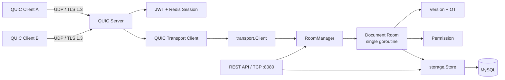
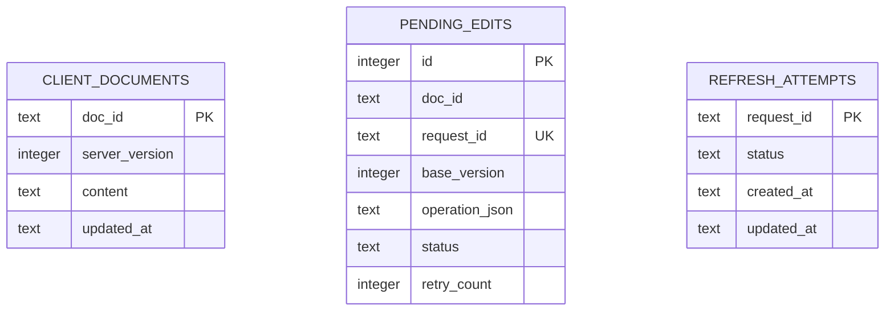

# Realtime Collaborative Code Editor — Go Backend

使用 Go 构建的实时多人代码编辑后端。REST API 运行于 TCP，实时协作使用 QUIC（UDP + TLS 1.3），核心业务采用单文档单 Room goroutine、Version + OT、MySQL 事务、JWT + Redis Session、Snapshot + Operation Log Replay。

## 功能概览

| 能力 | 实现 |
|---|---|
| 实时传输 | QUIC bidirectional stream，TLS 1.3，ALPN `collab-editor-v1` |
| 消息边界 | 4-byte big-endian length + JSON payload |
| 协作并发 | 每个文档一个 Room goroutine，event channel 串行处理 |
| 冲突处理 | Version + OT-lite，支持 Insert/Delete 四类变换 |
| 权限 | `owner / write / read`，动态降级立即生效 |
| 身份认证 | JWT Access Token + Redis Session，AUTH 消息不携带 user_id |
| 持久化 | MySQL Document、Permission、Operation Log、Snapshot |
| 恢复 | Snapshot + Operation Log Replay、RESUME/SYNC/RESYNC_REQUIRED |
| 幂等 | 相同 `request_id` 返回首次成功的 `edit_applied` |
| 客户端可靠性 | 状态机、自动重连、SQLite Pending/文档状态、进程崩溃恢复 |
| 凭据安全 | OS Keychain / Credential Manager / Secret Service，不在 SQLite 保存 Token |
| 慢客户端 | 有界发送队列 + 非阻塞 `TrySend`，队列满时安全断开 |

## 架构



Room 只依赖以下接口，不引用 QUIC、UDP、TLS 或 Stream 类型：

```go
type Client interface {
    Identity() string
    TrySend(protocol.Message) bool
    Close(error)
}
```

QUIC Client 与测试用 channel Client 都实现该接口。实时传输替换没有复制 Room、OT、权限或持久化业务逻辑。

## Room 与事件顺序

```text
QUIC ReadLoop
  -> Room.events
  -> Room goroutine
       Join / Resume / Edit / Leave / Permission Change / Snapshot Result
  -> Client.TrySend
  -> QUIC WriteLoop
```

- Room goroutine 是 `content/version/history/permissions/clients` 的唯一写入者。
- Permission Change 和 Edit 通过同一队列确定顺序。
- Resume 初始同步先进入发送队列，再注册实时广播，避免同步与后续编辑之间的消息缺口。
- `TrySend` 使用容量 32 的有界 channel，立即成功或立即失败，不阻塞 Room。

## QUIC 连接生命周期

第一版采用一个 QUIC Connection、一个 bidirectional Stream、一个协作文档：

```text
TLS 1.3 handshake (ALPN collab-editor-v1)
  -> client opens one bidirectional stream
  -> AUTH(access token)
  -> JWT signature/claims validation
  -> Redis Session + user status validation
  -> AUTH_OK
  -> JOIN or RESUME
  -> Room collaboration
```

服务端禁用 QUIC Datagram；编辑只使用可靠、有序 Stream。每个连接只有一个 WriteLoop 写 Stream。ReadLoop 负责 framing、JSON 严格解码、Session Lease 和 Room 调用，不直接修改 Room 状态。

连接关闭、异常、Logout 或服务退出都会执行 Room Leave、注销活动 Session Connection、关闭 Stream/Connection，并等待相关 goroutine 退出。

## 客户端连接状态与自动恢复

`cmd/quic-client` 使用单一 supervisor 管理连接，任何时刻最多存在一个 Dial/Reconnect Loop 和一个有效 QUIC Connection：

```text
DISCONNECTED -> CONNECTING -> AUTHENTICATING -> SYNCING -> CONNECTED
                                      network error |
                                                    v
RECONNECTING -> [REFRESHING_TOKEN when needed] -> CONNECTING

any state -> CLOSED (exit / context cancellation)
```

- 首次连接发送 `AUTH -> JOIN`；断线重连创建全新的 QUIC Connection 和 bidirectional Stream，并发送 `AUTH -> RESUME(last_version)`。
- 重连退避为 500ms、1s、2s、4s……，上限 30s，并加入 ±20% 随机抖动；成功恢复后重置计数。
- `disconnect` 停止自动重连并释放旧连接；`reconnect` 显式恢复。进程退出后不会重新连接。
- `status` 显示状态、文档、最后完整应用的 Server Version、认证/重连状态、重连次数、最近断线原因和 Pending Operations，但不显示任何 Token。
- QUIC KeepAlive/IdleTimeout 继续负责传输层健康检查；Read/Write 错误上报 supervisor，不额外复制 QUIC 的可靠传输机制。

### JWT 自动刷新

客户端只解析 Access Token 的 `exp` 来安排提前约 60 秒刷新；签名、Claims、Redis Session 和用户状态仍完全由服务端验证。刷新调用现有 `POST /api/auth/refresh`，成功后在一个互斥临界区内同时替换 Access/Refresh Token，避免旧 Refresh Token 被并发轮换。

Access Token 只保存在进程内存。Refresh Token 保存于操作系统原生安全凭据服务，不写入 SQLite、普通文件或日志。安全存储不可用时客户端明确失败，不会回退明文文件。

刷新前，客户端先在 SQLite 保存稳定 `request_id`；服务端 Redis 使用该 ID 保存 10 分钟的加密 Rotation Replay Record。若响应丢失或进程在请求中崩溃，客户端用原 Token 和原 ID 重试，服务端返回同一个新 Refresh Token。新 Token 先写 OS 安全存储，随后才清理 SQLite attempt。

### RESUME 与 Pending Edit

客户端只在按顺序成功应用完整 Operation 后推进 `last_version`：

```text
SYNC: verify from_version -> verify every version is contiguous
      -> apply operations -> verify to_version -> commit local state

RESYNC_REQUIRED: replace with snapshot -> verify/apply contiguous suffix
                 -> verify current_version -> commit local state
```

恢复校验失败时不会进入 `CONNECTED`。EDIT 发送前先以 `synchronous=FULL` 事务保存 `request_id/doc_id/base_version/operation`；只有 SQLite COMMIT 成功后才允许发送。断线或进程重启后按创建顺序恢复 Pending，并在 RESUME 后使用原 `request_id` 重试。

收到 `edit_applied` 后，文档 Content/Version 更新和 Pending 删除在同一个 SQLite 事务提交。历史幂等 ACK 不会重复应用内容；Version 缺口会触发重新连接和 RESUME。若服务端 History 已裁剪且未提交 Pending 无法转换，该 Pending 保留为冲突状态，等待人工处理。

CLI 没有 Optimistic UI 或独立本地编辑缓冲区，因此本阶段没有虚构完整 Optimistic Rebase。CLI 会串行发送 Pending Edit，并让现有服务端 OT 依据其原始 `base_version` 变换；真正编辑器集成后的本地光标、未提交视图和多操作 rebase 仍是后续扩展。

## 客户端 SQLite 与 Profile

默认数据库位于操作系统用户配置目录，而不是 Git 仓库：

- macOS：`~/Library/Application Support/collab-editor/profiles/<profile>/state.db`
- Linux：`~/.config/collab-editor/profiles/<profile>/state.db`
- Windows：由 `os.UserConfigDir()` 选择系统配置目录

可用 `COLLAB_CLIENT_STATE_DIR` 改变根目录，使用 `COLLAB_CLIENT_PROFILE` 或 `-profile` 隔离用户。相同 Profile 由 OS advisory lock 保证只有一个写进程；不同 Profile 可以同时运行。数据库启动时执行 Migration 和 `PRAGMA quick_check`，损坏时保留原文件并拒绝启动。



SQLite 启用 WAL、Foreign Keys、5 秒 Busy Timeout 和 `synchronous=FULL`。表中不存在 Access Token 或 Refresh Token 字段。

## Refresh Rotation 幂等与加密

Redis Lua 在一个原子操作内验证 Session/current hash，轮换 hash，并按 `session_id + request_id` 保存短期 Replay Record：

```text
old_refresh_hash
new_refresh_hash
AES-256-GCM encrypted new refresh token
TTL (default 10m)
```

AES-GCM Additional Authenticated Data 绑定 Session ID、Request ID、旧/新 Hash。密钥来自独立的 `REFRESH_REPLAY_ENCRYPTION_KEY`，不能复用 JWT Secret。Logout、Session 过期、Disabled User、不同 ID、错误旧 Token，以及 Session 已再次轮换时都拒绝旧 Replay。

## Framing

QUIC Stream 是字节流，每条消息编码为：

```text
4-byte unsigned big-endian payload length
JSON payload
```

默认最大 payload 为 1 MiB。长度为 0、超过上限、半包 EOF 均被拒绝；`io.ReadFull` 处理半包与连续消息，`writeAll` 处理短写。Malformed JSON 返回 `BAD_MESSAGE`，连接仍可继续使用；非法长度和超大 frame 会关闭连接。

## Version + OT

客户端 EDIT 必须携带 `base_version`：

```text
base_version == current_version -> 直接应用
history_floor <= base_version < current_version -> 对后续实际 Operation 逐条 Transform
base_version < history_floor -> RESYNC_REQUIRED
base_version > current_version -> VERSION_AHEAD
```

支持 Insert/Insert、Insert/Delete、Delete/Insert、Delete/Delete。Position 和 Length 使用 Unicode rune offset。同位置 Insert 按 Room 服务端处理顺序确定结果。

## MySQL 事务与恢复

编辑事务：

```text
Permission + Version + OT
  -> SELECT document FOR UPDATE
  -> check persisted version and request_id
  -> UPDATE documents
  -> INSERT operation_logs (transformed operation)
  -> COMMIT
  -> update Room
  -> broadcast edit_applied
```

创建文档时，Document、Owner Permission、Version 0 Snapshot 在同一事务提交。默认每 100 次成功编辑异步保存 Snapshot；成功结果回到 Room event queue 后推进 History Floor 并裁剪内存 History。Snapshot 失败不回滚编辑、不裁剪 History，并自动重试；History 达到硬上限时返回 `SERVICE_UNAVAILABLE`。

Room 重建流程：

```text
Latest Snapshot
  -> Operations after Snapshot Version
  -> verify contiguous versions
  -> replay persisted transformed operations without OT
  -> verify replayed content/version == documents row
  -> load permissions and start Room
```

没有 Snapshot 的旧文档会在行锁事务内创建当前状态的 Baseline Snapshot，不修改文档 Version，不删除旧 Operation Log。

## 身份与权限

| Role | Read | Edit | Change Permission |
|---|---:|---:|---:|
| owner | ✅ | ✅ | ✅ |
| write | ✅ | ✅ | ❌ |
| read | ✅ | ❌ | ❌ |

QUIC AUTH 只接受 JWT Access Token，不接受 user_id。每条业务消息持有 Session Lease；Logout 等待已开始的 EDIT 完成，再删除 Session 并通过 Connection Registry 关闭活动 QUIC 连接。Disabled 用户的已有 Access/Refresh Session 同样失效。

## 协议

AUTH：

```json
{"type":"auth","token":"ACCESS_TOKEN"}
```

成功响应：

```json
{"type":"auth_ok"}
```

交互 CLI 自动完成 AUTH，用户输入从 JOIN 或 RESUME 开始。

JOIN：

```json
{"type":"join","doc_id":"main.go"}
```

```json
{"type":"joined","doc_id":"main.go","version":0,"content":"abcdef","role":"owner"}
```

EDIT：

```json
{"type":"edit","request_id":"op-1","doc_id":"main.go","base_version":0,"operation":{"kind":"insert","position":2,"text":"X"}}
```

```json
{"type":"edit_applied","request_id":"op-1","doc_id":"main.go","version":1,"operation":{"kind":"insert","position":2,"text":"X"}}
```

RESUME：

```json
{"type":"resume","doc_id":"main.go","last_version":230}
```

增量恢复：

```json
{"type":"sync","doc_id":"main.go","from_version":230,"to_version":231,"operations":[{"version":231,"operation":{"kind":"insert","position":2,"text":"X"}}]}
```

完整恢复：

```json
{"type":"resync_required","doc_id":"main.go","snapshot":{"version":200,"content":"complete content"},"operations":[],"current_version":200}
```

主要错误码：`BAD_MESSAGE`、`PERMISSION_DENIED`、`VERSION_AHEAD`、`VERSION_CONFLICT`、`DUPLICATE_REQUEST`、`INVALID_OPERATION`、`RESYNC_REQUIRED`、`SERVICE_UNAVAILABLE`、`INTERNAL_ERROR`。

## 配置与启动

要求：Go 1.26.10+、Docker、有效的 TLS 证书。`go.mod` 和生产构建均固定使用 Go 1.26.10；QUIC 使用固定依赖 `github.com/quic-go/quic-go v0.49.1`。这些版本包含当前漏洞审计要求的标准库、TLS 和 QUIC 安全修复。

创建配置：

```bash
cp .env.example .env
```

开发环境可用 OpenSSL 创建本地 CA 和 localhost 证书：

```bash
mkdir -p certs
openssl req -x509 -newkey rsa:2048 -nodes -days 365 \
  -keyout certs/ca.key -out certs/ca.crt -subj '/CN=Collab Local CA'
openssl req -newkey rsa:2048 -nodes \
  -keyout certs/server.key -out certs/server.csr -subj '/CN=localhost'
printf 'subjectAltName=DNS:localhost,IP:127.0.0.1\nextendedKeyUsage=serverAuth\n' > certs/server.ext
openssl x509 -req -days 365 -in certs/server.csr \
  -CA certs/ca.crt -CAkey certs/ca.key -CAcreateserial \
  -out certs/server.crt -extfile certs/server.ext
```

证书私钥和 `.env` 不应提交。

启动依赖、Migration 和服务：

```bash
docker compose up -d --wait
set -a
source .env
set +a
go run ./cmd/migrate
go run ./cmd/server
```

- REST：开发模式默认 HTTP/TCP `:8080`；生产模式强制 HTTPS
- QUIC：UDP `:8443`
- 生产客户端必须使用 `QUIC_CA_FILE` 验证服务端证书；代码拒绝 `InsecureSkipVerify`。

生产 REST TLS 配置：

```text
APP_ENV=production
REST_TLS_CERT_FILE=certs/rest-server.crt
REST_TLS_KEY_FILE=certs/rest-server.key
```

生产模式缺少任一 REST TLS 文件、证书与私钥不匹配、证书过期或证书不允许
Server Authentication 时，服务会拒绝启动，不会自动降级为 HTTP。开发模式只有在
明确不配置这两个变量时才使用 HTTP。若以后由云负载均衡器终止 TLS，仍需显式设计
可信代理网络边界；当前服务不会信任任意客户端提交的 `X-Forwarded-*` Header。

主要 QUIC 配置：

```text
QUIC_ADDR=:8443
QUIC_TLS_CERT_FILE=certs/server.crt
QUIC_TLS_KEY_FILE=certs/server.key
QUIC_CA_FILE=certs/ca.crt
QUIC_HANDSHAKE_TIMEOUT=5s
QUIC_IDLE_TIMEOUT=60s
QUIC_KEEPALIVE_PERIOD=20s
QUIC_AUTH_TIMEOUT=10s
QUIC_READ_TIMEOUT=2m
QUIC_WRITE_TIMEOUT=10s
QUIC_OPERATION_TIMEOUT=10s
QUIC_MAX_MESSAGE_SIZE=1048576
QUIC_SEND_QUEUE_SIZE=32
```

多节点 Internal RPC 证书必须同时允许 Client/Server Authentication，并包含唯一的
规范 URI SAN：

```text
spiffe://collab-editor/node/<node-id>/incarnation/<incarnation>
```

`NODE_ID` 与 `NODE_INCARNATION` 必须和 URI SAN 完全一致。生产集群要求显式配置
`NODE_INCARNATION`，每次进程 Incarnation 变化都需要由外部 CA 签发匹配的新证书；
项目当前没有内置 CA 或自动签发机制。内部 RPC 从已验证证书读取身份，不信任 HTTP
Header 中声明的 NodeID 或 Incarnation，并继续要求该进程在 etcd Membership 中为
`READY`。

Snapshot 配置：

```text
SNAPSHOT_INTERVAL=100
MAX_HISTORY_OPERATIONS=1000
SNAPSHOT_TIMEOUT=5s
```

QUIC CLI 环境变量（Token 不应写入 `.env` 或提交到版本库）：

```text
COLLAB_QUIC_ADDR=localhost:8443
COLLAB_API_URL=http://localhost:8080
COLLAB_CA_FILE=certs/ca.crt
COLLAB_SERVER_NAME=localhost
COLLAB_ACCESS_TOKEN=...
COLLAB_REFRESH_TOKEN=...
COLLAB_CLIENT_PROFILE=user-a
# COLLAB_CLIENT_STATE_DIR=/custom/config/root
```

首次初始化可以通过环境变量提供 Token。成功后 CLI 优先使用 OS 安全存储中的最新 Refresh Token，避免旧环境变量覆盖已轮换凭据。Token 不支持命令行参数，避免出现在 shell history 或进程列表。

服务端 Refresh Replay 配置：

```text
REFRESH_REPLAY_TTL=10m
REFRESH_REPLAY_ENCRYPTION_KEY=<base64 of exactly 32 random bytes>
```

生成独立密钥示例：`openssl rand -base64 32`。不要复用 `JWT_SECRET`，也不要提交真实密钥。

## 认证与 REST API

注册和登录：

```bash
curl -X POST http://localhost:8080/api/auth/register \
  -H 'Content-Type: application/json' \
  -d '{"username":"user-a","password":"replace-this-password"}'

curl -X POST http://localhost:8080/api/auth/login \
  -H 'Content-Type: application/json' \
  -d '{"username":"user-a","password":"replace-this-password"}'
```

```bash
export ACCESS_TOKEN_A='login-response-access-token'
export REFRESH_TOKEN_A='login-response-refresh-token'
export USER_B_ID='user-b-id-from-auth-me'
export USER_C_ID='user-c-id-from-auth-me'
```

创建和读取文档：

```bash
curl -X POST http://localhost:8080/api/documents \
  -H 'Content-Type: application/json' \
  -H "Authorization: Bearer $ACCESS_TOKEN_A" \
  -d '{"id":"main.go","content":"abcdef"}'

curl http://localhost:8080/api/documents/main.go \
  -H "Authorization: Bearer $ACCESS_TOKEN_A"
```

设置权限：

```bash
curl -X PUT "http://localhost:8080/api/documents/main.go/permissions/$USER_B_ID" \
  -H 'Content-Type: application/json' \
  -H "Authorization: Bearer $ACCESS_TOKEN_A" \
  -d '{"role":"write"}'

curl -X PUT "http://localhost:8080/api/documents/main.go/permissions/$USER_C_ID" \
  -H 'Content-Type: application/json' \
  -H "Authorization: Bearer $ACCESS_TOKEN_A" \
  -d '{"role":"read"}'
```

## Demo 1–4：实时协作

QUIC CLI 的标准输入一行是一条 JSON message，发送 JSON 时必须整条写在一行。

Terminal A：

```bash
COLLAB_ACCESS_TOKEN="$ACCESS_TOKEN_A" \
COLLAB_REFRESH_TOKEN="$REFRESH_TOKEN_A" \
COLLAB_CLIENT_PROFILE=user-a \
go run ./cmd/quic-client -addr localhost:8443 \
  -api http://localhost:8080 -ca certs/ca.crt -server-name localhost
```

```json
{"type":"join","doc_id":"main.go"}
```

Terminal B 使用 `$ACCESS_TOKEN_B` 启动相同命令，然后发送相同 JOIN。

Demo 1，A 发送：

```json
{"type":"edit","request_id":"demo-1","doc_id":"main.go","base_version":0,"operation":{"kind":"insert","position":2,"text":"X"}}
```

A、B 均收到 Version 1，内容逻辑结果为 `abXcdef`。

Demo 2，A 与 B 依次发送：

```json
{"type":"edit","request_id":"demo-2-a","doc_id":"main.go","base_version":1,"operation":{"kind":"insert","position":0,"text":"A"}}
```

```json
{"type":"edit","request_id":"demo-2-b","doc_id":"main.go","base_version":1,"operation":{"kind":"insert","position":0,"text":"B"}}
```

B 的 Position 经 OT 从 0 变为 1，最终 `ABabXcdef`、Version 3。

Demo 3，Terminal C 使用 `$ACCESS_TOKEN_C` 连接并发送：

```json
{"type":"join","doc_id":"main.go"}
```

Expected response（不需要输入）：`joined` 且 `role=read`。然后发送：

```json
{"type":"edit","request_id":"demo-3","doc_id":"main.go","base_version":3,"operation":{"kind":"insert","position":0,"text":"blocked"}}
```

Expected response：`PERMISSION_DENIED`。

Demo 4，Owner 将 B 降级：

```bash
curl -X PUT "http://localhost:8080/api/documents/main.go/permissions/$USER_B_ID" \
  -H 'Content-Type: application/json' \
  -H "Authorization: Bearer $ACCESS_TOKEN_A" \
  -d '{"role":"read"}'
```

B 收到 `permission_changed`。B 后续 EDIT 被拒绝，但连接保持；A 编辑后 B 仍收到 `edit_applied`。最终预期 `ABabXcdef!`、Version 4。

## Demo 5：Snapshot + Resume + Resync

临时设置并重启服务：

```text
SNAPSHOT_INTERVAL=2
MAX_HISTORY_OPERATIONS=10
```

在 `recovery.go` 上依次应用 A、B、C，使 Version 2 生成 Snapshot，当前 Version 为 3。停止并重新启动服务后，客户端直接发送 RESUME，不需要 JOIN：

```json
{"type":"resume","doc_id":"recovery.go","last_version":2}
```

Expected response：Version 3 Operation 的 `sync`。

再开一个客户端发送：

```json
{"type":"resume","doc_id":"recovery.go","last_version":0}
```

Expected response：Version 2、Content `AB` 的 Snapshot，加上 Version 3 Insert `C`，`current_version=3`。REST GET 最终应为 `ABC/version=3`。

## Demo 6：断线自动恢复

先让 A、B 都使用上述 CLI 连接同一文档。CLI 命令也支持等价的一行协议 JSON：

```text
join main.go
edit insert 0 A
status
```

临时阻断 A 到 UDP 8443 的网络，或停止服务；A 进入 `RECONNECTING`。保持 B 在线并执行：

```text
edit insert 1 B
```

恢复网络/服务后，A 自动建立新 Connection/Stream、自动 AUTH、发送本地最后完整 Version 的 RESUME，应用 B 的 SYNC 后回到 `CONNECTED`。执行 `status` 应看到最新 Server Version、空 Pending 队列和已重置的重连次数。

验证“编辑已提交但 ACK 丢失”时，在 A 发送编辑后立即中断其网络。A 保留该 Pending 的原 `request_id`；恢复后先 RESUME，再以相同 ID 重试。若 Operation 已在恢复数据中出现，旧 Version 的幂等 ACK 只确认并清理 Pending，不会再次应用；REST GET 的 Content 只包含一次该编辑，Version 只增加一次。

## Demo 7：进程崩溃与 Refresh 响应丢失恢复

用固定 Profile 启动并加入文档：

```bash
COLLAB_CLIENT_PROFILE=user-a \
COLLAB_ACCESS_TOKEN="$ACCESS_TOKEN_A" \
COLLAB_REFRESH_TOKEN="$REFRESH_TOKEN_A" \
go run ./cmd/quic-client -ca certs/ca.crt
```

执行 `edit insert 0 X`，随后在服务端已提交但客户端尚未完成本地确认的窗口强制终止进程，例如测试环境中使用 `kill -9 <pid>`。重新执行相同启动命令（后续启动可省略 Refresh Token 环境变量）：

```text
SQLite load document + pending request_id
  -> Keychain load refresh credential
  -> AUTH
  -> RESUME(last durable version)
  -> retry original request_id
  -> idempotent edit_applied
  -> atomic SQLite document update + pending delete
```

使用 `pending` 确认队列最终为空，`status` 确认 Version，REST GET 确认 Content 只包含一次 `X`。

模拟 Refresh 响应丢失时，保持 SQLite 中的 `refresh_attempts.request_id` 和 Keychain 中的旧 Token。重启后客户端发送相同 ID；Redis Replay Record 返回同一个加密保存的新 Refresh Token。Keychain 更新成功后客户端清理 attempt。若 Keychain 与 attempt 的 Rotation ID 冲突，客户端拒绝猜测并要求人工恢复。

## 测试

```bash
gofmt -w .
go test -count=1 ./...
go test -count=1 -race ./...
go vet ./...
go build ./...
```

QUIC Demo 1–4 自动验收：

```bash
go test -count=1 -run TestDemoAcceptance -v ./internal/transport/quic
```

真实 MySQL/Redis 集成测试：

```bash
MYSQL_TEST_DSN='collab:password@tcp(127.0.0.1:3306)/collab_editor?charset=utf8mb4&parseTime=true&loc=UTC' \
REDIS_TEST_ADDR=127.0.0.1:6379 \
REDIS_TEST_PASSWORD='password' \
  go test -count=1 -v ./internal/authentication ./internal/migration ./internal/storage/mysql
```

QUIC 集成测试会在 localhost 创建真实 UDP listener 和真实 TLS 1.3 连接，不使用 QUIC Mock；覆盖 ALPN、双向 Stream、AUTH、JOIN、EDIT、双客户端广播、Read 拦截、Logout、Session 撤销、异常关闭、Resume、Sync、Resync、Framing、超大消息和并发发送。`internal/client` 另外覆盖指数退避/抖动、单一重连循环、Token 单飞刷新与结果未知处理、SYNC 连续性、Pending ACK 丢失、真实 QUIC 服务中断/恢复和离线期间远端编辑。

## 项目结构

```text
cmd/
  admin/
  healthcheck/
  loadtest/
  migrate/
  quic-client/
  server/
internal/
  api/
  authentication/
  client/
    credential/
    storage/
  collab/
  config/
  cluster/
  migration/
  permission/
  protocol/
  room/
  storage/
    mysql/
  transport/
    client.go
    quic/
migrations/
  001_initial.sql
  002_users.sql
  003_fencing_tokens.sql
deploy/
  gcp/
```

## 当前边界

- 已支持 etcd Membership、Rendezvous 优先节点选择、Lease/Transaction Ownership、MySQL Fencing、自动接管和 Owner Redirect；节点扩缩容仍采用受控的稳定节点身份，不会主动迁移健康 Room。
- 一个 QUIC Connection 只承载一个文档和一个 bidirectional Stream。
- 未使用 QUIC Datagram，不支持一个连接多文档或 Stream multiplexing。
- OT 是线性文本 OT-lite，不是 CRDT 或完整生产级 OT。
- CLI 已实现自动重连、Token 自动刷新、SQLite 进程崩溃恢复、严格 RESUME 和 Pending Edit 幂等恢复；完整 Optimistic Rebase 尚未实现，因为 CLI 没有真实本地编辑器缓冲区。
- 本地 SQLite 只保护已提交事务；磁盘损坏、文件丢失或 OS 凭据服务不可用时不会自动猜测或删除状态。
- MySQL Operation Log 保持追加写入，尚未归档。
- Redis 已提供跨节点 Session 撤销、Operation Lease、Presence、Pub/Sub 重订阅和周期性对账；Redis 不是文档或 Ownership 的权威存储。
- Google Cloud Terraform 仅完成格式化、校验和离线 Plan，没有执行 `terraform apply`。生产方案和边界见 [Phase 9.0 部署文档](docs/deployment/phase-9.0-google-cloud-deployment.md)，容器、备份与恢复见 [Phase 8.10 运维文档](docs/operations/phase-8.10-production-readiness.md)。
