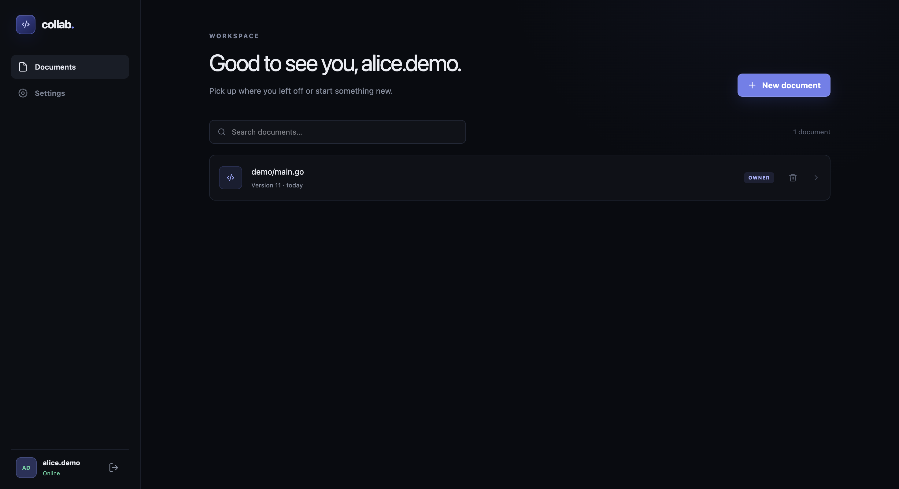
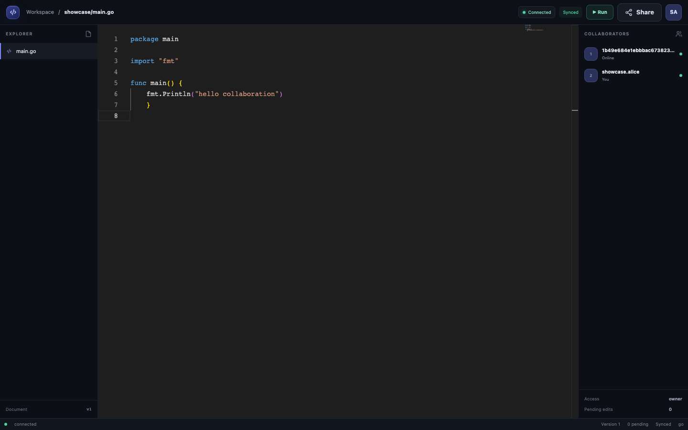
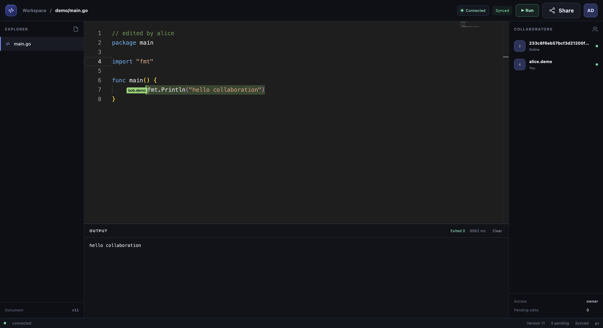
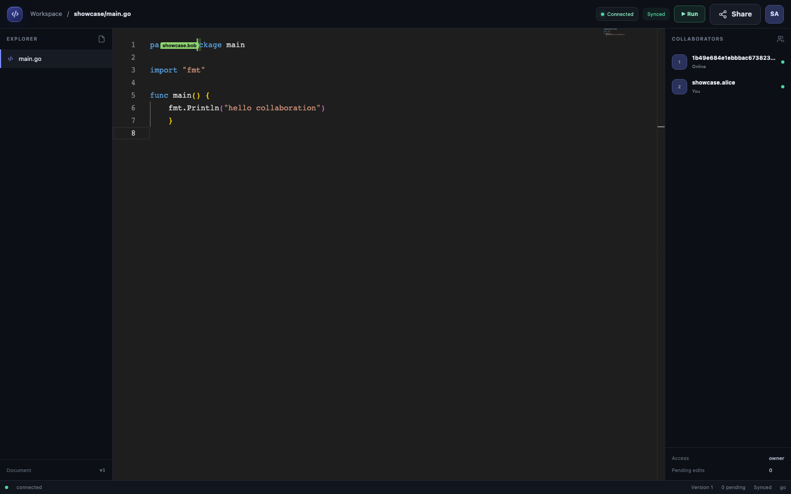
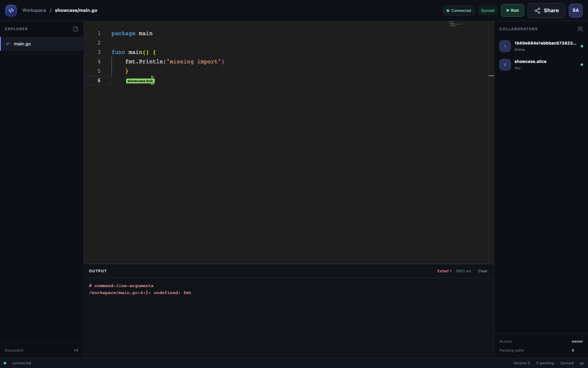
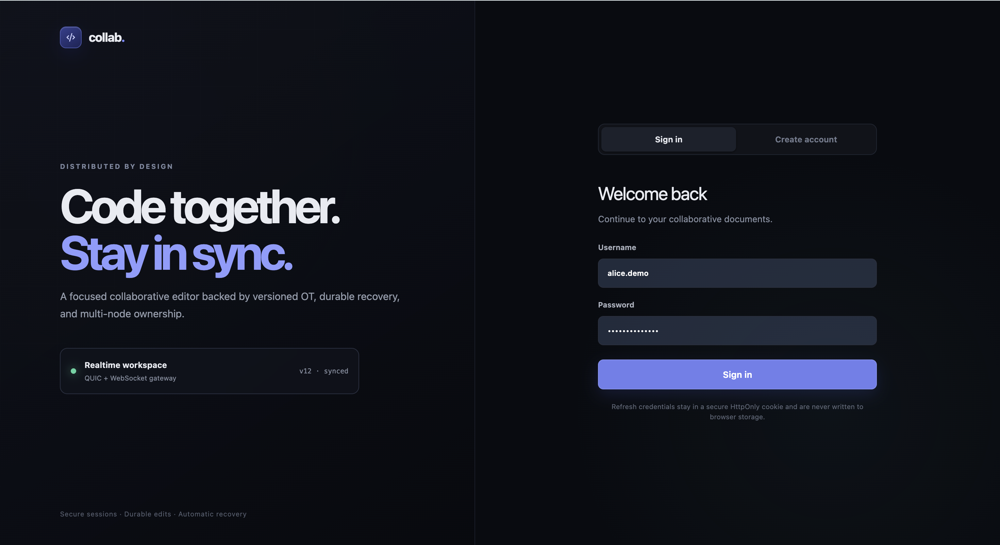
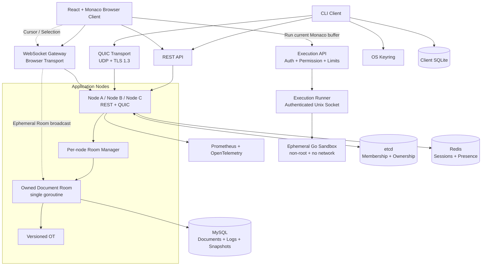

[](README.md) [](README.zh-CN.md)

# Realtime Collaborative Code Editor

A distributed real-time collaborative code editor with multi-node ownership, reliable synchronization, and isolated Go code execution.

         

## 1. Project Overview

This project implements a real-time collaborative editor for code and plain text, with a React browser UI and a recoverable CLI client. Both clients use REST for account and document management. Native clients use reliable ordered QUIC streams, while browsers use a same-process WebSocket gateway that feeds the same Room, OT, permission, ownership, and persistence path. The server resolves concurrent Insert/Delete operations with Operational Transformation (OT), keeps each document's in-memory state inside one Room goroutine, and persists documents, permissions, operation logs, snapshots, and fencing tokens through MySQL transactions.

QUIC provides TLS 1.3, reliable ordered streams, connection-level timeouts, and room for transport evolution over UDP, while keeping the real-time data plane separate from the REST control plane. The multi-node design removes the long-term availability dependency on a single process: etcd manages membership and lease-backed ownership, Rendezvous Hashing selects only the preferred candidate, and MySQL fencing tokens ultimately prevent stale owners from writing.

The main stack is Go, React, TypeScript, Monaco Editor, QUIC/WebSocket, MySQL, Redis, etcd, SQLite, JWT, mTLS, Prometheus, and OpenTelemetry. The backend, browser UI, CLI recovery path, multi-node failover, and real-dependency integration tests are implemented. Docker and Google Cloud Terraform assets are prepared, but no cloud deployment has been performed.

## Screenshots

### Dashboard

The authenticated workspace lists accessible documents, versions, roles, search, and document creation without exposing session credentials to browser storage.



### Collaborative Editor

Monaco, document version state, connection health, pending edits, participants, and permission-aware actions share one focused workspace.



### Go Code Execution

Owners and writers can run the current Monaco buffer in the isolated Runner and inspect stdout, exit code, and elapsed time without changing the document version.



### Real-time Collaboration

Two independent authenticated browser sessions edit the same document. The remote cursor label and selection are ephemeral Room state, separate from OT content operations.



### Execution Error Handling

Compiler diagnostics remain separate from document content and are returned as stderr with a non-zero exit code and measured duration.



<details>
<summary>Authentication screen</summary>

The browser flow uses an in-memory access token and an HttpOnly, SameSite refresh cookie.



</details>

## 2. Key Features

| Feature | Implementation |
| --- | --- |
| Real-time Communication | QUIC for native clients; WebSocket gateway for browsers; one shared protocol and Room path |
| Browser Editor | React, TypeScript, Monaco Editor, Zustand, IndexedDB pending recovery |
| Go Code Execution | Live Monaco source executed by an authenticated, Docker-isolated Runner |
| Collaborative Editing | Versioned Operational Transformation with Insert/Delete |
| Collaborative Presence | Authenticated, version-aware remote cursors and selections rendered with Monaco decorations |
| Node Discovery | etcd membership, leases, and watches |
| Node Selection | Rendezvous Hashing for preferred-candidate selection only |
| Ownership | etcd Lease + Transaction with `RECOVERING`/`ACTIVE` states |
| Write Protection | MySQL Fencing Token validated with NodeID inside write transactions |
| Persistence | MySQL documents, permissions, operation logs, and snapshots |
| Session & Presence | Redis sessions, operation leases, Presence TTL, Pub/Sub, and reconciliation |
| Local Recovery | SQLite document state, pending edits, and refresh-attempt transactions |
| Authentication | JWT access tokens, Refresh Token Rotation, and encrypted replay |
| Internal Communication | mTLS, certificate NodeID/incarnation binding, and membership revalidation |
| Authorization | `owner / write / read` roles with immediate dynamic enforcement |
| Slow-client Protection | Bounded send queues, non-blocking broadcast, and slow-connection removal |
| Observability | Prometheus metrics, OpenTelemetry tracing, and structured redacted logs |
| Graceful Shutdown | Context cancellation, SIGINT/SIGTERM, and dependency-ordered Room/QUIC/HTTP shutdown |

## 3. System Architecture



The REST API is the control plane for authentication, documents, and permissions. QUIC remains the native real-time data plane, while the browser WebSocket gateway adapts JSON frames to the same transport-neutral Room API; it does not duplicate collaboration logic. A client may connect to any node, which either serves the document or returns an owner redirect based on trusted etcd membership. When an owner-sensitive permission write reaches a non-owner node, the node forwards it over internal mTLS so the owner can reauthenticate and execute it.

Each application node has its own Room Manager, which creates, recovers, and retires Rooms owned by that node. A Room depends only on transport and storage interfaces, not directly on QUIC or SQL. MySQL is authoritative for documents and final write validation, etcd is authoritative for live nodes and ownership, and Redis is limited to sessions, operation leases, presence, and cross-node revocation. The client stores document versions and pending edits in SQLite, while refresh tokens remain in the OS keyring.

Go execution is deliberately outside the collaboration data path: `Execution API → Runner → Sandbox` never enters Room, OT, Snapshot, or MySQL Operation Log. The API authenticates the user, verifies `owner`/`write` permission, applies per-user and per-node limits, and sends the current Monaco buffer to a separate Runner over an authenticated Unix socket. Only that Runner can invoke Docker. Each request gets a disposable, non-root, network-disabled container; source and output are never persisted and do not change the document version.

## 4. Core Design

### 4.1 Multi-node Routing

**Purpose:** Allow QUIC clients to enter through any node and route permission writes to the document owner.

**Implementation:** The entry node resolves ownership through etcd membership and `OwnerResolver`. A local owner enters the Room path; otherwise permission writes are forwarded over mTLS and a QUIC client validates `owner_redirect` before reconnecting.

**Rationale and guarantees:** Routing information remains separate from write authority. Endpoints come only from trusted membership; invalid targets, redirect loops, and unavailable owners fail closed without local-write fallback.

### 4.2 Rendezvous Hashing

**Purpose:** Select a stable preferred node for a document without an owner.

**Implementation:** READY node identities are ranked against the document ID. Membership changes update the candidate order, but healthy Rooms are not migrated proactively.

**Rationale and guarantees:** Rendezvous Hashing minimizes remapping when nodes join or leave. A hash ranking never grants write authority; ownership still requires an etcd transaction.

### 4.3 Room Ownership

**Purpose:** Keep exactly one authoritative Room for a document at a time.

**Implementation:** A candidate atomically acquires an etcd lease-backed ownership key, transitions through `RECOVERING`, activates a higher fencing token, restores and validates the document from a snapshot plus operation log, and only then becomes `ACTIVE`.

**Rationale and guarantees:** etcd manages ephemeral live ownership while MySQL preserves durable state. Lease loss triggers self-fencing, and failed recovery never exposes an active Room.

### 4.4 Fencing Token

**Purpose:** Prevent a stale owner in a network partition from continuing to write.

**Implementation:** Each owner uses a monotonic `WriteAuthority{NodeID, FencingToken}`. A new owner activates a higher token in MySQL; edits, permissions, snapshots, and recovery baselines validate NodeID and token inside the same row-locked transaction as the write.

**Rationale and guarantees:** etcd and MySQL cannot commit atomically, so final authorization belongs inside the durable transaction. After a higher token is activated, every stale-token write is rejected before broadcast or in-memory mutation.

### 4.5 Collaborative Editing

**Purpose:** Keep content and versions consistent under concurrent edits.

**Implementation:** A single Room goroutine serializes permission checks, version handling, OT transformation, `CommitEdit`, in-memory mutation, and broadcast. The database commits before any broadcast. The operation log stores the transformed operation that was actually applied.

**Rationale and guarantees:** The single-writer model gives each document an explicit order without coupling OT to the transport. Insert/Insert, Insert/Delete, Delete/Insert, and Delete/Delete are supported; versions remain contiguous, `request_id` is idempotent, and failed transactions do not mutate Room state.

### 4.6 Room Lifecycle

**Purpose:** Reclaim idle resources without allowing duplicate local Rooms or abandoning in-flight events.

**Implementation:** Room Manager entries move through `opening`, `active`, and `stopping`. Concurrent opens share the same entry, and Join, Leave, Edit, Resume, permission changes, and shutdown signals are serialized through the Room event queue. A Room with no clients retires after the configured idle timeout (30 seconds by default), releases ownership when appropriate, closes its clients, and exits its goroutine. Manager shutdown rejects new Rooms and waits for active Rooms and failover workers.

**Rationale and guarantees:** Lifecycle state is changed under short manager critical sections while etcd and storage I/O run outside the lock. A stopping Room cannot process new events, an in-flight edit completes or is cancelled through context, and a later client can safely create and recover a new Room.

### 4.7 Snapshot + Replay

**Purpose:** Recover Room state while bounding in-memory history.

**Implementation:** Recovery loads the latest MySQL snapshot, replays later transformed operations in version order, and compares the result with the document row. The history floor advances only after a successful snapshot.

**Rationale and guarantees:** Snapshots shorten recovery while operation logs retain verifiable incremental history. Version gaps or content mismatches prevent Room activation, and snapshot failure never trims required history.

### 4.8 Session Revocation

**Purpose:** Stop an old session after logout or user disablement across all nodes.

**Implementation:** Operations acquire a Redis operation lease. Logout waits for already-started work, revokes the session, publishes an event, and each node closes matching QUIC connections through its connection registry. Periodic reconciliation checks for missed revocations.

**Rationale and guarantees:** Pub/Sub may lose messages and cannot be the sole correctness mechanism. Authenticated use revalidates the session, reconciliation covers missed notifications, and Redis failures fail closed.

### 4.9 Client Recovery

**Purpose:** Recover from network loss, process crashes, or owner changes without duplicate edits.

**Implementation:** The client uses a connection state machine, exponential backoff, JWT refresh, `RESUME/SYNC/RESYNC_REQUIRED`, SQLite pending state, and the OS keyring. An edit is committed to SQLite with its original `request_id` before transmission; after reconnecting, the client authenticates, synchronizes versions, and retries pending edits in order.

**Rationale and guarantees:** Local durability precedes network send, and refresh tokens are not stored in ordinary files. Only one reconnect loop runs at a time; acknowledgement and pending deletion commit atomically, while token rotation uses a stable request ID and encrypted replay record.

### 4.10 Collaborative Cursors and Selections

**Purpose:** Show where other authenticated collaborators are working without turning transient presence into document history.

**Implementation:** The browser converts Monaco UTF-16 positions to Unicode code-point offsets and sends throttled, sequenced `cursor_update` messages. The Owner Room validates read permission and version, transforms stale positions through retained OT history, and broadcasts server-derived identity in `cursor_changed`. Monaco decorations render stable per-user colors, carets, labels, and selections. Disconnect, navigation, session revocation, and local expiry remove decorations.

**Rationale and guarantees:** Cursor state stays inside the single-goroutine Room and follows the same Owner Redirect path as edits, but it never increments document version or writes MySQL, snapshots, or operation logs. Accepted edits transform stored cursor positions. Invalid or crossed-in-flight transient updates are discarded without weakening edit, ownership, or fencing validation.

## 5. Technology Stack

Versions below are read from the current repository configuration.

| Category | Technology | Version or Constraint |
| --- | --- | --- |
| Language | Go | language `1.26.0`, toolchain `1.26.10` |
| Browser UI | React / TypeScript / Vite | `19.3.1` / `6.0.3` / `8.3.6` |
| Browser Editor | Monaco Editor / Zustand | `0.57.0` / `5.1.0` |
| HTTP | Go `net/http` | standard library |
| Realtime Transport | `quic-go` / `coder/websocket` | `v0.49.1` / `v1.8.15`; TLS 1.3 for QUIC |
| Database | MySQL | local `8.4.13`; Cloud SQL target `MYSQL_8_4` |
| Session / Presence | Redis | local `7.4.5`; Memorystore target `REDIS_7_2` |
| Coordination | etcd | `3.5.17` |
| Client Storage | `modernc.org/sqlite` | `v1.34.5` |
| JWT | `golang-jwt/jwt/v5` | `v5.2.2` |
| Metrics | Prometheus Go Client | `v1.20.5` |
| Tracing | OpenTelemetry | core/sdk/exporter `v1.45.0`, HTTP instrumentation `v0.61.0` |
| Infrastructure as Code | Terraform | `>= 1.8.0, < 2.0.0`; audited with `1.17.1` |
| Terraform Providers | Google / Random | `8.10.0` / `3.9.0` |
| Container Images | MySQL / Redis / etcd | `8.4.13` / `7.4.5-alpine` / `3.5.17` |

## 6. Project Structure

```text
cmd/                    # Executables
  server/               # REST, QUIC, and lifecycle composition root
  quic-client/          # Recoverable CLI client
  migrate/              # MySQL migration runner
  admin/                # Administrative utility
  loadtest/             # REST + QUIC load generator
  healthcheck/          # Container health probe
  runner/               # Isolated Go execution service; the only Docker owner
internal/
  api/                  # REST, authentication middleware, cross-node mTLS forwarding
  authentication/       # JWT, Redis sessions, rotation, presence, and revocation
  client/               # Reconnect, redirect, resume, and pending recovery
  cluster/              # Membership, Rendezvous, and ownership interfaces
    etcd/                # etcd registry, leases, ownership, and failover
    rpc/                 # Internal mTLS RPC
  collab/               # Document operations and OT
  execution/            # Runner contract, Unix-socket client/server, Docker sandbox
  config/               # Environment configuration and security validation
  migration/            # Ordered, recoverable migration runner
  observability/        # Logs, metrics, tracing, and health
  protocol/             # REST/QUIC messages and error codes
  room/                 # Single-goroutine document state machine
  storage/              # Storage contracts, memory implementation, and replay
    mysql/               # MySQL transactions and fencing implementation
  transport/            # Transport interface
    quic/                # QUIC framing, client, server, and connection lifecycle
  websocket/            # Browser adapter over the same Room Manager
frontend/               # React + TypeScript + Vite + Monaco browser client
migrations/             # MySQL schema migrations
deploy/gcp/              # Google Cloud Terraform and startup templates
docs/                    # Architecture, operations, testing, and deployment reports
```

`internal/room` does not import the QUIC implementation, and `internal/storage` does not depend on etcd. Cluster coordination, persistence, and transport meet through explicit interfaces. `cmd/server` is the composition root that creates dependencies and shuts them down in order.

## 7. Getting Started

### Prerequisites

Go 1.26.10+, Docker, Docker Compose, and OpenSSL are required. The client also needs the platform credential service: macOS Keychain, Windows Credential Manager, or Linux Secret Service.

### Environment Configuration

Copy the example configuration and replace every password and key placeholder. Never commit production secrets, `.env`, or certificate private keys.

```bash
cp .env.example .env
```

Create a development-only CA and localhost certificate for the local QUIC server.

```bash
mkdir -p certs
openssl req -x509 -newkey rsa:2048 -nodes -days 365 \
  -keyout certs/ca.key -out certs/ca.crt -subj '/CN=Collab Local CA'
openssl req -newkey rsa:2048 -nodes \
  -keyout certs/server.key -out certs/server.csr -subj '/CN=localhost'
printf 'subjectAltName=DNS:localhost,IP:127.0.0.1\nextendedKeyUsage=serverAuth\n' > certs/server.ext
openssl x509 -req -days 365 -in certs/server.csr \
  -CA certs/ca.crt -CAkey certs/ca.key -CAcreateserial \
  -out certs/server.crt -extfile certs/server.ext
```

### Infrastructure and Database Initialization

Compose starts MySQL 8.4.13 and Redis 7.4.5; the migration command creates and validates the schema.

```bash
docker compose up -d --wait
set -a
source .env
set +a
go run ./cmd/migrate
```

### Server Startup

Single-node development mode still exercises MySQL, Redis, JWT, and QUIC. REST listens on TCP `:8080`, QUIC on UDP `:8443`, and management endpoints on `127.0.0.1:9090` by default.

```bash
go run ./cmd/server
```

### Start the Browser Client

The Vite development server proxies REST and WebSocket traffic to `localhost:8080`. Refresh tokens remain in an HttpOnly, SameSite cookie; access tokens are held in memory.

```bash
cd frontend
npm ci
npm run dev
```

Open `http://127.0.0.1:5173`. For a production build, run `npm run build` and serve `frontend/dist` behind the configured HTTPS origin.

### Start the Optional Go Runner

The Run button requires a separate local Runner. The public API process must not receive the Docker socket. Both processes share a randomly generated internal token only through their environment and communicate through a mode-`0600` Unix socket.

```bash
docker pull golang:1.26.10-bookworm
export RUNNER_SOCKET=/tmp/collab-editor-runner.sock
export RUNNER_TOKEN="$(openssl rand -hex 32)"
go build -o /tmp/collab-runner ./cmd/runner
go build -o /tmp/collab-server ./cmd/server
/tmp/collab-runner &
runner_pid=$!
/tmp/collab-server
kill "$runner_pid"
```

`cmd/runner` creates one disposable container per request with no network, a read-only root filesystem, UID/GID 65532, all capabilities removed, `no-new-privileges`, bounded tmpfs storage, 512 MB memory, 1 CPU, 64 PIDs, a 10-second timeout, and a combined 64 KB output limit. It accepts only a single Go source file and disables module downloads with `GOPROXY=off` and `GOSUMDB=off`. See [Go Execution Runner](docs/operations/go-execution-runner.md) for configuration and deployment boundaries.

### Register and Start the CLI Client

Register and log in through REST, then obtain the access and refresh tokens from the response. Do not store real tokens in the repository or a shell script.

```bash
curl -X POST http://localhost:8080/api/auth/register \
  -H 'Content-Type: application/json' \
  -d '{"username":"user-a","password":"StrongPassword123!"}'

curl -X POST http://localhost:8080/api/auth/login \
  -H 'Content-Type: application/json' \
  -d '{"username":"user-a","password":"StrongPassword123!"}'
```

Tokens may be imported through environment variables on first use; after import, the refresh token is managed by the OS keyring. The CLI deliberately has no token flags so credentials do not enter shell history or process listings.

```bash
export COLLAB_ACCESS_TOKEN='<access-token>'
export COLLAB_REFRESH_TOKEN='<refresh-token>'
export COLLAB_CA_FILE='certs/ca.crt'
go run ./cmd/quic-client -addr localhost:8443 -api http://localhost:8080 -profile user-a
```

Available interactive commands:

```text
join DOC_ID
edit insert POSITION TEXT
edit delete POSITION LENGTH
status
pending
reconnect
disconnect
exit
```

### Test Commands

These commands run the base quality gates; real integration tests also require the environment variables described below.

```bash
gofmt -l .
go test -count=1 ./...
go test -count=1 -race ./...
go vet ./...
go build ./...
```

## 8. Testing

- Unit tests cover OT, Room ordering, permissions, protocol handling, framing, the client state machine, configuration, and error mapping.
- Integration tests use real MySQL, Redis, etcd, TLS/mTLS, QUIC, and SQLite to verify rollback, fencing, ownership takeover, cross-node logout, Snapshot + Replay, reconnect, and process-crash recovery.
- Browser E2E tests use real Go/MySQL/Redis environments to verify two-user OT, IndexedDB pending recovery, cursor/selection presence, Owner Redirect, fencing failover, and session revocation. Cross-engine runs cover Chromium 141, Firefox 142, and WebKit 26 in four pairings.
- Go execution tests use the pinned real Docker image to verify compilation, panic handling, timeouts, network and host-path isolation, memory/CPU/PID arguments, output truncation, cleanup, concurrent isolation, browser output, and Viewer rejection. Run them explicitly with `RUN_DOCKER_INTEGRATION=true go test -count=1 -run TestDockerRunnerRealSandbox -v ./internal/execution`; a skipped result is not a Docker sandbox pass.
- The Race Detector exercises concurrent Room, QUIC, Client, Session, and Ownership paths with package-level parallelism enabled.
- Integration tests explicitly skip when their environment variables are absent; a skipped result is not treated as real-infrastructure validation. Required values include `MYSQL_TEST_DSN`, `REDIS_TEST_ADDR`, `REDIS_TEST_PASSWORD`, `ETCD_TEST_ENDPOINTS`, etcd TLS files, and the `CLUSTER_TEST_*` internal mTLS certificates.
- The isolated, no-skip validation procedure and results are documented in [Final Quality Gate](docs/operations/final-quality-gate.md) and [Phase 9.1 Audit](docs/operations/phase-9.1-pre-commit-audit.md).

### Controlled Multi-node Results

These results come from a small controlled burst test on an Apple M4 development machine. They are not production capacity, SLA, or soak-test claims.

| Nodes | Clients | Documents | Applied Edits | Errors | RPS | P95 |
| ---: | ---: | ---: | ---: | ---: | ---: | ---: |
| 1 | 4 | 2 | 40 | 0 | 241.3 | 24.6 ms |
| 3 | 9 | 6 | 135 | 0 | 491.5 | 29.9 ms |
| 5 | 15 | 10 | 300 | 0 | 660.0 | 29.8 ms |

See [Phase 8.9 Load Test](docs/performance/phase-8.9-load-test.md) for conditions, fault injection, and limitations.

## 9. Deployment

The repository includes a multi-stage Dockerfile, a non-root runtime user, health checks, Compose-based local dependencies, and Google Cloud Terraform. The target cloud architecture uses three Compute Engine application nodes, a three-member etcd cluster, private Cloud SQL MySQL HA, Memorystore Redis, Secret Manager, Cloud NAT, internal mTLS, and Monitoring. Terraform has passed `fmt`, `validate`, and an offline `plan` with 56 additions, 0 changes, and 0 deletions.

**Infrastructure prepared, deployment not performed.** `terraform apply` has not been run and no paid Google Cloud resource has been created. Production deployment still requires real certificates and secrets, a protected remote state bucket, budget approval, image scanning, and a rollback window.

```bash
docker build -t collab-editor:local .

terraform -chdir=deploy/gcp fmt -recursive -check
terraform -chdir=deploy/gcp init
terraform -chdir=deploy/gcp validate
terraform -chdir=deploy/gcp plan -refresh=false
```

Do not apply without an approved plan, budget, and rollback procedure.

## 10. Documentation

| Document | Description |
| --- | --- |
| [Final Code Review](docs/architecture/final-code-review.md) | Phase 1–9.0 architecture boundaries, call paths, and review findings |
| [Frontend Architecture](docs/frontend/phase-10.1-frontend-architecture.md) | Browser transport, authentication, state, recovery, and integration design |
| [Browser UI Report](docs/frontend/phase-10.2-ui-report.md) | Implemented pages, component boundaries, visual checks, and UI limitations |
| [Frontend Integration](docs/frontend/phase-10.3-integration-report.md) | REST/WebSocket compatibility, recovery behavior, and Phase 10 test evidence |
| [Browser Acceptance](docs/frontend/phase-10.4-acceptance-report.md) | Real two-browser and multi-node acceptance results |
| [Cursor Design](docs/frontend/phase-10.5-cursor-design.md) | Cursor protocol, OT position transformation, lifecycle, and rate limits |
| [Cursor Acceptance](docs/frontend/phase-10.5-acceptance-report.md) | Real browser and cross-node cursor validation |
| [Browser Compatibility](docs/frontend/phase-10.6-browser-compatibility.md) | Chromium, Firefox, WebKit, and native Safari verification status |
| [Phase 10.7 Final Review](docs/architecture/phase-10.7-final-review.md) | Final backend, frontend, distributed-safety, and readability audit |
| [Phase 10.7 Quality Gate](docs/operations/phase-10.7-final-quality-gate.md) | Final test, security, dependency, Docker, and Terraform validation |
| [Go Execution Runner](docs/operations/go-execution-runner.md) | Phase 10.9 API, isolation boundary, resource limits, startup, and tests |
| [System Review](docs/architecture/phase-8.7-system-review.md) | Client recovery, multi-node, and persistence review |
| [Readability Refactoring](docs/architecture/readability-refactoring-report.md) | Readability refactoring scope and compatibility notes |
| [Final Quality Gate](docs/operations/final-quality-gate.md) | Real-dependency tests and final quality gates |
| [Pre-Commit Audit](docs/operations/phase-9.1-pre-commit-audit.md) | Secret, dependency, license, Docker, and Terraform audit |
| [Production Readiness](docs/operations/phase-8.10-production-readiness.md) | Container, security, backup, and recovery runbook |
| [Observability](docs/operations/phase-8.8-observability.md) | Metrics, tracing, health, and logging conventions |
| [Load Test](docs/performance/phase-8.9-load-test.md) | Controlled multi-node load and failure results |
| [Google Cloud Deployment](docs/deployment/phase-9.0-google-cloud-deployment.md) | GCP architecture, cost, deployment, and rollback design |

## 11. Current Limitations

- The browser editor synchronizes linear-text edits, cursors, selections, and online participants, but not rich-text metadata. Cursor presence is ephemeral and is rebuilt after Owner failover rather than persisted.
- Browser execution supports one Go source file and the standard library only. It does not provide a shell, terminal, multi-file workspace, third-party module download, or other languages. Cold standard-library compilation counts toward the 10-second limit.
- The local Runner uses the host Docker daemon, but the public API never receives Docker access. A production rollout requires a separately hardened Runner host/service and is not included in the current Google Cloud Terraform.
- Chromium, Firefox, and Playwright WebKit are automated. Native Safari 26.5 is installed but remains unverified because Safari remote automation is disabled; WebKit is not reported as native Safari.
- One QUIC connection currently carries one document over one bidirectional stream; datagrams and multi-document stream multiplexing are not enabled.
- OT is a linear-text OT-lite implementation, not a full CRDT. Browser edits are stored in IndexedDB and replayed sequentially; complex client-side multi-operation rebasing remains limited.
- The MySQL operation log is append-only and does not yet have a long-term archival policy.
- The initial multi-node deployment assumes stable node identities; it does not automate scaling, certificate issuance, or proactive migration of healthy Rooms.
- Google Cloud has not been deployed. Terraform validation cannot replace real quota, IAM, certificate, DNS, and network verification.
- Phase 8.9 was a short, small-scale test and does not establish production peak capacity, cross-region latency, or long-term memory stability.
- The production image was built and its non-root runtime and health check were verified; an external image CVE scan remains a deployment-time requirement.
- The repository does not yet declare a public-distribution license.
