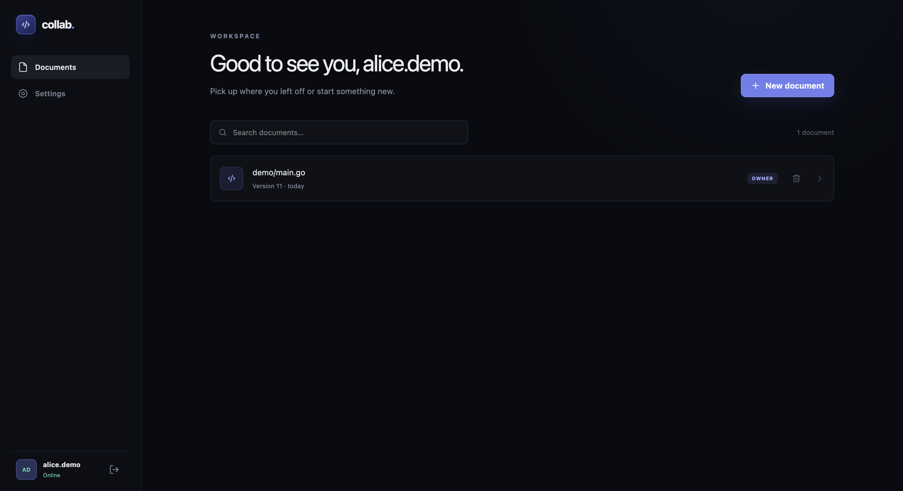
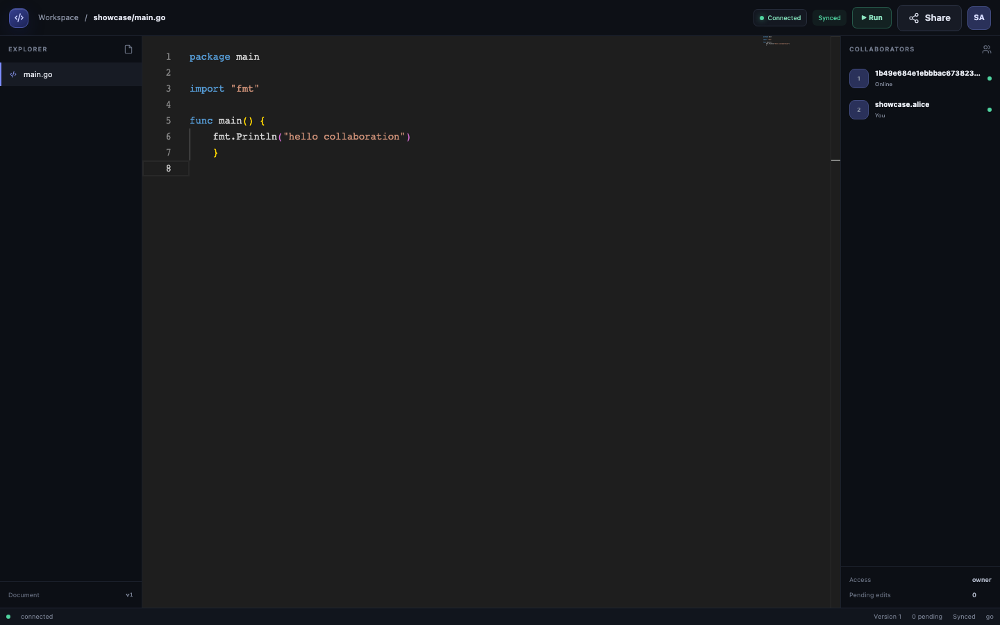
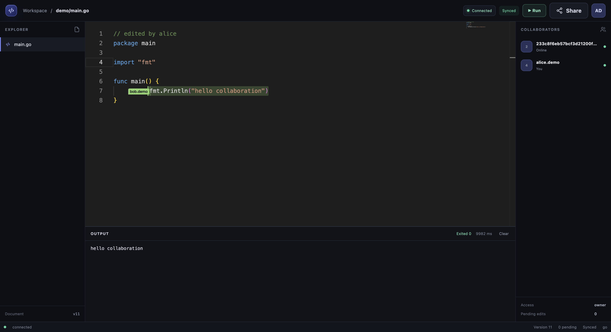
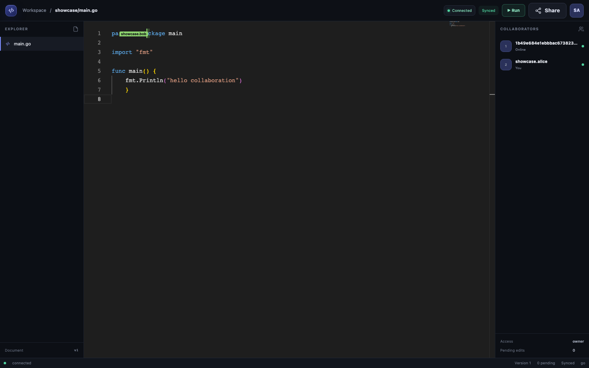
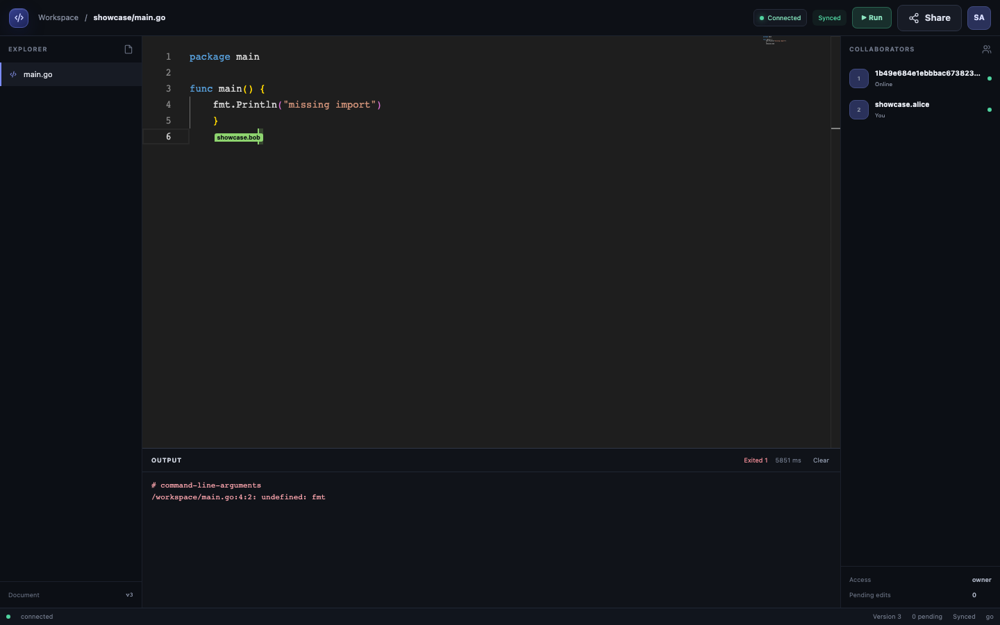
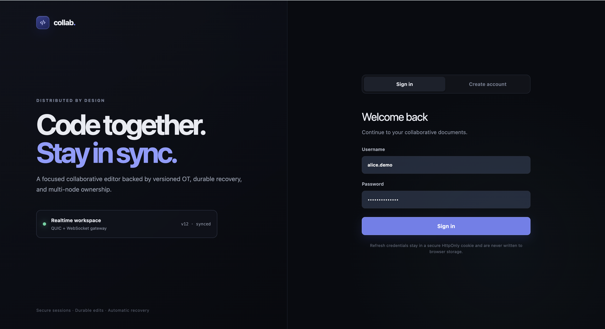
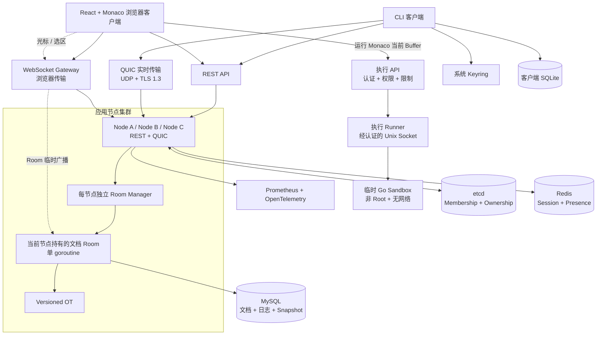

[](README.md) [](README.zh-CN.md)

# 实时协作代码编辑器

具备多节点 Ownership、可靠同步与隔离 Go 代码执行能力的分布式实时协作代码编辑器。

         

## 1. 项目介绍

本项目实现了一个面向代码与纯文本场景的实时协作编辑器，包含 React 浏览器界面和可恢复的 CLI 客户端。两类客户端都通过 REST 管理账户与文档；原生客户端使用 QUIC 可靠有序 Stream，浏览器则通过同进程 WebSocket Gateway 进入同一套 Room、OT、权限、Ownership 和持久化流程。服务端使用 Operational Transformation（OT）处理并发 Insert/Delete，以单文档单 Room goroutine 串行维护内存状态，并在 MySQL 事务中持久化文档、权限、Operation Log、Snapshot 和 Fencing Token。

选择 QUIC 是为了在 UDP 之上获得 TLS 1.3、可靠有序 Stream、连接级超时与后续扩展空间，同时让实时传输与 REST 控制面保持独立。多节点架构用于避免单节点成为长期可用性瓶颈：etcd 负责 Membership 和基于 Lease 的 Ownership，Rendezvous Hashing 只选择优先候选节点，MySQL Fencing Token 最终阻止旧 Owner 继续写入。

主要技术包括 Go、React、TypeScript、Monaco Editor、QUIC/WebSocket、MySQL、Redis、etcd、SQLite、JWT、mTLS、Prometheus 和 OpenTelemetry。当前后端、浏览器界面、CLI 恢复链路、多节点接管和真实依赖集成测试已经完成；Docker 与 Google Cloud Terraform 配置已经准备，但尚未执行云端部署。

## 项目截图

### Dashboard

登录后的 Workspace 展示当前可访问文档、Version、Role、搜索与文档创建，不会将 Session 凭据写入浏览器存储。



### 协作编辑器

Monaco、文档 Version、连接状态、Pending Edit、在线参与者和受权限控制的操作集成在同一个 Workspace 中。



### Go 代码执行

Owner 和 Writer 可以在隔离 Runner 中运行 Monaco 当前 Buffer，并查看 stdout、Exit Code 和执行耗时，不改变文档 Version。



### 实时多人协作

两个独立且已认证的浏览器 Session 同时编辑一份文档。远程光标标签和选区属于临时 Room 状态，与 OT 内容 Operation 分离。



### 执行错误处理

编译器诊断与文档内容彼此分离，并以 stderr、非零 Exit Code 和实际耗时返回。



<details>
<summary>认证页面</summary>

浏览器流程使用内存中的 Access Token 和 HttpOnly、SameSite Refresh Cookie。



</details>

## 2. 核心功能

| 功能 | 技术实现 |
| --- | --- |
| 实时通信 | 原生客户端使用 QUIC，浏览器使用 WebSocket Gateway，共用协议与 Room 流程 |
| 浏览器编辑器 | React、TypeScript、Monaco Editor、Zustand、IndexedDB Pending 恢复 |
| Go 代码运行 | 将 Monaco 当前文本交给经认证的 Docker 隔离 Runner 执行 |
| 协作编辑 | Versioned Operational Transformation，支持 Insert/Delete |
| 协作光标 | 经认证、感知 Version 的远程光标与选区，使用 Monaco Decoration 渲染 |
| 节点发现 | etcd Membership、Lease 和 Watch |
| 节点选择 | Rendezvous Hashing，仅用于选择优先候选节点 |
| 所有权管理 | etcd Lease + Transaction，以及 `RECOVERING`/`ACTIVE` 状态 |
| 写入保护 | MySQL Fencing Token，在写事务内校验 NodeID 与 Token |
| 数据持久化 | MySQL Document、Permission、Operation Log 和 Snapshot |
| Session 与在线状态 | Redis Session、Operation Lease、Presence TTL、Pub/Sub 和 reconciliation |
| 本地恢复 | SQLite 文档状态、Pending Edit 和 refresh-attempt transaction |
| 身份认证 | JWT Access Token、Refresh Token Rotation 和加密 Replay |
| 内部通信 | mTLS、证书 NodeID/Incarnation 绑定和 Membership 重新校验 |
| 权限模型 | `owner / write / read`，动态变更立即生效 |
| 慢客户端保护 | 有界发送队列、非阻塞广播和慢连接自动移除 |
| 可观测性 | Prometheus metrics、OpenTelemetry tracing 和结构化脱敏日志 |
| 优雅关闭 | Context、SIGINT/SIGTERM，以及按依赖顺序关闭 Room/QUIC/HTTP |

## 3. 系统架构



REST API 是认证、文档与权限管理的控制面。QUIC 仍是原生客户端的实时数据面；浏览器 WebSocket Gateway 只把 JSON Frame 适配到同一个 Transport-neutral Room API，不复制协作逻辑。客户端可以连接任意节点，节点根据可信 etcd Membership 中的 Owner 信息处理请求或返回 Owner Redirect。Owner-sensitive Permission 写入到达非 Owner 节点时，会通过内部 mTLS 转发到 Owner 节点重新鉴权并执行。

每个应用节点拥有独立的 Room Manager，用于创建、恢复和回收本节点持有 Ownership 的文档 Room。Room 只依赖 Transport 与 Storage 接口，不直接依赖 QUIC 或 SQL。MySQL 是文档和最终写入校验的权威来源，etcd 是节点与在线 Ownership 的权威来源，Redis 只管理 Session、Operation Lease、Presence 和跨节点撤销通知。客户端将文档版本与 Pending Edit 保存在 SQLite，将 Refresh Token 保存在 OS Keyring。

Go 代码执行与协作数据链路完全分离：`Execution API → Runner → Sandbox` 不进入 Room、OT、Snapshot 或 MySQL Operation Log。API 先认证用户、校验 `owner`/`write` 权限并执行用户级和节点级限制，再通过经认证的 Unix Socket 将 Monaco 当前 Buffer 交给独立 Runner。只有 Runner 能调用 Docker。每次请求使用一个无网络、非 Root 的临时容器；源码和输出不会持久化，也不改变文档 Version。

## 4. 核心设计

### 4.1 多节点路由

**设计目的：** 允许 QUIC 客户端从任意节点进入，并让 Permission 写入到达文档 Owner。

**实现流程：** 入口节点通过 etcd Membership 和 `OwnerResolver` 解析 Ownership。本节点为 Owner 时进入 Room；否则 Permission 写入通过 mTLS 转发，QUIC 客户端验证 `owner_redirect` 后重新连接。

**原因与保证：** 路由信息必须与写入权分离。Endpoint 只能来自可信 Membership；非法目标、Redirect loop 和不可达 Owner 都会 fail closed，不回退到本地写入。

### 4.2 Rendezvous Hashing

**设计目的：** 为尚无 Owner 的文档选择稳定的优先节点。

**实现流程：** 使用文档 ID 对 READY Node Identity 排序。Membership 变化时重新计算候选顺序，但不会主动迁移健康 Room。

**原因与保证：** Rendezvous Hashing 可以减少节点加入或退出带来的映射变化。Hash 排名本身不授予写入权，最终 Ownership 仍必须经过 etcd Transaction。

### 4.3 Room Ownership

**设计目的：** 任一时刻只允许一个权威 Room 处理文档。

**实现流程：** 候选节点原子获取由 etcd Lease 保护的 Ownership Key，进入 `RECOVERING`，激活更高的 Fencing Token，从 Snapshot + Operation Log 恢复并校验文档，最后才切换为 `ACTIVE`。

**原因与保证：** etcd 负责短期在线 Ownership，MySQL 保存长期持久状态。Lease 丢失会触发 Self-Fencing；恢复失败的节点不会对外提供 Active Room。

### 4.4 Fencing Token

**设计目的：** 阻止网络分区中的旧 Owner 继续写入。

**实现流程：** 每个 Owner 使用单调递增的 `WriteAuthority{NodeID, FencingToken}`。新 Owner 先在 MySQL 激活更高 Token；Edit、Permission、Snapshot 与恢复基线写入都在同一个行锁事务中校验 NodeID 和 Token。

**原因与保证：** etcd 与 MySQL 无法原子提交，因此最终写入授权必须放在持久化事务内部。新 Token 激活后，旧 Token 的所有写入都会在广播或内存更新前被拒绝。

### 4.5 协作编辑

**设计目的：** 在并发编辑下保持所有客户端内容与版本一致。

**实现流程：** 单个 Room goroutine 串行处理权限检查、Version、OT Transform、`CommitEdit`、内存更新和广播；数据库必须先提交，之后才能广播。Operation Log 保存 OT 后实际应用的 Operation。

**原因与保证：** 单写入者模型让每个文档的执行顺序清晰，同时避免将 Transport 逻辑混入 OT。系统支持 Insert/Insert、Insert/Delete、Delete/Insert 和 Delete/Delete；Version 连续，`request_id` 幂等，失败事务不会改变 Room 状态。

### 4.6 Room 生命周期

**设计目的：** 在不创建重复本地 Room、不中断在途事件的前提下回收空闲资源。

**实现流程：** Room Manager Entry 依次处于 `opening`、`active` 和 `stopping` 状态。并发打开请求共享同一个 Entry；Join、Leave、Edit、Resume、权限变化和关闭信号通过 Room Event Queue 串行执行。没有客户端的 Room 会在配置的空闲超时后回收（默认 30 秒），按需释放 Ownership、关闭连接并退出 goroutine。Manager Shutdown 会拒绝新 Room，并等待现有 Room 与 Failover Worker 结束。

**原因与保证：** 生命周期状态只在短时间持有 Manager 锁时修改，etcd 与 Storage I/O 在锁外执行。进入 stopping 的 Room 不再处理新事件，在途 Edit 会完成或通过 Context 取消；后续客户端可以安全地重新创建并恢复 Room。

### 4.7 Snapshot + Replay

**设计目的：** 在 Room 重建时恢复状态并限制内存 History。

**实现流程：** 恢复过程加载最新 MySQL Snapshot，按 Version 顺序重放后续经过 OT 的 Operation，并与 documents 行比对。只有 Snapshot 成功保存后才推进 History Floor。

**原因与保证：** Snapshot 缩短恢复路径，Operation Log 保留可验证的增量历史。版本缺口或内容不一致会拒绝激活 Room；Snapshot 失败不会错误裁剪仍需使用的 History。

### 4.8 跨节点 Session 撤销

**设计目的：** Logout 或用户禁用后，在所有节点阻止旧 Session 继续操作。

**实现流程：** 业务操作先获取 Redis Operation Lease；Logout 等待已经开始的操作结束，撤销 Session 并发布事件，各节点通过 Connection Registry 关闭匹配的 QUIC Connection。周期性 reconciliation 负责发现遗漏的撤销事件。

**原因与保证：** Pub/Sub 可能丢消息，不能作为唯一正确性机制。每次认证使用都会重新验证 Session，周期性对账覆盖丢失通知，Redis 异常时 fail closed。

### 4.9 客户端故障恢复

**设计目的：** 在断网、进程崩溃或 Owner 切换后恢复编辑且不重复提交。

**实现流程：** 客户端使用连接状态机、指数退避、JWT Refresh、`RESUME/SYNC/RESYNC_REQUIRED`、SQLite Pending 和 OS Keyring。Edit 先以原始 `request_id` 提交到 SQLite，再发送；重连后完成认证与版本同步，然后按顺序重试 Pending Edit。

**原因与保证：** 本地持久化必须先于网络发送，Refresh Token 不应保存在普通文件中。同一时刻只有一个 Reconnect Loop；ACK 与 Pending 删除在同一事务中原子提交，Token Rotation 使用稳定 Request ID 和加密 Replay Record。

### 4.10 多人光标与选区

**设计目的：** 展示其他已认证协作者的工作位置，同时避免把临时 Presence 写入文档历史。

**实现流程：** 浏览器将 Monaco UTF-16 位置转换为 Unicode code-point offset，并发送经过节流和 Sequence 排序的 `cursor_update`。Owner Room 校验读取权限与 Version，通过保留的 OT History 转换旧位置，并在 `cursor_changed` 中广播服务端派生的用户身份。Monaco Decoration 使用稳定颜色渲染光标、用户名与选区；断开连接、页面离开、Session 撤销和本地过期都会清理 Decoration。

**原因与保证：** Cursor 状态保存在单 goroutine Room 内，并与 Edit 一样遵循 Owner Redirect，但不会增加文档 Version，也不会写入 MySQL、Snapshot 或 Operation Log。已接受的 Edit 会转换已有 Cursor 位置；非法或与 ACK 交错产生的临时旧消息会被丢弃，不降低 Edit、Ownership 或 Fencing 校验强度。

## 5. 技术栈

以下版本均来自当前仓库配置。

| 类别 | 技术 | 当前版本或约束 |
| --- | --- | --- |
| 语言 | Go | language `1.26.0`，toolchain `1.26.10` |
| 浏览器 UI | React / TypeScript / Vite | `19.3.1` / `6.0.3` / `8.3.6` |
| 浏览器编辑器 | Monaco Editor / Zustand | `0.57.0` / `5.1.0` |
| HTTP | Go `net/http` | 标准库 |
| 实时传输 | `quic-go` / `coder/websocket` | `v0.49.1` / `v1.8.15`；QUIC 使用 TLS 1.3 |
| 数据库 | MySQL | 本地 `8.4.13`；Cloud SQL 目标 `MYSQL_8_4` |
| Session / Presence | Redis | 本地 `7.4.5`；Memorystore 目标 `REDIS_7_2` |
| 集群协调 | etcd | `3.5.17` |
| 客户端存储 | `modernc.org/sqlite` | `v1.34.5` |
| JWT | `golang-jwt/jwt/v5` | `v5.2.2` |
| Metrics | Prometheus Go Client | `v1.20.5` |
| Tracing | OpenTelemetry | core/sdk/exporter `v1.45.0`，HTTP instrumentation `v0.61.0` |
| Infrastructure as Code | Terraform | `>= 1.8.0, < 2.0.0`；使用 `1.17.1` 完成审计 |
| Terraform Provider | Google / Random | `8.10.0` / `3.9.0` |
| Container Image | MySQL / Redis / etcd | `8.4.13` / `7.4.5-alpine` / `3.5.17` |

## 6. 项目结构

```text
cmd/                    # 可执行程序
  server/               # REST、QUIC 与生命周期组合根
  quic-client/          # 可恢复 CLI 客户端
  migrate/              # MySQL Migration runner
  admin/                # 管理工具
  loadtest/             # REST + QUIC 压测工具
  healthcheck/          # 容器健康检查
  runner/               # 隔离 Go 执行服务，唯一可调用 Docker 的组件
internal/
  api/                  # REST、认证中间件、跨节点 mTLS forwarding
  authentication/       # JWT、Redis Session、Rotation、Presence、Revocation
  client/               # Reconnect、Redirect、Resume、Pending recovery
  cluster/              # Membership、Rendezvous、Ownership 接口
    etcd/                # etcd Registry、Lease、Ownership、Failover
    rpc/                 # 内部 mTLS RPC
  collab/               # 文档 Operation 与 OT
  execution/            # Runner 契约、Unix Socket Client/Server 和 Docker Sandbox
  config/               # 环境配置与安全校验
  migration/            # 有序、可恢复的 Migration runner
  observability/        # 日志、Metrics、Tracing、Health
  protocol/             # REST/QUIC 消息与错误码
  room/                 # 单 goroutine 文档状态机
  storage/              # Storage 接口、Memory 实现与 Replay
    mysql/               # MySQL Transaction 与 Fencing 实现
  transport/            # Transport 接口
    quic/                # QUIC Framing、Client、Server、Connection 生命周期
  websocket/            # 复用同一 Room Manager 的浏览器 Adapter
frontend/               # React + TypeScript + Vite + Monaco 浏览器客户端
migrations/             # MySQL Schema Migration
deploy/gcp/              # Google Cloud Terraform 与启动模板
docs/                    # 架构、运维、测试和部署报告
```

`internal/room` 不引用 QUIC 实现，`internal/storage` 不依赖 etcd，集群协调、持久化和 Transport 分别通过明确的接口连接。`cmd/server` 是负责创建依赖并按顺序关闭资源的组合根。

## 7. 快速开始

### 环境要求

需要 Go 1.26.10+、Docker、Docker Compose 和 OpenSSL。运行客户端还需要系统凭据服务：macOS Keychain、Windows Credential Manager 或 Linux Secret Service。

### 环境配置

复制示例配置并替换所有密码与密钥占位符。生产 Secret、`.env` 和证书私钥不得提交。

```bash
cp .env.example .env
```

为本地 QUIC 服务创建只用于开发的 CA 和 localhost 证书。

```bash
mkdir -p certs
openssl req -x509 -newkey rsa:2048 -nodes -days 365 \
  -keyout certs/ca.key -out certs/ca.crt -subj '/CN=Collab Local CA'
openssl req -newkey rsa:2048 -nodes \
  -keyout certs/server.key -out certs/server.csr -subj '/CN=localhost'
printf 'subjectAltName=DNS:localhost,IP:127.0.0.1\nextendedKeyUsage=serverAuth\n' > certs/server.ext
openssl x509 -req -days 365 -in certs/server.csr \
  -CA certs/ca.crt -CAkey certs/ca.key -CAcreateserial \
  -out certs/server.crt -extfile certs/server.ext
```

### 启动基础设施与初始化数据库

Compose 启动 MySQL 8.4.13 与 Redis 7.4.5；Migration 命令创建并校验 Schema。

```bash
docker compose up -d --wait
set -a
source .env
set +a
go run ./cmd/migrate
```

### 启动服务端

单节点开发模式仍使用完整的 MySQL、Redis、JWT 和 QUIC 路径。REST 默认监听 TCP `:8080`，QUIC 默认监听 UDP `:8443`，管理端点默认只监听 `127.0.0.1:9090`。

```bash
go run ./cmd/server
```

### 启动浏览器客户端

Vite 开发服务器会把 REST 和 WebSocket 请求代理到 `localhost:8080`。Refresh Token 只保存在 HttpOnly、SameSite Cookie 中，Access Token 只保存在内存。

```bash
cd frontend
npm ci
npm run dev
```

访问 `http://127.0.0.1:5173`。生产构建使用 `npm run build`，并在已配置的 HTTPS Origin 下托管 `frontend/dist`。

### 启动可选 Go Runner

Run 按钮需要单独的本地 Runner。公网 API 进程不得获取 Docker Socket。两个进程只通过环境变量共享随机生成的内部 Token，并使用权限为 `0600` 的 Unix Socket 通信。

```bash
docker pull golang:1.26.10-bookworm
export RUNNER_SOCKET=/tmp/collab-editor-runner.sock
export RUNNER_TOKEN="$(openssl rand -hex 32)"
go build -o /tmp/collab-runner ./cmd/runner
go build -o /tmp/collab-server ./cmd/server
/tmp/collab-runner &
runner_pid=$!
/tmp/collab-server
kill "$runner_pid"
```

`cmd/runner` 每次请求创建一个临时容器，并强制无网络、只读 RootFS、UID/GID 65532、移除全部 Capability、`no-new-privileges`、有界 tmpfs、512 MB 内存、1 CPU、64 PID、10 秒超时和 stdout/stderr 合计 64 KB 上限。Runner 只接受单个 Go 源文件，并使用 `GOPROXY=off` 和 `GOSUMDB=off` 禁止下载 Module。配置与部署边界详见 [Go 执行 Runner](docs/operations/go-execution-runner.md)。

### 创建用户并启动 CLI 客户端

先通过 REST 注册并登录，从响应中取得 Access Token 和 Refresh Token。不要把真实 Token 写入仓库或 Shell 脚本。

```bash
curl -X POST http://localhost:8080/api/auth/register \
  -H 'Content-Type: application/json' \
  -d '{"username":"user-a","password":"StrongPassword123!"}'

curl -X POST http://localhost:8080/api/auth/login \
  -H 'Content-Type: application/json' \
  -d '{"username":"user-a","password":"StrongPassword123!"}'
```

首次运行可通过环境变量导入 Token；Refresh Token 成功导入后由 OS Keyring 管理。CLI 不接受 Token 命令行参数，避免凭据进入 Shell History 或进程列表。

```bash
export COLLAB_ACCESS_TOKEN='<access-token>'
export COLLAB_REFRESH_TOKEN='<refresh-token>'
export COLLAB_CA_FILE='certs/ca.crt'
go run ./cmd/quic-client -addr localhost:8443 -api http://localhost:8080 -profile user-a
```

客户端支持以下交互命令：

```text
join DOC_ID
edit insert POSITION TEXT
edit delete POSITION LENGTH
status
pending
reconnect
disconnect
exit
```

### 测试命令

以下命令用于基础质量检查；真实集成测试还需要下一节列出的环境变量。

```bash
gofmt -l .
go test -count=1 ./...
go test -count=1 -race ./...
go vet ./...
go build ./...
```

## 8. 测试

- 单元测试覆盖 OT、Room 顺序、权限、协议、Framing、客户端状态机、配置和错误映射。
- 集成测试使用真实 MySQL、Redis、etcd、TLS/mTLS、QUIC 和 SQLite，覆盖事务回滚、Fencing、Ownership 接管、跨节点 Logout、Snapshot + Replay、断线恢复和进程崩溃恢复。
- 浏览器 E2E 使用真实 Go/MySQL/Redis 环境，覆盖双用户 OT、IndexedDB Pending 恢复、光标与选区、Owner Redirect、Fencing 故障接管和 Session 撤销。跨引擎测试覆盖 Chromium 141、Firefox 142 和 WebKit 26 的四种组合。
- Go 执行测试使用固定的真实 Docker 镜像，验证编译、panic、超时、网络与宿主机路径隔离、Memory/CPU/PID 参数、输出截断、容器清理、并发隔离、浏览器输出和 Viewer 拒绝。使用 `RUN_DOCKER_INTEGRATION=true go test -count=1 -run TestDockerRunnerRealSandbox -v ./internal/execution` 显式运行；Skip 不能计为 Docker Sandbox PASS。
- Race Detector 在 Package 并行执行条件下验证 Room、QUIC、Client、Session 与 Ownership 并发路径。
- 未设置集成测试环境变量时，相关测试会明确 Skip；这种结果不能视为真实基础设施验证通过。变量包括 `MYSQL_TEST_DSN`、`REDIS_TEST_ADDR`、`REDIS_TEST_PASSWORD`、`ETCD_TEST_ENDPOINTS`、etcd TLS 文件，以及 `CLUSTER_TEST_*` 内部 mTLS 证书。
- 完整隔离环境和无 Skip 的验收结果记录在 [最终质量 Gate](docs/operations/final-quality-gate.md) 与 [Phase 9.1 提交前审计](docs/operations/phase-9.1-pre-commit-audit.md)。

### 受控多节点测试数据

以下结果来自 Apple M4 开发机上的小规模突发测试，不是生产容量、SLA 或长期稳定性声明。

| 节点 | 客户端 | 文档 | 已应用 Edit | Error | RPS | P95 |
| ---: | ---: | ---: | ---: | ---: | ---: | ---: |
| 1 | 4 | 2 | 40 | 0 | 241.3 | 24.6 ms |
| 3 | 9 | 6 | 135 | 0 | 491.5 | 29.9 ms |
| 5 | 15 | 10 | 300 | 0 | 660.0 | 29.8 ms |

详细条件、故障注入矩阵和限制见 [Phase 8.9 压力测试](docs/performance/phase-8.9-load-test.md)。

## 9. 部署

仓库包含多阶段 Dockerfile、非 Root 运行用户、Health Check、基于 Compose 的本地依赖，以及 Google Cloud Terraform。目标云架构使用三台 Compute Engine 应用节点、三节点 etcd、私网 Cloud SQL MySQL HA、Memorystore Redis、Secret Manager、Cloud NAT、内部 mTLS 和 Monitoring。Terraform 已完成 `fmt`、`validate` 和离线 `plan`，计划结果为 56 add / 0 change / 0 destroy。

**基础设施已经准备，尚未执行部署。** 没有运行 `terraform apply`，没有创建 Google Cloud 收费资源。正式部署前仍需准备真实证书与 Secret、受保护的远程 State Bucket、预算审批、镜像扫描和回滚窗口。

```bash
docker build -t collab-editor:local .

terraform -chdir=deploy/gcp fmt -recursive -check
terraform -chdir=deploy/gcp init
terraform -chdir=deploy/gcp validate
terraform -chdir=deploy/gcp plan -refresh=false
```

不要在未审核 Plan、预算和回滚方案时执行 Apply。

## 10. 技术文档

| 文档 | 说明 |
| --- | --- |
| [最终代码审查](docs/architecture/final-code-review.md) | Phase 1–9.0 架构边界、调用链和审查结论 |
| [前端架构](docs/frontend/phase-10.1-frontend-architecture.md) | 浏览器传输、认证、状态、恢复与集成设计 |
| [浏览器 UI 报告](docs/frontend/phase-10.2-ui-report.md) | 已实现页面、组件边界、视觉检查与 UI 限制 |
| [前后端集成报告](docs/frontend/phase-10.3-integration-report.md) | REST/WebSocket 兼容、恢复行为与 Phase 10 测试证据 |
| [浏览器验收](docs/frontend/phase-10.4-acceptance-report.md) | 真实双浏览器与多节点验收结果 |
| [光标设计](docs/frontend/phase-10.5-cursor-design.md) | Cursor 协议、OT 位置转换、生命周期与限流 |
| [光标验收](docs/frontend/phase-10.5-acceptance-report.md) | 真实浏览器与跨节点 Cursor 验证 |
| [浏览器兼容性](docs/frontend/phase-10.6-browser-compatibility.md) | Chromium、Firefox、WebKit 与原生 Safari 验证状态 |
| [Phase 10.7 最终审查](docs/architecture/phase-10.7-final-review.md) | 后端、前端、分布式安全和可读性最终审查 |
| [Phase 10.7 质量 Gate](docs/operations/phase-10.7-final-quality-gate.md) | 最终测试、安全、依赖、Docker 与 Terraform 验证 |
| [Go 执行 Runner](docs/operations/go-execution-runner.md) | Phase 10.9 API、隔离边界、资源限制、启动和测试 |
| [系统审查](docs/architecture/phase-8.7-system-review.md) | 客户端恢复、多节点和持久化系统审查 |
| [可读性重构](docs/architecture/readability-refactoring-report.md) | Clean Code 重构范围与兼容性说明 |
| [最终质量 Gate](docs/operations/final-quality-gate.md) | 真实依赖测试与最终质量 Gate |
| [提交前审计](docs/operations/phase-9.1-pre-commit-audit.md) | Secret、依赖、License、Docker 和 Terraform 审计 |
| [生产就绪说明](docs/operations/phase-8.10-production-readiness.md) | 容器、安全、备份与恢复运行手册 |
| [可观测性](docs/operations/phase-8.8-observability.md) | Metrics、Tracing、Health 和日志约定 |
| [压力测试](docs/performance/phase-8.9-load-test.md) | 多节点受控压测与故障注入结果 |
| [Google Cloud 部署](docs/deployment/phase-9.0-google-cloud-deployment.md) | GCP 架构、成本、部署和回滚设计 |

## 11. 当前限制

- 浏览器编辑器同步线性文本、光标、选区与在线参与者，但不支持富文本元数据。Cursor Presence 属于临时状态，Owner 故障接管后通过在线客户端重建，不做持久化。
- 浏览器执行只支持单个 Go 源文件和标准库，不提供 Shell、Terminal、多文件 Workspace、第三方 Module 下载或其他语言。标准库冷编译时间也计入 10 秒上限。
- 本地 Runner 使用宿主机 Docker Daemon，但公网 API 永远不获取 Docker 权限。生产发布需要单独加固的 Runner 主机/服务，当前 Google Cloud Terraform 不包含这部分。
- Chromium、Firefox 与 Playwright WebKit 已自动化验收；本机安装了原生 Safari 26.5，但因 Safari Remote Automation 未启用而尚未验证，不能把 WebKit 结果视为原生 Safari 结果。
- 一个 QUIC Connection 当前只承载一个文档和一个 bidirectional Stream；未启用 Datagram 或多文档 Stream Multiplexing。
- OT 是线性文本 OT-lite，不是完整 CRDT。浏览器编辑会写入 IndexedDB 并按顺序重放，但复杂的客户端多操作 Rebase 仍有限制。
- MySQL Operation Log 仍为追加写入，尚未实现长期归档策略。
- 第一版多节点部署采用稳定节点身份，不包含自动扩缩容、自动证书签发或健康 Room 主动迁移。
- Google Cloud 尚未部署；Terraform 验证不能替代真实配额、IAM、证书、DNS 和网络验证。
- Phase 8.9 是短时小规模测试，不代表生产峰值容量、跨区域延迟或长期内存稳定性。
- 生产镜像已完成构建，并验证了非 Root 运行与 Health Check；外部镜像 CVE 扫描仍属于部署前必做项。
- 仓库尚未选择公开分发 License。
