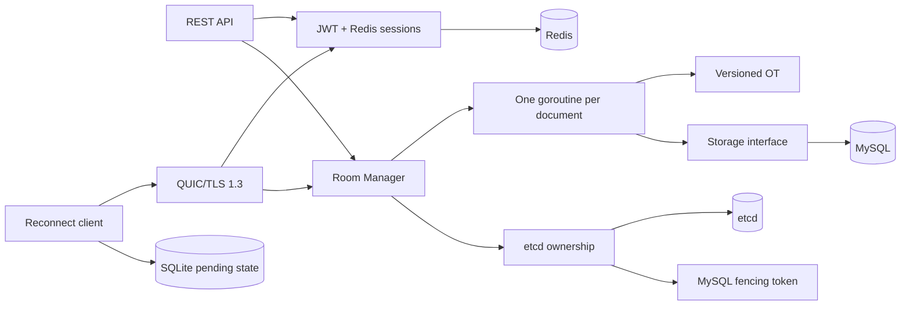

# Phase 1–9.0 Final Code Review

## Scope and baseline

This review covers all 25 Go packages, 109 Go source files, 47 test files, the SQL migrations, Docker assets, and the Google Cloud Terraform configuration. The review started on branch `main` at HEAD `0c349f0c7b9babd62dabf8d7cd01c107d4e69621`. The large existing working tree is the accumulated Phase 1–9.0 implementation and is treated as project source, not disposable output.

No committed or untracked credential file was found. `.env`, private keys, client SQLite files, Terraform state, plans, and certificates are excluded from source and image contexts. Example passwords and test-only constants remain placeholders.

## System architecture

MySQL is authoritative for durable document data and fencing validation. etcd is authoritative for live node membership and Room ownership. Redis is authoritative for live sessions and operation leases, but not documents or ownership. A Room goroutine is the sole in-memory writer for one document. These boundaries are correct and must remain explicit.

## Package responsibilities

| Package | Responsibility |
| --- | --- |
| `internal/collab` | Document, operation validation, application, and pairwise OT transformation |
| `internal/protocol` | Stable REST/QUIC message representation and error codes |
| `internal/room` | Serialized document event loop, permissions, edits, snapshots, and manager lifecycle |
| `internal/storage` | Transport-independent persistence contracts and memory implementation |
| `internal/storage/mysql` | Transactional document, permission, operation-log, snapshot, and fencing persistence |
| `internal/authentication` | JWT, users, Redis sessions, refresh rotation/replay, leases, presence, and revocation |
| `internal/api` | REST parsing, authentication, routing, permission forwarding, CORS, and rate limiting |
| `internal/transport` | Minimal nonblocking Room client contract |
| `internal/transport/quic` | TLS 1.3 framing, authentication, owner redirect, and connection lifecycle |
| `internal/client` | Connection state machine, redirect/reconnect, token refresh, resume, and pending edits |
| `internal/client/storage` | Transactional SQLite document and pending-operation persistence |
| `internal/client/credential` | OS credential-store boundary |
| `internal/cluster` | Node/owner models, Rendezvous ranking, and cross-node service interfaces |
| `internal/cluster/etcd` | Membership, lease confirmation, ownership transaction/watch, and failover candidates |
| `internal/cluster/rpc` | Membership-bound mutual-TLS permission forwarding |
| `internal/migration` | Ordered, checksummed, transaction-aware migration runner |
| `internal/observability` | Structured logging, redaction, metrics, health, and tracing |
| `internal/config` | Environment parsing, defaults, and production validation |
| `cmd/server` | Composition root and graceful service lifecycle |
| `cmd/quic-client` | Interactive client entry point |
| `cmd/admin`, `cmd/migrate` | Administrative password and migration commands |
| `cmd/loadtest` | Real REST/QUIC load generator |
| `cmd/healthcheck` | Container readiness probe |

## Main call paths

### Edit

`QUIC frame → authenticated Client → Room event queue → permission/version check → OT transform → Storage.CommitEdit → MySQL row lock and fencing check → Room state update → broadcast`.

The database commit precedes the in-memory mutation and broadcast. This ordering is a critical invariant.

### Ownership recovery

`client/manager request → RoomManager → etcd EnsureOwner/Acquire → RECOVERING owner → MySQL ActivateOwnership with higher token → snapshot + operation replay → etcd ACTIVE → accept clients`.

Rendezvous ranking selects a preferred candidate only. etcd transaction ownership and MySQL fencing provide correctness.

### Cross-node logout

`REST logout → session gate → revoke Redis session → wait for distributed operation leases → Redis Pub/Sub notification → remote ConnectionRegistry close`. Periodic session reconciliation covers lost Pub/Sub notifications.

### Client recovery

`SQLite state + credential store → AUTH → JOIN/RESUME → SYNC or RESYNC_REQUIRED → retry pending operations with original request_id → atomic SQLite acknowledgement`.

## Findings before refactoring

### CRITICAL

None found.

### HIGH

None remaining. Previous high-risk security and distributed correctness findings have already been addressed by TLS/mTLS verification, Redis fail-closed behavior, MySQL fencing, ownership self-fencing, secret redaction, and real integration tests.

### MEDIUM

1. Several core files combine unrelated concerns and are expensive to navigate: `room.go`, `client/manager.go`, `authentication/service.go`, `storage/mysql/store.go`, and `cmd/server/main.go`.
2. Go comments in core concurrency and distributed code are mixed Chinese and English, despite a single-language code-comment requirement.
3. The server composition root passes eleven related lifecycle arguments through `serveServices`, making shutdown ownership difficult to read and easy to misorder.
4. Room event declarations, in-process transport code, event-loop logic, edit workflow, and snapshot workflow are colocated in one file.
5. Authentication service logic and connection/presence registry logic are colocated, obscuring which component owns Pub/Sub and Redis Client lifetimes.
6. Client manager connection, recovery, message, and state-transition logic is concentrated in one 900-line file. The state machine is correct but harder to review than necessary.

### LOW

1. Some exported interfaces and types lack conventional GoDoc even when their safety contract matters.
2. A few small helpers use broad names such as `handle`, `record`, or `result`; context usually resolves them, but lifecycle-specific names improve scanning.
3. The README project tree and boundaries had fallen behind the multi-node implementation; they were updated before this review.
4. Docker and Terraform contain intentional repetition for explicit per-node identities. Removing that repetition through opaque generic modules would reduce auditability and is not recommended.

### STYLE

1. Chinese code comments should be translated to concise English while preserving the rationale.
2. Large test files should keep scenario-oriented names and local helpers; a global test framework would be unnecessary abstraction.
3. Mechanical one-line wrappers used to provide context-aware and compatibility APIs are justified and should not be removed merely to reduce line count.

## Refactoring plan

- Separate declarations and lifecycle concerns into cohesive files without changing package APIs.
- Replace the server shutdown argument list with a small internal service group that makes resource ownership visible.
- Translate code comments to English and add GoDoc only where it communicates a contract.
- Simplify duplicated control flow only when the resulting helper has a clear domain name.
- Keep tests scenario-driven; improve names and synchronization, not assertions.
- Run package tests after each module group and run real MySQL, Redis, etcd, mTLS, and QUIC tests in the final gate.

## Designs that must not be simplified away

- One Room goroutine as the sole in-memory document writer.
- Storage and transport interfaces that isolate Room logic from MySQL and QUIC.
- Database commit-before-memory-update ordering.
- MySQL fencing validation inside every durable owner write transaction.
- etcd lease confirmation timeout and self-fencing.
- Redis operation leases around authenticated edits and logout.
- Refresh rotation replay encryption and stable request IDs.
- SQLite transactions that atomically persist pending edits and acknowledgements.
- Explicit per-node identity and certificate mapping in Terraform.
