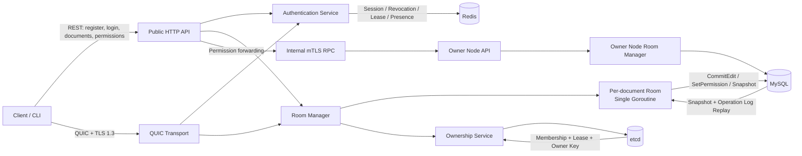
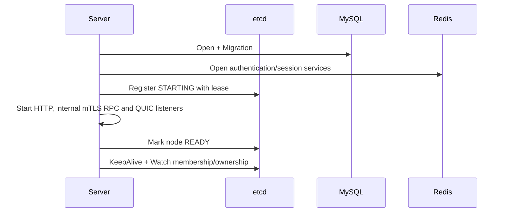
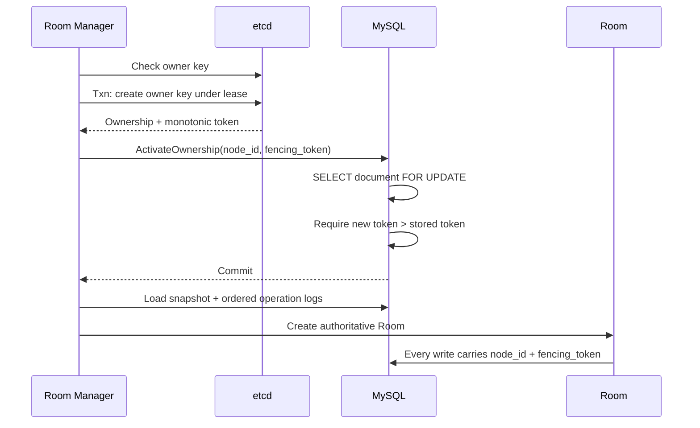
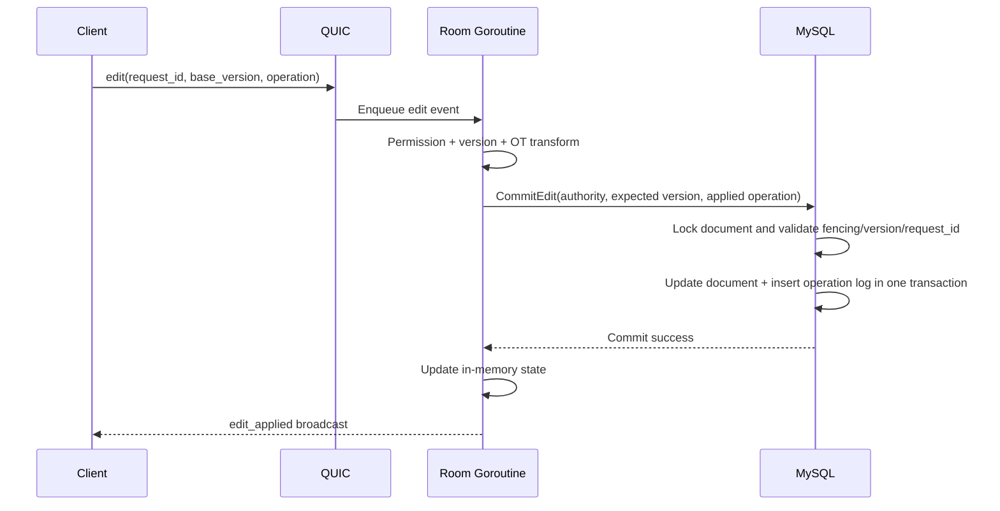
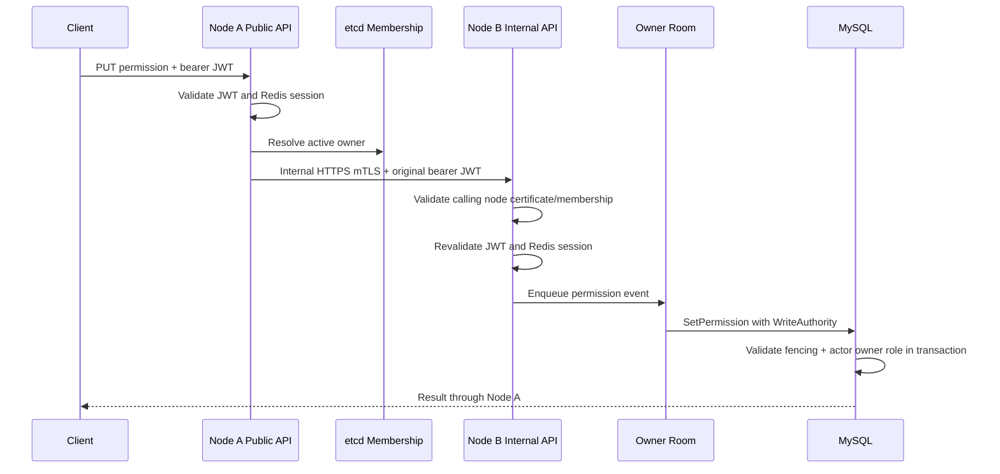
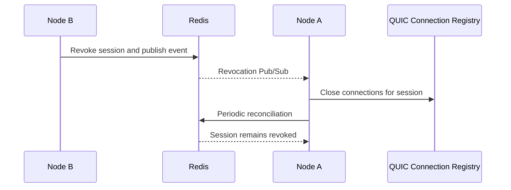
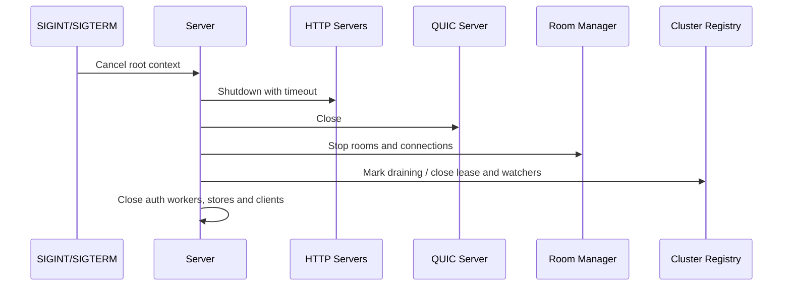

# Phase 8.7 — 分布式系统架构审查

## 1. 审查结论

**Phase 8.7 初次审计状态：FAIL**

**Phase 8.7 Recovery 重新审计状态：PASS（2026-11-06）**

当前实现已经形成较完整的单节点及多节点协作编辑基础：每个文档由单个 Room
goroutine 串行处理，etcd 管理节点成员与文档 Ownership，MySQL Fencing Token
保护持久化写入，Redis 管理 Session、撤销通知与在线状态，QUIC 承载实时协议。

初次静态审查确认了 3 项 HIGH 级问题。按照总控任务的阶段规则，出现任何
CRITICAL/HIGH 问题后必须停止，因此：

- Phase 8.8、8.9、8.10 和 9.0 均未开始。
- 本阶段未修改业务代码。
- 本阶段未运行完整测试 Gate，也未启动真实基础设施验收。
- 初次审计时不应将版本认定为生产就绪。三个 HIGH 已在 Recovery 中修复并通过
  真实基础设施测试；生产就绪仍需完成 Phase 8.8–8.10。

Recovery 已完成：生产 REST HTTPS 强制策略、URI SAN 形式的 NodeID + Incarnation
证书绑定，以及 Document/Permission 查询的跨节点 Owner 路由。详细证据见
`docs/architecture/phase-8.7-recovery-report.md`。

## 2. 审查范围与基线

- 分支：`main`
- HEAD：`0c349f0c7b9babd62dabf8d7cd01c107d4e69621`
- 审查方式：以当前未提交工作区为准，保留 Phase 1–8.6 的全部成果。
- 重点模块：
  - `cmd/server`
  - `cmd/quic-client`
  - `internal/api`
  - `internal/authentication`
  - `internal/client`
  - `internal/cluster`
  - `internal/room`
  - `internal/storage`
  - `internal/transport/quic`
  - `internal/config`
  - `migrations`

审查没有执行 reset、checkout、clean、restore、stash、add、commit 或 push。

## 3. 当前系统架构



### 3.1 权威来源

| 领域 | 权威来源 | 说明 |
| --- | --- | --- |
| 文档内容、版本、权限、Operation Log、Snapshot | MySQL | 所有持久化写入应在事务中完成 |
| 节点成员、节点状态、文档 Ownership | etcd | Lease 表示存活性，Transaction 获取 Owner Key |
| 写入有效性 | MySQL Fencing Token | Go 内存和 etcd 判断不能替代数据库事务校验 |
| 活跃 Session、撤销、Operation Lease、Presence | Redis | Session 校验失败时采用 fail-closed |
| 单文档实时协作状态 | Owner 节点上的 Room | 单 goroutine 是内存状态唯一写入者 |
| 客户端 Pending Edit | SQLite | 保留原 `request_id`，支持进程恢复与重试 |

## 4. 关键流程审查

### 4.1 节点启动与注册



节点仅在主要监听器已经建立后才标记为 READY。etcd 客户端使用 Lease 和
KeepAlive 维护成员状态，Membership 作为路由候选集合。

### 4.2 Ownership、恢复与 Fencing



etcd Ownership 只决定当前候选所有者；MySQL 中已激活的 Fencing Token 才是
最终写权限。新 Token 激活后，旧节点即使仍能访问 MySQL，也不能继续提交编辑、
权限变更或 Snapshot。

### 4.3 编辑事务



数据库提交成功前，Room 不更新内存版本且不广播。`request_id` 数据库唯一约束
与客户端 SQLite Pending 状态共同提供重试幂等基础。

### 4.4 跨节点权限变更



转发失败不会回退为本地写入，这是正确的 fail-closed 行为。但内部节点身份绑定
仍存在 HIGH-02 所述缺陷。

### 4.5 Session 撤销与跨节点 Logout



Pub/Sub 用于低延迟通知，周期性 Redis 对账弥补消息丢失。Authentication Service
关闭时会主动关闭其拥有的 Subscription，以解除阻塞读取，同时不关闭共享 Redis
Client。

### 4.6 优雅关闭



## 5. 已确认的系统保证

### 5.1 一致性与并发

- 每个文档的 Room 由单 goroutine 串行消费事件。
- Join、Leave、Edit、Resume、Permission Change 通过 Room 事件队列处理。
- 慢客户端队列采用非阻塞发送，慢客户端被移除，不会阻塞其他客户端。
- Room 内存版本只在持久化事务成功后推进。
- MySQL 编辑事务原子更新 `documents` 和 `operation_logs`。
- Snapshot 与 Replay 保持版本有序，恢复后继续使用持久化版本。
- Room 生命周期退出后不继续接受旧事件。

### 5.2 多节点写安全

- Rendezvous Hashing 仅选择优先候选，不直接授予写权限。
- etcd Lease + Transaction 决定当前 Owner Key。
- MySQL `owner_node_id` 和 `fencing_token` 是最终写入校验。
- CommitEdit、SetPermission 和 Snapshot 写入均携带 `WriteAuthority`。
- 新 Token 激活后，旧 Token 的后续写入被数据库拒绝。
- Owner 不可达或状态不确定时，权限写入不会回退到本地执行。

### 5.3 身份、Session 与客户端恢复

- 用户认证使用 JWT，并在 Redis 中验证 Session 状态。
- Refresh Token Rotation、撤销和重放保护保留。
- QUIC 使用 TLS 1.3，并验证服务端身份。
- Redirect Endpoint 从可信 Membership 获得，客户端检查非法 Endpoint、重定向环和次数。
- SQLite 持久化 Pending Edit，重连不重新生成已存在的 `request_id`。
- RESUME、SYNC、RESYNC_REQUIRED 路径保持 Snapshot/History 边界。

上述保证不抵消第 6 节列出的传输与节点身份问题。

## 6. 审查发现

### HIGH-01：Public REST API 以明文 HTTP 监听敏感认证流量

**证据**

- `cmd/server/main.go` 的 `listenServers` 使用 `net.Listen("tcp", address)`。
- Public HTTP Server 通过 `server.Serve(listener)` 启动，没有 TLS 配置或
  `ServeTLS`。
- `/register`、`/login` 接收明文密码，`/refresh` 接收 Refresh Token，其他接口
  使用 Bearer JWT。
- `cmd/quic-client` 的 REST 默认地址为 `http://localhost:8080`。
- 当前配置和文档没有强制要求可信 TLS 终止层，也没有限制 Public API 只绑定
  loopback/private socket。

**影响**

若 Public API 直接暴露在网络中，密码、Access Token 和 Refresh Token 可能被
被动监听或中间人窃取。QUIC 的 TLS 1.3 不能保护独立的 REST 连接。

**建议**

- 生产模式必须二选一：原生 HTTPS，或显式声明并校验可信 TLS Reverse Proxy。
- 若使用终止层，应用监听地址应限制在受信网络，配置应明确区分 public URL 与
  bind address。
- 客户端生产配置拒绝 `http://`，测试/loopback 模式必须显式开启。
- 增加真实 TLS 集成测试，验证登录、刷新及 Bearer API 不允许明文降级。

### HIGH-02：mTLS 证书未与节点 Incarnation 做密码学绑定

**证据**

- 内部 RPC 客户端通过普通请求头发送 `X-Collab-Node-ID` 和
  `X-Collab-Node-Incarnation`。
- 服务端只检查客户端证书 `Subject.CommonName == nodeID`。
- 随后使用请求头中的 `nodeID + incarnation` 查询当前 READY Membership。
- Incarnation 不在证书 SAN、扩展或签名载荷中，也没有独立节点签名。

**影响**

同一 NodeID 的旧进程若仍持有有效节点证书，可以把请求头替换为该 NodeID 的
当前 Incarnation，从而冒充新进程通过节点 Membership 检查。Owner 节点仍会
重新验证用户 JWT、Redis Session 与 Owner 权限，因此该缺陷不会直接绕过用户
授权；但它破坏了“调用节点实例已被 etcd Membership 认证”的安全边界，并扩大
有效用户 Token 泄漏后的利用面。

**建议**

- 为每个 Incarnation 使用短期节点证书，并把 `nodeID + incarnation` 绑定到
  URI SAN 或经过校验的自定义扩展；或让节点用独立私钥签名请求摘要、时间戳与
  nonce。
- Membership 必须保存并校验证书公钥指纹或 SPIFFE 风格身份。
- 增加旧进程持有旧证书、伪造新 Incarnation 的拒绝测试。
- 保留用户 JWT/Redis Session 的二次验证，不以节点认证替代用户授权。

### HIGH-03：Document 与 Permission 查询缺少跨节点 Owner 路由

**证据**

- `getDocument` 和 `getPermission` 直接调用本地 `RoomManager.Room(docID)`。
- 两个读取 Handler 都没有先调用 OwnerResolver，也没有转发或返回可操作的
  Owner Redirect。
- `updatePermission` 已实现 OwnerResolver 和内部 mTLS 转发，说明当前只有写权限
  路径具备跨节点处理。

**影响**

在负载均衡将 REST 请求发送到非 Owner 节点时，文档和权限查询可能尝试本地获取
Ownership，或因其他 Owner 已存在而失败。客户端无法可靠地“连接任意节点”，
多节点 REST API 会出现与请求落点相关的可用性错误。错误还可能被映射为通用
500，而不是稳定的 Redirect/Service Unavailable 语义。

**建议**

- 为所有需要 Room 权威状态的 REST 路径统一 OwnerResolver 策略。
- 明确采用内部转发还是对客户端返回可验证 Redirect，并统一超时和错误码。
- 读取可以评估直接从 MySQL 获取，但必须明确其一致性语义，不能静默混用 Room
  实时状态与持久化状态。
- 增加随机入口节点、Owner 切换和 Owner 恢复期间的 REST 查询集成测试。

### MEDIUM-01：Public HTTP 请求体没有显式大小上限

`decodeJSON` 直接从 `request.Body` 解码。HTTP Server 已设置 Header、Read、Write
和 Idle Timeout，但未使用 `http.MaxBytesReader` 或等价的统一请求体限制。攻击者
可用超大 JSON 消耗带宽、内存和解码 CPU。

建议按 Endpoint 设定小而明确的 Body Limit，并将超限稳定映射为 413；同时加入
连接级限流和认证端点速率限制。

### MEDIUM-02：多节点就绪与可观测性缺少外部可验证契约

节点内部存在 STARTING/READY 等状态，但 Public API 没有清晰的 liveness、
readiness、dependency health 与 draining 端点。运维系统无法区分“进程存活”、
“可接受新连接”和“MySQL/Redis/etcd 依赖可用”。

建议 Phase 8.8 增加独立健康语义和指标，避免用普通业务接口代替探针。

### MEDIUM-03：`owner` 角色赋予语义不明确

Permission Role 校验接受 `owner`，权限修改路径可把目标用户设为 owner；但
`documents.owner_id` 仍保留原创建者，当前 Schema 也未表达唯一 Owner 或正式
Ownership Transfer 事务。这样会产生“多个 owner 权限行”与“单一 owner_id”两套
可能不同的事实来源。

建议明确产品语义：若只允许一个 Owner，应禁止普通 SetPermission 写入 owner；
若支持转移，应建立单独的原子 TransferOwnership 流程并同步 document 与权限行。

### LOW-01：部分 Close 方法的重复调用错误语义不一致

个别资源使用 `sync.Once`，但首次 Close 的局部错误没有持久保存，后续调用可能
返回 nil。当前未发现它导致资源泄漏或数据错误，但会降低关闭失败的可诊断性。

建议统一 Close 幂等契约：要么始终返回首次错误，要么明确记录并只保证幂等完成。

## 7. 风险优先级与阶段决策

| ID | 严重度 | 类型 | 是否阻断后续阶段 |
| --- | --- | --- | --- |
| HIGH-01 | HIGH | 认证数据传输安全 | 是 |
| HIGH-02 | HIGH | 集群节点身份认证 | 是 |
| HIGH-03 | HIGH | 多节点 API 路由与可用性 | 是 |
| MEDIUM-01 | MEDIUM | HTTP 资源保护 | 否，但上线前必须处理 |
| MEDIUM-02 | MEDIUM | 可观测性与运维 | 否，建议 Phase 8.8 处理 |
| MEDIUM-03 | MEDIUM | 授权模型一致性 | 否，但需先确定语义 |
| LOW-01 | LOW | 生命周期可诊断性 | 否 |

初次审计根据总控规则判定失败。Recovery 重新审计确认 HIGH-01、HIGH-02、
HIGH-03 均已关闭，当前 CRITICAL=0、HIGH=0，可以进入 Phase 8.8。

## 8. 测试与验证状态

初次静态架构审查发现 HIGH 后没有执行 Gate。Recovery 已补充执行完整 Gate：

- `go test -count=1 ./...`：PASS。
- `go test -count=1 -race ./...`：PASS。
- `go vet ./...`：PASS。
- `go build ./...`：PASS。
- `git diff --check`：PASS。
- 真实 MySQL、Redis、etcd、双节点 mTLS、QUIC：PASS。

这不撤销此前 Phase 8.6 已记录的测试结果，但此前结果不能证明本次发现的生产
安全与路由问题已经解决。

## 9. 建议的恢复顺序

在人工确认后，应先创建独立的 Phase 8.7 Recovery 任务，按以下顺序修复并 Gate：

1. 明确 Public REST TLS 部署模型并强制安全配置。
2. 将节点 Incarnation 与证书/签名身份做密码学绑定。
3. 统一所有 REST Room 路径的跨节点 Owner 路由。
4. 增加请求体限制、认证端点限流和健康探针。
5. 明确单 Owner 或 Ownership Transfer 业务语义。
6. 执行单元测试、Race Detector、Vet、Build 和真实多节点基础设施测试。
7. 重新进行 Phase 8.7 审查；只有不存在 CRITICAL/HIGH 时才能进入 Phase 8.8。

## 10. 最终阶段状态

```text
PHASE 8.7 RECOVERY: PASS
CRITICAL: 0
HIGH: 0
MEDIUM: 3 (scheduled for later hardening or product decision)
LOW: 1

NEXT PHASE: 8.8
COMMIT: NO
PUSH: NO
```
