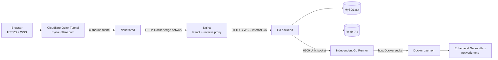

# GCP 单机公开 Demo 部署

本文档描述一个临时、低成本的公开演示环境。它与 `deploy/gcp/` 中的多节点生产准备方案完全独立，不修改后者，也不创建 Cloud SQL、Memorystore、GKE、Cloud NAT 或 Load Balancer。

## 架构



所有服务运行在一台 `e2-medium` Compute Engine VM 上。Compose 不发布任何容器端口：`cloudflared` 通过 Docker `edge` 网络访问 Nginx，Nginx 通过受内部 CA 验证的 HTTPS/WSS 访问 Go。MySQL 和 Redis 只在 `internal: true` 的 `data` 网络可见。Runner 没有 TCP 监听，通过权限为 `0600` 的 Unix Socket 接收后端请求；只有 Runner 挂载宿主机 Docker Socket，后端不挂载。每次代码运行仍由现有实现创建 `--network none`、只读 RootFS、无 Linux Capability、有限 CPU/内存/PID/tmpfs 的一次性 Sandbox。

原生 QUIC 服务仍由 Go 进程启动，但 Compose 不映射 UDP 8443；浏览器 Demo 只走 Nginx 的 WebSocket Gateway。VM 唯一允许的入站规则是来自 IAP TCP Forwarding 地址段 `35.235.240.0/20` 的 TCP 22，并启用 OS Login 与 `block-project-ssh-keys`。应用没有公网入站防火墙，Quick Tunnel 由 VM 主动建立出站连接。

## 文件

- `deploy/demo/docker-compose.demo.yml`：单机应用栈。
- `deploy/demo/Dockerfile.frontend`：构建 React 并由 Nginx 提供静态文件。
- `deploy/demo/Dockerfile.runner`：只包含 Runner 和 Docker CLI。
- `deploy/demo/nginx.conf`：同源 REST/WebSocket 反向代理。
- `deploy/demo-gcp/`：独立单 VM Terraform，不使用或修改 `deploy/gcp/`。
- `scripts/deploy-demo.sh`：显式确认后创建 VM、上传当前工作区、启动 Compose 并验证。
- `scripts/backup-demo.sh`：通过 IAP 将一致性 MySQL Dump 保存到本机并生成 SHA-256。
- `scripts/restore-demo.sh`：校验备份并在显式确认后恢复。
- `scripts/teardown-demo.sh`：先完成本地备份，再次确认后执行 Terraform Destroy。
- `scripts/verify-demo.sh`：验证前端、REST、WebSocket 与独立 Go Runner。

## 成本

区域固定为 `us-central1`，规格固定为一台按需 `e2-medium`、20 GiB `pd-standard` 与一个使用中的临时外部 IPv4。以下是 2026-11-10 核对的公开 USD 列表价：

| 项目 | 单价 | 小时成本 |
| --- | ---: | ---: |
| `e2-medium` | USD 0.03350571 / hour | USD 0.03350571 |
| 使用中的外部 IPv4 | USD 0.005 / hour | USD 0.00500000 |
| 20 GiB `pd-standard` | USD 0.000054795 / GiB-hour | USD 0.00109590 |
| **固定资源总计** |  | **USD 0.03960161 / hour** |
| **24 小时** |  | **USD 0.95043864 / day** |

按固定资源列表价，USD 10 可维持约 **252.51 小时（10.52 天）**。如果该账号当月仍符合 Compute Engine Free Tier 的前 30 GiB 标准盘额度，磁盘项可能为零，此时为 **USD 0.03850571 / hour、USD 0.92413704 / day**，USD 10 约为 259.70 小时。

这是固定资源的精确估算，不包含随访问量变化的公网数据传输费、税费、汇率或其他账号已有用量。Cloudflare Quick Tunnel 本身不需要购买域名或证书，但 Google Cloud 到 Cloudflare/访客的流量仍可能产生 GCP 出站费用。部署前应在 Cloud Billing 报表中确认剩余额度；脚本不会激活、升级或绑定 Billing。

价格依据：Google Cloud 的 [`e2-medium` 通用 VM 价格](https://cloud.google.com/products/compute/pricing/general-purpose)、[Persistent Disk 价格](https://cloud.google.com/compute/disks-image-pricing) 与[外部 IPv4 价格](https://cloud.google.com/vpc/pricing)。

## 前置条件

操作机需要：

- 已登录正确账号的 `gcloud`，且项目已存在于 Free Trial。
- `terraform >= 1.8`、`git`、`curl`、`tar`。
- 操作者具有 Compute 管理、Service Usage、IAP Tunnel 和 OS Login 所需权限。
- 如执行完整浏览器验证，`frontend/node_modules` 已由 `npm ci` 安装，Playwright Chromium 已安装。

脚本只读取环境变量，不写真实 `.env`：

```bash
export GCP_PROJECT_ID='existing-free-trial-project-id'
export GCP_REGION='us-central1'
export GCP_ZONE='us-central1-a'
```

## 部署（需要后续人工批准）

```bash
./scripts/deploy-demo.sh
```

脚本在执行任何 Terraform Apply 之前打印费用并要求输入完整确认短语。随后它：

1. 创建独立 VPC、子网、IAP SSH 防火墙和一台 VM。
2. 通过 IAP 上传当前工作区（排除 `.git`、`.env`、Node 构建产物和 Terraform State）。
3. 在 VM 本地生成随机 MySQL、Redis、JWT、Refresh Replay 和 Runner Secret。
4. 生成短期内部 CA/证书，不向公网暴露证书私钥。
5. 拉取固定 Sandbox 镜像，构建并启动 Compose。
6. 从 `cloudflared` 日志取得临时 `trycloudflare.com` URL，将其写入后端精确 CORS allowlist 并重启后端/Nginx。
7. 执行真实 HTTPS、REST、WebSocket 与 Go 执行浏览器验证。

Quick Tunnel 的主机名在 Tunnel 重建时会变化，不提供 SLA，最多支持 200 个同时在途请求，也不支持 SSE；本项目 Demo 使用 WebSocket，不使用 SSE。它只适合临时演示，不是生产入口。参见 [Cloudflare Quick Tunnels 文档](https://developers.cloudflare.com/tunnel/get-started/quick-tunnels/)。

## 验证

```bash
./scripts/verify-demo.sh 'https://generated-name.trycloudflare.com'
```

完整模式先检查首页和受保护 REST 路由，再运行现有 Playwright Go Execution 场景。该场景会真实注册临时用户、通过 WebSocket 加入 Room、编辑 Monaco 内容，并通过独立 Runner 在 Docker Sandbox 中运行 Go 代码。只做路由诊断时可使用 `http-only`，但该结果不能证明 WebSocket 或 Runner 正常：

```bash
./scripts/verify-demo.sh 'https://generated-name.trycloudflare.com' http-only
```

## 备份与恢复

备份通过 IAP 从 MySQL 容器流式输出到操作机，不在 VM 上留下 SQL 文件：

```bash
./scripts/backup-demo.sh
```

默认输出到 `~/collab-demo-backups/`，生成 `.sql.gz` 和 `.sha256`。脚本要求 Dump 同时包含 MySQL Header 和完成标记，并执行 `gzip -t` 与 SHA-256。

恢复需要指定备份并输入确认短语：

```bash
./scripts/restore-demo.sh "$HOME/collab-demo-backups/collab-demo-YYYYMMDDTHHMMSSZ.sql.gz"
```

## 销毁

```bash
./scripts/teardown-demo.sh
```

销毁脚本的顺序固定为：本机 MySQL 备份 → 内容结构验证 → gzip 验证 → SHA-256 → 要求输入包含 VM 和项目 ID 的完整确认短语 → `terraform destroy` → 确认 VM 不再存在。任一备份步骤失败都会在 Terraform Destroy 之前停止。它只操作此独立 Terraform State 中的资源，不会清理其他 Docker 容器、Volume 或数据库。

## 已知边界

- 这是单节点公开 Demo，不演示 etcd Ownership 接管；代码中的多节点实现保持不变。
- Quick Tunnel URL 不是固定域名，Tunnel 重启后需要重新执行部署启动步骤以更新精确 CORS Origin。
- VM 的 4 GiB 内存适合小规模演示；Runner 全局并发被降低为 2，单次执行超时通过现有配置提高为 20 秒，避免冷启动编译和并行任务争用资源时产生误判。
- Docker Socket 是高权限边界，因此只挂载给独立 Runner。该设计满足现有功能演示，但不是多租户生产级代码执行平台。
- 本方案不创建云端备份资源；销毁前的本地备份由操作机负责长期保管。
