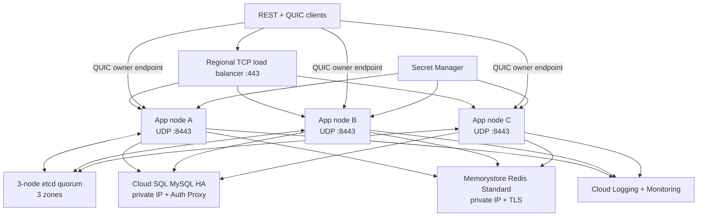

# Phase 9.0 — Google Cloud Deployment Preparation

This document is a deployment design and runbook. The accompanying Terraform is preparation only: no paid Google Cloud resource has been created and `terraform apply` must not be run without an approved plan, budget and rollback window.

## Decision: Compute Engine for the first production deployment

Both GKE and Compute Engine can carry UDP. A GKE `LoadBalancer` Service creates a Layer 4 TCP/UDP passthrough load balancer, and `externalTrafficPolicy: Local` can preserve the source address ([GKE load-balancing overview](https://docs.cloud.google.com/kubernetes-engine/docs/concepts/about-load-balancing), [LoadBalancer Service details](https://docs.cloud.google.com/kubernetes-engine/docs/concepts/service-load-balancer)). That works for generic QUIC ingress, but this application redirects a document client to one authoritative Room owner. The redirect target must therefore identify a stable individual node, not just another balanced service address.

The initial production recommendation is three Compute Engine application VMs distributed across three zones, each with a stable regional public address for UDP 8443, plus one regional TCP load-balancer address for REST. Regional static addresses can be attached to instances in any zone in their region ([Compute Engine regions and zones](https://docs.cloud.google.com/compute/docs/regions-zones)). This is operationally simpler than maintaining one external UDP Service/load balancer per owner Pod.

GKE Standard becomes attractive when the transport gains a stable owner-routing gateway or when many additional services justify Kubernetes. Its benefits are managed upgrades, repair, autoscaling and efficient packing. Compute Engine retains direct control and lower conceptual overhead for the current small number of stateful, identity-bearing nodes. Google now recommends startup scripts or cloud-init rather than the deprecated container startup agent on VMs ([containers on Compute Engine](https://docs.cloud.google.com/compute/docs/containers/deploying-containers)); the Terraform follows that guidance.

## Target architecture

Rendezvous hashing only selects the preferred candidate. etcd lease/transaction ownership remains authoritative for routing, and every MySQL write still validates node ID plus fencing token. Node join/leave does not migrate healthy rooms; acquisition occurs only when no valid owner exists.

## Network plan

- One custom VPC and regional private subnet with Private Google Access.
- Cloud NAT gives private etcd nodes controlled egress without public addresses.
- Public ingress permits only TCP 443 to app nodes through the regional passthrough backend and UDP 8443 directly to the published node addresses.
- Internal TCP 2379/2380 and 9443 is limited to the application subnet. SSH is allowed only through IAP.
- Cloud SQL and Memorystore use private service access. Memorystore always uses internal addresses, and private service access is the recommended mode for dedicated VPCs ([Memorystore networking](https://docs.cloud.google.com/memorystore/docs/redis/networking)).
- App-to-app permission RPC remains mutual TLS. The node certificate URI SAN carries the exact node ID and incarnation advertised through etcd. Certificates and CA bundles come from Secret Manager; etcd membership is checked again before trusting a caller.

## Data services

### Cloud SQL

Use MySQL 8.4, Enterprise regional HA, private IP, automated backups, binary logs and point-in-time recovery. Cloud SQL requires backups and PITR for HA instances and automatically fails over between zones ([Cloud SQL HA](https://docs.cloud.google.com/sql/docs/mysql/high-availability)). The application reaches it through Cloud SQL Auth Proxy on the VM-local Docker network; the proxy encrypts the upstream connection and uses the VM service account.

The database remains the final authority for documents, permissions, operation logs, snapshots and fencing. A Cloud SQL outage must make writes fail closed. Recovery requires checking operation continuity and fencing tokens before re-enabling traffic.

### Memorystore

Use Standard Tier Redis with AUTH, private service access, TLS and `noeviction`. Standard Tier replicates across zones and automatically fails over; connections are dropped during failover, so the existing reconnect and periodic reconciliation paths are required ([Memorystore HA](https://docs.cloud.google.com/memorystore/docs/redis/high-availability-for-memorystore-for-redis)). Memorystore replication is asynchronous and is not a durable document store. Session reconciliation, MySQL idempotency and fencing remain the safety mechanisms.

### etcd

Run three pinned etcd 3.5.17 containers on three private VMs with separate persistent disks and mutual TLS. Do not put etcd behind a load balancer. Application nodes list all three endpoints. Back up with `etcdctl snapshot save`, encrypt and copy snapshots outside the cluster. Test a full three-member restore before production.

## Secrets and identity

- Application and etcd VMs have separate least-privilege service accounts.
- Runtime environment and per-node TLS bundles are existing Secret Manager secrets. No secret payload is committed to Terraform source or embedded in VM startup metadata.
- The generated MySQL password and Redis authentication string are stored in Secret Manager and encrypted Terraform state. Application nodes receive per-secret access and fetch values at boot. Protect the GCS state bucket with uniform access, versioning, retention and restricted IAM.
- Pin the application image by Artifact Registry digest. Pin the Cloud SQL Proxy and etcd images by reviewed versions; promote by digest in the final release manifest.
- Rotate the internal CA with an overlap bundle: distribute both roots, issue new leaves, then remove the old root. A node incarnation change requires a matching certificate and etcd identity.

## Monitoring and SLO inputs

Terraform creates an external TCP uptime check and baseline Cloud SQL CPU and Redis memory alerts. In addition, scrape the private `/metrics` endpoint and alert on:

- readiness loss for more than two checks;
- fencing or ownership conflict rate;
- etcd lease loss and recovery failures;
- Redis operation errors, revocation reconciliation lag and presence failures;
- HTTP 5xx/429 rate and authentication latency;
- QUIC rejects, active connections, reconnect/redirect loops and frame errors;
- Room queue depth, slow-client removals and snapshot failures;
- MySQL pool wait time, storage growth and operation-log continuity.

Cloud Logging must redact tokens, passwords, DSNs and document contents. Route security and ownership audit logs to a retention-controlled sink.

## Capacity and cost estimate

The following is a planning range, not a quote. Prices vary by region, traffic, disk, backup retention, IPs and negotiated discounts. Before approval, enter the exact Terraform sizes in the [Google Cloud Pricing Calculator](https://cloud.google.com/products/calculator) and set a billing budget.

| Component | Initial shape | Budgetary monthly range (USD) |
| --- | --- | ---: |
| Application | 3 × `e2-standard-2`, 20 GB disks, static IPs | 180–350 |
| etcd | 3 × `e2-medium`, 20 GB disks | 90–180 |
| Cloud SQL | 2 vCPU / 7.5 GiB regional HA, 50 GB SSD, backups | 250–550 |
| Memorystore | Standard HA, 5 GiB | 180–350 |
| Network, load balancing, logging, backups | workload dependent | 80–400+ |
| **Indicative total** | excludes high internet egress | **780–1,830+** |

Cloud SQL charges compute, memory and storage separately and HA doubles the compute topology; see the current [Cloud SQL pricing](https://cloud.google.com/sql/pricing). Compute Engine bills VM, disk and network separately; see [VM pricing](https://cloud.google.com/products/compute/pricing). Memorystore price depends on tier, capacity and region; Standard Tier includes cross-zone replication and automatic failover ([Memorystore pricing](https://cloud.google.com/memorystore/docs/redis/pricing)).

## Deployment sequence

1. Create and lock the remote Terraform state bucket manually. Enable billing budgets and audit logging.
2. Build, scan and push the server image to Artifact Registry; record its digest.
3. Issue etcd and per-node app certificates with their final private addresses, DNS names and SPIFFE identities. Create Secret Manager secret versions.
4. Run `terraform fmt -check -recursive`, `terraform init`, `terraform validate`, and save a reviewed `terraform plan`. This repository never runs `apply` automatically.
5. Apply in a scheduled environment only after approval. Confirm Cloud SQL backup/PITR and Redis TLS.
6. Wait for etcd quorum, then start one canary app node. Run migrations once, readiness, registration/login, REST permission, QUIC edit, redirect, snapshot/replay and fencing smoke tests.
7. Start the remaining nodes. Verify etcd membership, unique ownership, per-node UDP reachability and cross-node logout.
8. Enable REST DNS only after TLS validation. Publish QUIC node endpoints through membership, not DNS round-robin.

## Rollback

1. Remove the failed release from REST and stop it from acquiring new Rooms.
2. Gracefully drain QUIC connections and release ownership; wait for replacement nodes to activate higher fencing tokens.
3. Roll app VMs back to the previous image digest. Do not roll back schema blindly.
4. If a migration is incompatible, stop writes and restore the verified pre-deployment Cloud SQL backup into a new instance. Re-run continuity and fencing checks.
5. If Redis is replaced, invalidate sessions and require login; do not restore stale presence or operation leases.
6. If etcd is rebuilt, keep app nodes stopped until quorum is healthy, then allow fresh leases and higher MySQL fencing tokens.

## Known deployment boundaries

- Stable application VMs are intentional. This first plan does not autoscale Room owners or automatically provision new per-node certificates and static QUIC addresses.
- The external TCP health check proves listener reachability; private `/readyz` is the dependency-aware rollout gate.
- Cross-region disaster recovery is documented but not automated. Memorystore for Redis Standard does not provide cross-region replication; a multi-region requirement should evaluate Memorystore for Valkey or an explicit session invalidation strategy.
- Terraform validation does not prove certificate SAN correctness, DNS ownership, quotas, account permissions or real application readiness. Those remain pre-apply and post-apply gates.
