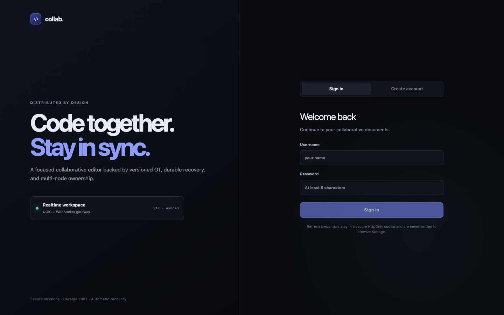
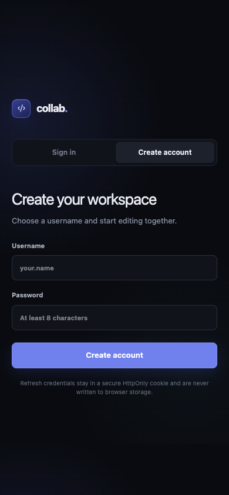
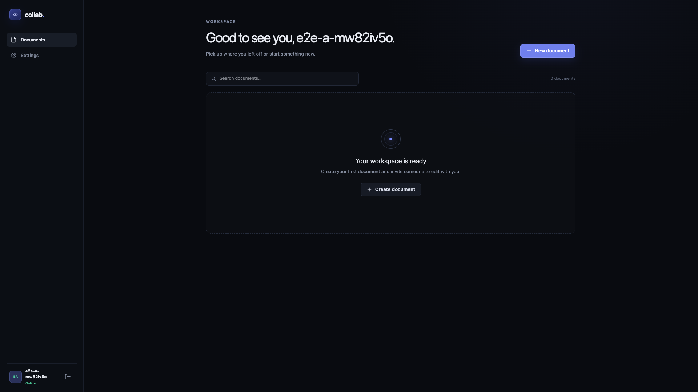
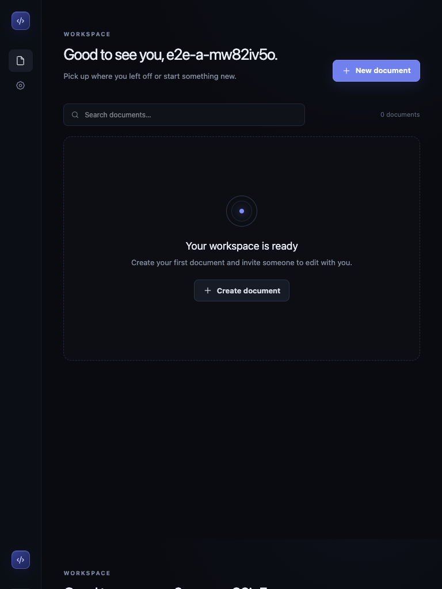
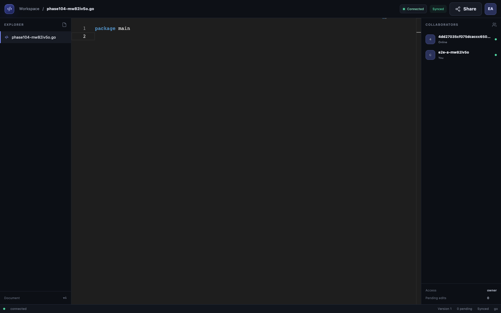
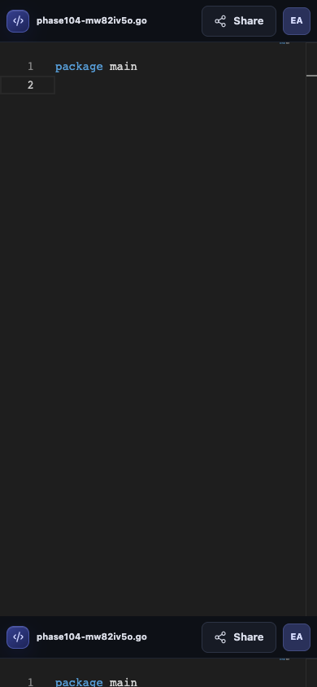
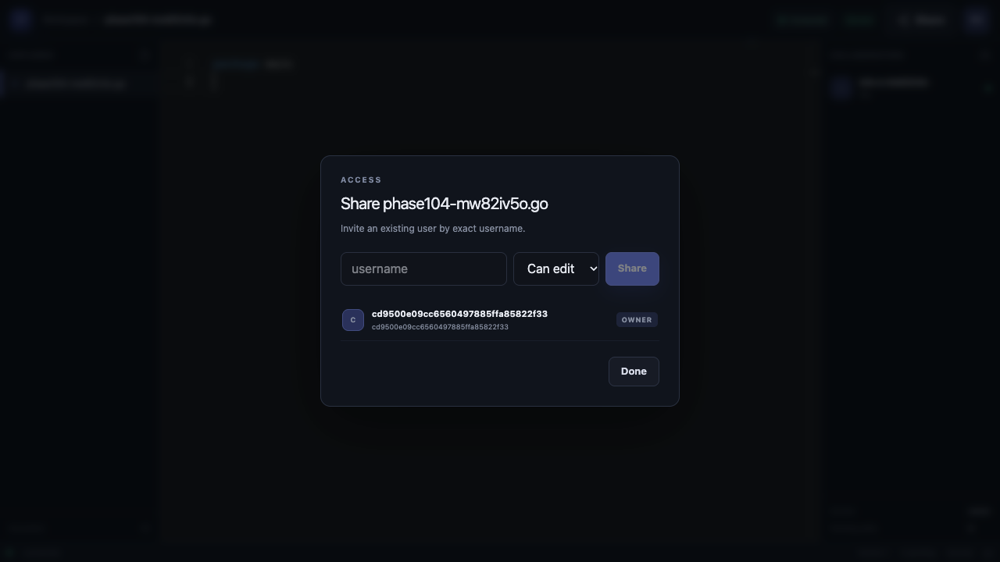

# Phase 10.4 前端验收报告

验收日期：2026-11-09（Australia/Melbourne）

## 验收结论

Phase 10.4 通过。前端静态质量检查、两个独立 Chrome Context 的真实协作、离线 Pending 恢复、动态权限、多标签 Logout、两节点 Owner Redirect 与 Owner 宕机接管均已使用真实 MySQL、Redis、etcd、TLS/mTLS 完成。测试未使用 Mock 冒充基础设施，未将 Skip 计为 PASS。

## 1. 代码审查与修复

完整审查结果见 [Phase 10.4 Frontend Review](phase-10.4-frontend-review.md)。本阶段修复了以下真实问题：

- IndexedDB Pending Edit 原先只按文档隔离，现在同时按 `user_id + document_id` 隔离。
- ACK 删除、已确认 Content/Version 和变换后 Pending 改为同一 IndexedDB Transaction 原子提交。
- 离线时仍可编辑，操作先持久化，联网后使用原 `request_id` 重放。
- 补充浏览器 `online/offline` 生命周期处理，并统一管理 reconnect timer，避免重复重连循环。
- Refresh 使用 Web Locks 跨标签串行化；Logout 和 Session Expired 通过 BroadcastChannel/事件清理所有前端状态。
- `resume -> sync/resync_required` 响应增加当前 Role，页面刷新后 Owner/Write/Read 权限能正确恢复。
- Observability `ResponseWriter` 保留 WebSocket Hijack 能力，修复真实服务中 Upgrade 返回 HTTP 501 的问题。
- 内部 mTLS `NODE_HTTP_ENDPOINT` 与浏览器公开 `NODE_BROWSER_ENDPOINT` 分离，避免将内部 RPC 端点暴露给浏览器。
- 客户端支持 `VITE_REALTIME_URLS` 多 Seed 轮询；Owner 连接失效后回到 Seed 重新解析 Owner。
- 修复 HTML `pattern` 在新版 Unicode Sets 正则语义下的连字符兼容性，并增加内联 favicon 避免 404。
- npm 间接依赖漏洞通过兼容版本 override 消除，`npm audit` 结果为 0。

## 2. UI 与响应式验收

连接状态现在对 Connected、Connecting、Authenticating、Syncing、Reconnecting、Disconnected 和 Error 使用不同颜色与动效。顶部同时显示同步状态，底部显示 Version 和 Pending 数量。移动端隐藏次要 IDE 侧栏，保留编辑、Share 和账号入口。

| 视口/页面 | 截图 |
| --- | --- |
| Login 1440×900 |  |
| Register 390×844 |  |
| Dashboard 1920×1080 |  |
| Dashboard 768×1024 |  |
| Editor 1440×900 |  |
| Editor 390×844 |  |
| Permission 1280×720 |  |

截图已人工检查：未发现主要按钮被遮挡、明显水平溢出或移动端强制压缩完整 IDE 的问题。

## 3. 单节点双浏览器 E2E

使用两个独立 Chrome Browser Context、两个独立账号以及真实 Go Server/MySQL 8.4.13/Redis 7.4.5 执行。

- 创建文档、分享 Write 权限、双方 Join 与 Presence：PASS。
- 同位置 Insert、不同位置 Insert、Insert + Delete、快速交错编辑：PASS。
- Browser A 离线编辑时 Pending 确实写入 IndexedDB，Browser B 继续远端编辑：PASS。
- 重连后 AUTH/RESUME/SYNC/Pending Replay，原 `request_id` 不变，Pending 清空：PASS。
- 刷新后通过 HttpOnly Refresh Cookie 恢复，localStorage/sessionStorage 中无 Token：PASS。
- Write 实时降为 Read，被降权用户无法编辑但仍接收远端更新：PASS。
- 另一标签 Logout 后编辑器标签同步退出：PASS。
- 最终 MySQL：Version 11，Operation Log 11，唯一 request_id 11：PASS。

最终日志：`/tmp/collab-phase104-single-5252f8e976.log`

## 4. 多节点浏览器 E2E

独立环境包含 MySQL 8.4.13、Redis 7.4.5、etcd 3.5.17、Node A、Node B、两个 Vite 入口以及两个 Chrome Context。etcd 使用客户端证书，内部 RPC 使用带 SPIFFE URI SAN 的双向 TLS，公开 WSS 使用临时 CA 签发证书并在测试 Chrome 中仅信任该证书的精确 SPKI。

- Browser A 通过 Node A，Browser B 通过 Node B 进入：PASS。
- etcd Membership 与 Rendezvous 候选节点可见：PASS。
- 非 Owner 入口返回可验证的公开 `owner_redirect`，两浏览器进入同一 Room：PASS。
- 停止当前 Owner，etcd Lease 过期后存活节点接管：PASS。
- 浏览器轮询 Seed、重新 Redirect/RESUME，并在新 Owner 继续编辑：PASS。
- MySQL Fencing Token 从旧值严格增加，最终为 10：PASS。
- 最终 MySQL：Version 3，Operation Log 3，唯一 request_id 3：PASS。
- 不存在旧 Owner 绕过 Fencing 的写入：PASS。

最终日志：`/tmp/collab-phase104-cluster-4659917981.log`

## 5. 安全与异常检查

- Access Token 只保存在 JavaScript 内存；Refresh Token 只使用 HttpOnly/SameSite Cookie，生产配置增加 Secure：PASS。
- 无 `dangerouslySetInnerHTML`，用户代码作为 Monaco 文本渲染：PASS。
- REST/WebSocket 精确 Origin 限制与 CORS 测试：PASS。
- 无证书、密钥或 Token 写入仓库；高置信 Secret Scan：PASS。
- 恶意 JSON、超大 WebSocket Message、未 AUTH 先发消息均会关闭连接，不会进入 Room：PASS。
- npm audit：0 vulnerabilities。
- 用户本地 `.env` 仍受 `.gitignore` 保护，未读取、修改或提交。

## 6. 质量 Gate

| Gate | 结果 |
| --- | --- |
| `gofmt -l .` | PASS（无输出） |
| `go test -count=1 ./...` | PASS |
| `go test -count=1 -race ./...` | PASS |
| `go vet ./...` | PASS |
| `go build ./...` | PASS |
| `git diff --check` | PASS |
| `npm run lint` | PASS |
| `npm run typecheck` | PASS |
| `npm test -- --run` | PASS（4 files / 8 tests） |
| `npm run build` | PASS |
| `npm audit --audit-level=low` | PASS（0 vulnerabilities） |
| Playwright 单节点双浏览器 | PASS（1 test） |
| Playwright 两节点故障接管 | PASS（1 test） |
| WebSocket 恶意/超大/未认证消息定向测试 | PASS |

## 7. 主要修改文件

- Frontend：`frontend/src/services/realtimeSession.ts`、`pendingEdits.ts`、Auth/Editor/Store/CSS、Vite/ESLint/Playwright 配置与 E2E 测试。
- Backend integration：`internal/websocket/`、`internal/observability/metrics.go`、`internal/protocol/message.go`、`internal/room/room.go`、`internal/cluster/node.go`、`internal/config/config.go`。
- Documentation：本报告、审查报告、Phase 10.4 截图、`.env.example` 和 `frontend/README.md`。

## 8. 已知限制

- 尚未实现光标与选区同步，UI 中未宣称具备该能力。
- 此轮真实浏览器验收使用 Google Chrome；Firefox/Safari 未执行同等 E2E。
- 多节点 Gate 使用两个应用节点，用于验证 Redirect、Lease、Failover 和 Fencing，不代表生产容量。
- Google Cloud 仅完成 Terraform/文档准备，未创建付费云资源。
- Phase 10.4 未执行 commit 或 push，所有前期未提交成果保留在当前工作区。

## 9. 数据与资源安全

每轮真实基础设施测试都使用随机名称的独立 Docker Network/Container，不挂载任何现有 Volume。测试密码只存在进程环境与临时目录，未输出到报告。成功或失败时均只清理本轮记录的资源。验收完成后未遗留 `collab-phase104-*` 容器或 Network，未操作其他项目容器和用户 Docker Volume。
